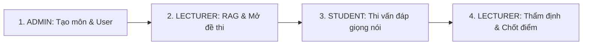

# AIVES — KỊCH BẢN KIỂM THỬ E2E TRÊN MÔI TRƯỜNG PRODUCTION (AWS)

* **Phiên bản hệ thống**: Release Step 11 (Live AWS CloudFront)
* **Domain truy cập chính thức (HTTPS)**: [https://d36ezmiqpl9miu.cloudfront.net](https://d36ezmiqpl9miu.cloudfront.net)
* **Môn học chuẩn kiểm thử**: `SWD392` — Software Architecture & Design
* **Cơ chế AI chạy thực tế**:
  - **LLM**: Amazon Bedrock Nova Pro (`apac.amazon.nova-pro-v1:0` / `amazon.nova-pro-v1:0`)
  - **Embedding**: Amazon Titan Text Embeddings V2 (`amazon.titan-embed-text-v2:0` — vector 1024 chiều)
  - **Email Service**: Gmail SMTP thực (`quantmhe179013@fpt.edu.vn`)
  - **TTS Engine**: Web Speech API tự nhiên tích hợp trình duyệt (Client-side SpeechSynthesis)
  - **Session State**: Amazon DynamoDB (`aives-prod-session-context` kèm TTL)
  - **File Storage**: Amazon S3 (`aives-prod-materials-554013701253` & `aives-prod-audio-554013701253`)

---

## 1. BẢNG TÀI KHOẢN VÀ THÔNG TIN ĐĂNG NHẬP PRODUCTION

| Vai trò (Role) | Mã người dùng | Email đăng nhập | Mật khẩu ban đầu | Ghi chú |
| :--- | :--- | :--- | :--- | :--- |
| **Quản trị viên (ADMIN)** | `AD01` | `admin@aives.local` | `Admin@123456` | Đã khởi tạo sẵn trên CSDL EC2 Production |
| **Giảng viên (LECTURER)** | `GV_PROD` | *(Email thật của bạn hoặc giảng viên)* | Tự thiết lập qua link email | Nhận thư kích hoạt qua Gmail thực |
| **Sinh viên (STUDENT)** | `SE179013` | *(Email thật của bạn hoặc sinh viên)* | Tự thiết lập qua link email | Nhận thư kích hoạt qua Gmail thực |

---

## 2. QUY TRÌNH KIỂM THỬ THỦ CÔNG TOÀN DIỆN (4 PHA KHÉP KÍN)

---

### PHA 1: Quản trị viên (ADMIN) — Khởi tạo Môn học & Cấp quyền người dùng

1. **Truy cập hệ thống**:
   - Mở trình duyệt (khuyên dùng Chrome hoặc Edge trên máy tính có micro).
   - Truy cập: **`https://d36ezmiqpl9miu.cloudfront.net`**
2. **Đăng nhập Quản trị viên**:
   - Email: `admin@aives.local`
   - Mật khẩu: `Admin@123456`
   - Hệ thống tự động chuyển hướng vào `/admin/users`.
3. **Tạo môn học**:
   - Vào menu **Subjects** (`/admin/subjects`) ➔ Nhấn **Add Subject**.
   - Mã môn: `SWD392`
   - Tên môn: `Software Architecture and Design`
   - Nhấn **Save**.
4. **Tạo Giảng viên (nhận email thật)**:
   - Vào menu **Users** (`/admin/users`) ➔ Nhấn **Create User**.
   - Mã: `GV01`
   - Họ tên: `Thầy Hoàng Văn Giảng`
   - Email: *(Nhập email thật bạn có thể mở được, ví dụ email Gmail cá nhân hoặc email FPT)*
   - Vai trò: `LECTURER`
   - Nhấn **Submit**.
5. **Gán Giảng viên vào môn**:
   - Quay lại menu **Subjects** ➔ Nhấn vào môn `SWD392`.
   - Chọn giảng viên `GV01` vừa tạo và nhấn lưu phân công.
6. **Tạo Sinh viên (nhận email thật)**:
   - Menu **Users** ➔ Nhấn **Create User**.
   - Mã: `SE179013`
   - Họ tên: `Trần Minh Quang`
   - Email: *(Nhập một email thật khác mà bạn có thể mở được để nhận link)*
   - Vai trò: `STUDENT`
   - Nhấn **Submit**.
7. **Kích hoạt tài khoản từ Hộp thư Gmail thật**:
   - Mở hộp thư Gmail thật của Giảng viên và Sinh viên.
   - Kiểm tra Hộp thư đến (hoặc mục Spam): Bạn sẽ nhận được email có tiêu đề: **"Set your AIVES password"** từ người gửi `quantmhe179013@fpt.edu.vn`.
   - Bấm vào link trong email (trỏ tới `https://d36ezmiqpl9miu.cloudfront.net/set-password?token=...`).
   - Đặt mật khẩu mới cho cả hai tài khoản (ví dụ: `Password@123`).

---

### PHA 2: Giảng viên (LECTURER) — RAG Giáo trình, Tạo Rubric & Mở kỳ thi

1. **Đăng nhập Giảng viên**:
   - Đăng xuất tài khoản Admin.
   - Đăng nhập bằng email Giảng viên vừa đặt mật khẩu tại `https://d36ezmiqpl9miu.cloudfront.net`.
2. **Đăng tải tài liệu môn học (RAG Chunks & Titan Embeddings)**:
   - Vào menu **Materials** (`/lecturer/materials`) ➔ Chọn môn `SWD392`.
   - Tải lên tệp tài liệu giảng dạy PDF hoặc DOCX (ví dụ tài liệu kiến trúc phần mềm, Clean Architecture, Microservices $\le 50$ MB).
   - Chờ trong giây lát: Job `INGEST_MATERIAL` xử lý tách đoạn text, gọi Amazon Bedrock Titan Text Embeddings V2 sinh vector 1024 chiều và lưu vào PostgreSQL. Trạng thái chuyển sang `READY` / `PROCESSED`.
3. **Sinh câu hỏi tự động bằng AI (Amazon Bedrock Nova Pro)**:
   - Nhấn **Generate by AI** ➔ Chọn chủ đề/môn `SWD392` ➔ Chọn số lượng 3 câu ➔ Nhấn Submit.
   - Job `GENERATE_QUESTIONS` chạy ngầm: AI trích xuất các đoạn kiến thức liên quan từ tài liệu giáo trình và tạo ra câu hỏi kèm mức độ tư duy Bloom và trích dẫn bằng chứng (Grounding Excerpts).
4. **Tạo Tiêu chí chấm điểm (Rubrics)**:
   - Vào menu **Rubrics** (`/lecturer/rubrics`) ➔ Nhấn **Create Rubric**.
   - Tên: `Rubric Vấn đáp Kiến trúc SWD392` | Môn: `SWD392`.
   - Thêm các tiêu chí (Tổng trọng số chuẩn 100%):
     * *Tiêu chí 1*: Hiểu đúng khái niệm & nguyên lý thiết kế (Trọng số 40%).
     * *Tiêu chí 2*: Khả năng phân tích & giải pháp thực tế (Trọng số 40%).
     * *Tiêu chí 3*: Kỹ năng trình bày & thuật ngữ chuyên ngành (Trọng số 20%).
   - Nhấn **Save Rubric**.
5. **Duyệt câu hỏi (Pending Review)**:
   - Vào menu **Pending Review** (`/lecturer/pending-review`).
   - Giảng viên đối chiếu câu hỏi do AI tạo bên cạnh **Đoạn trích dẫn sách gốc (Grounding Citation)** và **Lý giải mục đích hỏi (Rationale)**.
   - Nhấn **Approve** (Gắn với `Rubric Vấn đáp Kiến trúc SWD392` vừa tạo).
   - Câu hỏi được phê duyệt chính thức (trạng thái `APPROVED`).
6. **Khởi tạo Kỳ thi vấn đáp (Exam Sessions)**:
   - Vào menu **Exam Sessions** (`/lecturer/exam-sessions`) ➔ Nhấn **Create Session**:
     * Môn: `SWD392`.
     * Tiêu đề: `Kỳ thi Vấn đáp Cuối kỳ SWD392`.
     * Ngôn ngữ thi: `Tiếng Việt`.
     * Số câu hỏi chính: `3`.
     * Số câu hỏi xoáy tối đa mỗi câu: `1` (hoặc `2`).
     * Thời gian suy nghĩ: `15` giây.
     * Thời gian trả lời tối đa: `90` giây.
     * Giới hạn thời gian buổi thi: `30` phút.
     * Danh sách mã sinh viên dự thi: Nhập `SE179013`.
   - Nhấn **Create**.
7. **Mở kỳ thi (Open Session)**:
   - Nhấn nút **Open Session**: Hệ thống kiểm tra hợp lệ ngân hàng câu hỏi, khóa Rubric và mở cổng phòng thi cho sinh viên. Trạng thái kỳ thi chuyển sang `OPEN`.

---

### PHA 3: Sinh viên (STUDENT) — Trải nghiệm Phòng thi Vấn đáp AI

1. **Đăng nhập Sinh viên**:
   - Đăng xuất tài khoản Giảng viên.
   - Đăng nhập bằng email Sinh viên tại `https://d36ezmiqpl9miu.cloudfront.net`.
   - Giao diện sinh viên hiển thị danh sách kỳ thi được phân công.
2. **Vào phòng thi (Viva Session)**:
   - Nhấn **Start Interview** tại kỳ thi `SWD392` đang mở.
   - **Microphone Test**: Trình duyệt sẽ yêu cầu cấp quyền micro ➔ Chọn **Allow/Cho phép**. Nói thử vài từ, thanh âm lượng chuyển động chứng minh micro bắt âm tốt ➔ Nhấn xác nhận **I am Ready**.
3. **Tiến trình vấn đáp AI**:
   - **Đọc câu hỏi**: Trình duyệt kích hoạt Web Speech API đọc to câu hỏi bằng tiếng Việt rõ ràng, đồng thời hiển thị nội dung câu hỏi trên màn hình.
   - **Thời gian suy nghĩ**: Đồng hồ đếm ngược 15 giây (Sinh viên có thể bấm *Skip Thinking* để trả lời ngay).
   - **Thời gian trả lời**: Micro tự động bật ghi âm, đồng hồ đếm ngược 90 giây bắt đầu. Sinh viên nói trực tiếp câu trả lời vào micro.
   - **Kết thúc lượt trả lời**: Nhấn **Submit Answer** (hoặc đợi hết giờ đếm ngược tự động nộp).
   - **AI hỏi xoáy (Follow-up)**: Hệ thống đưa âm thanh lên backend, Bedrock Nova Pro phân tích ý trả lời. Nếu câu trả lời thiếu ý, AI sẽ đưa ra câu hỏi xoáy đào sâu vào đúng ý sinh viên vừa trình bày.
   - Sinh viên trả lời câu hỏi xoáy ➔ AI chuyển tiếp sang câu hỏi chính tiếp theo.
4. **Kiểm thử khả năng chịu lỗi (Fault Tolerance)**:
   - *(Tùy chọn)*: Trong lúc đang đếm ngược trả lời, thử bấm **F5 (Reload lại trang web)**.
   - Trình duyệt tải lại và phục hồi ngay lập tức đúng câu hỏi hiện tại, bảo toàn chính xác số giây làm bài còn lại.
5. **Nộp bài**:
   - Sau khi hoàn thành hết các câu hỏi, màn hình thông báo hoàn thành bài thi và kích hoạt tiến trình chấm điểm ngầm (`GRADE_INTERVIEW`).

---

### PHA 4: Giảng viên (LECTURER) — Thẩm định Bằng chứng AI & Chốt điểm

1. **Xem kết quả thi**:
   - Giảng viên đăng nhập lại vào hệ thống.
   - Vào menu **Exam Sessions** ➔ Bấm vào kỳ thi `SWD392` ➔ Danh sách sinh viên hiển thị bài thi của `SE179013` đã có trạng thái `AI_SUGGESTED`.
   - Nhấn **Review Evaluation** để vào trang chi tiết chấm thi (`/lecturer/evaluation/:id`).
2. **Thẩm định minh chứng (Auditing & Evidence)**:
   - **Phát lại Audio**: Bấm nút nghe lại giọng nói của sinh viên ở từng lượt hỏi.
   - **Toàn văn Transcript & Trích dẫn**: Đọc lại bản ghi lời nói kèm các đoạn text mà AI trích dẫn làm cơ sở cho điểm.
   - **Điểm gợi ý theo Rubric**: Xem điểm số chi tiết do AI phân tích theo từng tiêu chí kèm nhận xét ưu điểm / nhược điểm của câu trả lời.
3. **Điều chỉnh điểm & Chốt kết quả (Human-in-the-loop)**:
   - Giảng viên điều chỉnh điểm theo đánh giá sư phạm (ví dụ: điều chỉnh điểm từ 7.5 lên 8.0).
   - Hệ thống mở ô yêu cầu nhập **Lý do điều chỉnh điểm** (đảm bảo tính minh bạch và lưu vào bảng `score_adjustment`).
   - Nhấn **Finalize Score**: Điểm số được chốt chính thức (Finalized), hoàn tất trọn vẹn chu trình kỳ thi.

---

## 3. CHECKLIST SẴN SÀNG TRƯỚC GIỜ THUYẾT TRÌNH

- [x] CloudFront Domain HTTPS truy cập mượt mà: `https://d36ezmiqpl9miu.cloudfront.net`
- [x] Tài khoản Admin production sẵn sàng: `admin@aives.local` / `Admin@123456`
- [x] CSDL PostgreSQL 16 + pgvector trên EC2 hoạt động ổn định và có volume lưu trữ an toàn.
- [x] Gmail SMTP thật sẵn sàng gửi thư kích hoạt tài khoản qua internet.
- [x] Máy tính demo đã bật quyền Micro cho trình duyệt.
