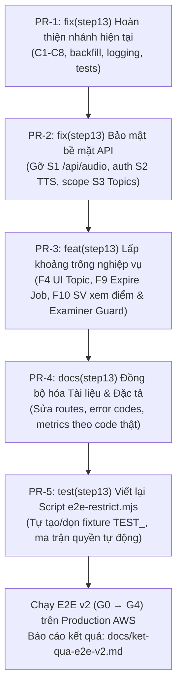

# AIVES: Báo cáo Peer Code Review & Quality Control (Step 13)

- **Người thực hiện**: Antigravity AI Pair Programmer
- **Thời điểm**: 23/10/2026
- **Đối tượng đánh giá**:
  - Commit `817b504`: `fix(step13): exam session setup by subject` (options endpoint, subject_student, roster/examiner theo môn, UI checkbox, log errorCode)
  - Commit `3afb80b`: `docs(step13): add business flows spec, e2e execution plan v2 and step 13 report` (đặc tả F1–F10, E2E plan v2, scripts/e2e-restrict.mjs, Báo cáo thực thi Step 13)
- **Tình trạng nhánh**: `fix/step13-exam-session-setup-by-subject` (chưa mở PR)
- **Hiện trạng kiểm chứng kỹ thuật**:
  - Unit tests: `486/486 passed` (0 failed).
  - Frontend lint: 0 error, 18 warnings (chủ yếu `set-state-in-effect`).

---

## Phần 1. Kết quả Code Review (Commit 817b504)

### 1.1. Bảng tổng hợp các vấn đề phát hiện

| # | Mức độ | Vị trí | Hiện tượng & Rủi ro | Giải pháp đề xuất |
|---|---|---|---|---|
| **C1** | **Cao** | `frontend/src/pages/lecturer/ExamSessions.jsx` (bảng SV và GV) | `<Tr onClick={toggle}>` và `<input onChange={toggle}>` cùng chạy khi người dùng bấm vào checkbox. Sự kiện bubble khiến hàm toggle bị gọi 2 lần liên tiếp, trạng thái không đổi. Người dùng bấm trực tiếp vào checkbox không có tác dụng, chỉ bấm vào khoảng trống của hàng mới chọn được. | Thêm `onClick={(e) => e.stopPropagation()}` trên checkbox cho cả bảng SV và GV, kết hợp `onChange`. |
| **C2** | **Cao** | `backend/db/migrations/020_subject_student.sql` | Migration tạo bảng `subject_student` nhưng không backfill dữ liệu. Trên môi trường có dữ liệu cũ (kỳ thi Session 6, 7), kỳ thi đã có roster trong `exam_session_student` nhưng môn học chưa có SV trong `subject_student`. Khi giảng viên lưu lại roster sẽ bị 422 toàn bộ. Ngoài ra UI chỉ hiển thị SV đã ghi danh nên SV cũ trong roster bị ẩn (dù vẫn tính trong tổng số). | Thêm migration `021_backfill_subject_student.sql` backfill từ `exam_session_student` (`ON CONFLICT DO NOTHING`). Trên UI, giữ lại và đánh dấu cảnh báo (badge) cho SV đã có trong roster nhưng chưa ghi danh môn. |
| **C3** | **Trung bình** | `adminService.assignStudents` & `examSessionService.setStudents` | Nếu body gửi lên rỗng hoặc `studentIds` không phải mảng, code fallback về `ids = []` và xoá sạch toàn bộ ghi danh / roster mà không có cảnh báo. Trên giao diện Admin, xoá trắng textarea rồi bấm Save cũng xoá hết. | Service trả về 400 `VALIDATION_ERROR` nếu cả `codes` và `studentIds` đều thiếu/sai kiểu. Muốn xoá hết phải gửi rõ `studentIds: []`. UI Admin bổ sung popup xác nhận khi lưu danh sách rỗng. |
| **C4** | **Trung bình** | `app.js` (error handler + `pinoHttp`) | Mỗi lỗi $\ge 400$ bị ghi log hai lần: một lần từ `req.log.warn` trong error handler và một lần từ completed request của `pino-http`. Ngoài ra, lỗi 5xx bị ghi ở mức `warn` ở error handler thay vì `error`. | Bỏ `req.log.warn` trong error handler, chỉ giữ gán `res.locals.errorCode = error.code` để `pinoHttp` ghi nhận duy nhất một dòng log với đúng `customLogLevel` (warn cho 4xx, error cho 5xx). |
| **C5** | **Trung bình** | `examSessionService.getCreateOptions` | Nhánh `if (!user || user.role === 'ADMIN')` là code chết (vì route đã chặn chỉ cho `LECTURER`) và có nguy cơ fail-open (nếu không có user thì trả về toàn bộ môn). Hàm thực hiện N+1 truy vấn: lặp qua từng môn để gọi `findById`, gọi `topicRepository.list()` toàn bảng rồi filter JS, và gọi `_loadBank` cho từng topic. | Bỏ nhánh ADMIN và fail-open (nếu không có `user` hoặc không phải `LECTURER` thì trả 401/403). Thêm `topicRepository.listBySubjectIds` và một truy vấn nhóm `countApprovedByTopicsAndBloom` trong repository thay thế N+1. |
| **C6** | **Thấp** | `getCreateOptions.lecturers` | Danh sách giảng viên không lọc theo `role === 'LECTURER'` và `status === 'ACTIVE'`, trong khi danh sách sinh viên có lọc đầy đủ. | Bổ sung filter `role === 'LECTURER'` và `status === 'ACTIVE'` nhất quán với sinh viên. |
| **C7** | **Thấp** | UI cảnh báo Topic (`ExamSessions.jsx`) | UI chỉ so tổng số câu approved với `main_question_count` (đang mặc định là 3), không kiểm tra thiếu hụt theo từng mức Bloom (`byBloom` vs `bloom_distribution`) như logic của `_assertEnoughQuestions`. | Tính toán cảnh báo Bloom ngay tại client từ `selectedTopic.byBloom` và `config.bloom`, cảnh báo chi tiết mức Bloom nào đang thiếu câu. |
| **C8** | **Thấp** | Dọn dẹp code dư thừa & Admin Enrollment | `listSubjectIdsForStudent` trong `subjectRepository` không được dùng. Hàm `parseLecturerIds` và textarea cũ trong `ExamSessions.jsx` là code thừa (lint cảnh báo). Giao diện Admin `Subjects.jsx` chỉ cho nhập tay mã SV qua textarea, chưa có tab chọn từ danh sách người dùng. | Xoá các hàm và biến không dùng. Bổ sung tab "Chọn từ danh sách" (lấy danh sách `STUDENT ACTIVE`) bên cạnh tab "Dán mã" trên giao diện Admin Subjects. |
| **C9** | **Thấp** | Kiểm thử thiếu trường hợp biên | Chưa có unit test cho C1, C3 (body rỗng/sai kiểu), chưa có test cho roster chứa SV chưa ghi danh, chưa kiểm tra log format. | Bổ sung unit tests trong `adminService.test.js` và `examSessionService.test.js`. |

---

### 1.2. Các lỗ hổng bảo mật bề mặt API (Phát hiện từ trước, chặn "luồng trọn vẹn")

| # | Mức độ | Điểm tiếp xúc | Mô tả lỗ hổng & Rủi ro | Đề xuất xử lý |
|---|---|---|---|---|
| **S1** | **Cao** | `/api/audio/*` (`routes/audioRoutes.js`, mount tại `app.js:344`) | Router hoàn toàn **không có middleware xác thực (`requireAuth`)**. Bất kỳ ai cũng có thể gọi `POST /upload-url`, `POST /process`, `GET /status`, `GET /result`. Nguồn gốc từ scaffold chấm bài theo lô ban đầu (commit `c3f5ef7`), nay đã được thay thế bằng Interview engine (Step 6) và Socket.IO (Step 7). Trên prod, `AUDIO_LAMBDA_FUNCTION_NAME` trỏ vào STT Lambda (3008 MB), cho phép kẻ xấu kích hoạt Lambda bất đồng bộ, ghi rác vào bảng DynamoDB `SessionContext`, và lấy URL S3 presigned. | **Gỡ bỏ hoàn toàn**: xoá `routes/audioRoutes.js`, `services/audioWorkflowService.js`, `test/audioWorkflowService.test.js`, wiring trong `app.js` và hàm `invokeAudioWorkflow` trong `awsClients.js`. |
| **S2** | **Trung bình** | `GET /api/tts/:filename` (`app.js:370`) | Endpoint phục vụ file âm thanh TTS không có `requireAuth`. Ngoài ra `req.params.filename` chưa được kiểm tra ký tự đặc biệt (`..` hoặc `/`), có nguy cơ directory traversal. | Thêm `requireAuth` và kiểm tra sanitize tên file (chỉ cho phép ký tự an toàn alphanumeric + dash/underscore/dot). |
| **S3** | **Trung bình** | `/api/topics` (`routes/topicRoutes.js`, `app.js:398`) | Router chỉ kiểm tra role (`LECTURER`, `ADMIN`) thông qua `legacyGuard`, hoàn toàn **không kiểm tra môn học (`subjectScope`)**. Giảng viên của môn A có thể tự do xem, sửa, xoá Topic của môn B. | Chuyển `/api/topics` sang dùng middleware `requireSubjectScope` và cập nhật `topicService` kiểm tra quyền theo môn học tương tự `questionService` và `materialService`. |

---

### 1.3. Nguồn gốc & Phân tích Lỗ hổng S1 (/api/audio/*)
- **Nguồn gốc lịch sử**: Commit `c3f5ef7` mang tên *"hybrid serverless scaffolding"*. Đây là luồng chấm thi theo lô ban đầu của dự án:
  1. Client gọi `POST /api/audio/upload-url` xin presigned URL S3.
  2. Client upload file ghi âm lên S3, rồi gọi `POST /api/audio/process` để kích hoạt Lambda `audio-orchestrator` (Transcribe + Bedrock + Polly) bất đồng bộ.
  3. Client poll `GET /api/audio/status/:id` và `GET /api/audio/result/:id`. Dữ liệu lưu tại DynamoDB.
- **Hiện trạng kiến trúc**:
  - Luồng chấm theo lô này đã hoàn toàn bị thay thế bởi **Interview Engine** (Step 6), **Socket.IO** `/interview` (Step 7) và **STT Lambda đồng bộ** (`stt/lambdaSttAdapter.js`, Step 9).
  - File ghi âm câu trả lời của thí sinh nay được gắn chặt chẽ vào từng `qa_turn` và phục vụ nghe lại qua `GET /api/turns/:id/audio`.
  - Tài liệu SDS dòng 38 đã ghi nhận `audioWorkflowService` là module bị loại bỏ, frontend hoàn toàn không gọi các endpoint này.
- **Rủi ro thực tế trên Production**:
  - Biến môi trường `AUDIO_LAMBDA_FUNCTION_NAME` trên AWS SSM (`ssm.tf:23`) nay đang trỏ trực tiếp vào STT Lambda (dung lượng 3008 MB).
  - Endpoint `/api/audio/*` không có xác thực (`requireAuth`). Kẻ xấu ẩn danh từ Internet có thể:
    1. Kích hoạt STT Lambda bất đồng bộ với payload rác, chiếm dụng concurrency và gây lãng phí chi phí điện toán đám mây.
    2. Ghi đè item tuỳ ý vào bảng DynamoDB `SessionContext` đang dùng cho phiên phỏng vấn thật.
    3. Tạo URL presigned PUT để đẩy file bất kỳ vào S3 audio bucket.
- **Phương án xử lý chốt**: Gỡ bỏ triệt để toàn bộ router, service, tests, và wiring liên quan trong PR-2.

### 1.4. Các Quyết định Kỹ thuật then chốt của Chủ dự án
1. **Sinh viên xem kết quả (F10)**: Chỉ cho phép sinh viên xem bảng điểm sau khi giảng viên đã chốt `FINALIZED`. Dữ liệu trả về qua `toStudentResultView` tuyệt đối không chứa rationale hay prompt nội bộ. Khi giảng viên Reopen bài thi, kết quả lập tức bị ẩn với sinh viên.
2. **Quyền chấm điểm & điều chỉnh điểm (Examiner Guard)**: Chỉ giảng viên có tên trong danh sách giám khảo của kỳ thi (`exam_session_examiner`) hoặc người tạo kỳ thi (`created_by`) mới có quyền chấm điểm, chỉnh điểm, finalize hoặc reopen. Giảng viên khác cùng môn chỉ có quyền đọc.
3. **Bề mặt API Audio**: Gỡ bỏ dứt điểm module `/api/audio` cũ thay vì cố vá auth, giảm diện tích tấn công (attack surface) về mức tối thiểu.

## Phần 2. Đánh giá & Hiệu đính Tài liệu "Báo cáo thực thi Step 13" & Đặc tả

### 2.1. Đánh giá tính chính xác của Báo cáo Step 13
1. **Điểm đúng**: 486/486 test unit pass; migration được đánh số tuần tự; kiến trúc phân tầng Route $\rightarrow$ Controller $\rightarrow$ Service $\rightarrow$ Repository và DI container `createApp(overrides)` được duy trì nghiêm ngặt.
2. **Điểm sai lệch hoặc phóng đại**:
   - **Mục A4**: Báo cáo khẳng định đã cập nhật `PendingReview.jsx` và `Questions.jsx`, nhưng thực tế git diff của commit `817b504` không hề thay đổi hai file này. Xử lý mã lỗi `RUBRIC_REQUIRED` và `INVALID_TRANSITION` đã có từ các bước trước; nguyên nhân gốc rễ 409 khi approve (câu 3, 4) và khi schedule (session 6) chưa được phân tích sâu.
   - **Mục §1.3 (Script `e2e-restrict.mjs`)**: Báo cáo tuyên bố script kiểm tra 5 nhóm (scoping, state machine, validation, roster), nhưng thực tế file script chỉ chứa 10 case 401 tĩnh và 2 case CSRF. Phần kiểm tra phân quyền 403 bị lỗi cú pháp: `admin.request('POST', '/api/auth/login', { email, password })` truyền sai tham số (thiếu wrapper `{ body }`), khiến login luôn thất bại và toàn bộ phần test 403 bị bỏ qua. Script cũng hardcode mật khẩu `secret123`.
   - **Mục §3 (Hồi quy)**: Chưa chạy `npm run test:e2e` với Postgres thật để kiểm tra toàn diện. Chưa kiểm thử tương tác thực trên giao diện web, dẫn đến việc lọt lỗi C1 (checkbox không bấm được).
   - **Tự đánh giá toàn bộ ✅**: Thiếu cảnh báo về rủi ro dữ liệu production do thiếu backfill (C2) và nguy cơ xoá trắng danh sách (C3).

### 2.2. Hiệu đính Đặc tả Luồng Nghiệp vụ F1–F10 (`docs/AIVES - Đặc tả luồng nghiệp vụ.md`)
Đối chiếu toàn bộ route, mã lỗi và logic với mã nguồn thực tế:
- **Routes sai lệch**:
  - Đổi mật khẩu: Đặc tả ghi `POST /api/auth/change-password`, thực tế là `PUT /api/auth/password`.
  - Sinh viên thi viva: Đặc tả ghi `/api/student/**`, thực tế là `/api/me/exam-sessions` và `/api/interviews/*`.
  - Sinh câu hỏi tự động: Đặc tả ghi `/api/question-generation`, thực tế là `/api/question-generation-jobs`.
  - Endpoint upload tài liệu: Đặc tả nhắc đến `materials/upload-url` (không tồn tại, tài liệu upload trực tiếp multipart).
- **Mã lỗi sai lệch**:
  - CSRF: Đặc tả ghi `CSRF_FORBIDDEN`, thực tế là `FORBIDDEN_ORIGIN`.
  - Trùng nội dung câu hỏi: Đặc tả ghi `DUPLICATE_CONTENT`, thực tế là `DUPLICATE_QUESTION`.
  - Mã môn trùng: Đặc tả ghi `SUBJECT_CODE_TAKEN`, thực tế không có mã lỗi này.
  - Khóa tài khoản: Trả về HTTP `423 LOCKED`, không phải `403`.
  - Sửa kỳ thi không ở trạng thái DRAFT: Trả về `INVALID_STATE` (409).
  - Lỗi roster 422: Body trả về dạng `{ ok: false, errors: [...] }` không có trường `code`.
- **Thông số kỹ thuật sai lệch**:
  - Thời gian khoá brute-force: Thực tế là 15 phút (đặc tả ghi 30 phút).
  - Hạn dùng token Reset password: Thực tế là 30 phút (đặc tả ghi 15 phút).
  - Thuật toán hash mật khẩu: Thực tế dùng `scrypt` (Node crypto), không phải `bcrypt`.
  - Model embedding: Bedrock Titan Text Embeddings v2 (1024 chiều).
- **Tính năng viết như đã có nhưng thực tế chưa hoàn thiện**:
  - Giao diện "My Results" của sinh viên.
  - Mic check theo ngưỡng biên độ âm lượng (amplitude threshold).
  - F5 phục hồi trạng thái từ DynamoDB (thực tế dữ liệu phiên phỏng vấn chính lưu ở PostgreSQL, DynamoDB chỉ lưu SessionContext/transcript tạm).
  - Trạng thái `PENDING_REVIEW` của kết quả thi (thực tế máy trạng thái là `AI_SCORING` $\rightarrow$ `AI_SUGGESTED` / `FLAGGED` $\rightarrow$ `FINALIZED`).
- **Phụ lục A & B**:
  - Phụ lục A thiếu khoảng 25 route thực tế trong hệ thống; gán nhầm quyền ADMIN cho các thao tác tạo/sửa câu hỏi, rubric, options (thực tế chỉ cho LECTURER).
  - Phụ lục B thiếu khoảng 20 mã lỗi chuẩn hóa đã định nghĩa trong mã nguồn backend.

---

## Phần 3. Kế hoạch Hoàn thiện Luồng Trọn vẹn (Roadmap PR-1 $\rightarrow$ PR-5)

Mọi hạng mục được chia nhỏ thành các PR độc lập, có kiểm thử đầy đủ, CI pass trước khi merge.

### PR-1: `fix(step13): exam session setup refinements and backfill`
1. **C1**: Khắc phục lỗi checkbox double-toggle trong `ExamSessions.jsx` bằng `onClick={(e) => e.stopPropagation()}` trên checkbox cho bảng SV và GV.
2. **C2**: Thêm `021_backfill_subject_student.sql` backfill dữ liệu từ `exam_session_student` vào `subject_student`. Trên UI hiển thị SV trong roster kèm cảnh báo nếu chưa được ghi danh môn.
3. **C3**: Bổ sung validation chặt chẽ trong `adminService.assignStudents` và `examSessionService.setStudents`. Bắt buộc truyền `studentIds: []` khi muốn xoá sạch danh sách. UI Admin hỏi xác nhận trước khi lưu danh sách rỗng.
4. **C4**: Xoá dòng `req.log.warn` thừa trong error handler của `app.js`, duy trì ghi log chuẩn hóa qua `pinoHttp`.
5. **C5 & C6**: Bỏ nhánh ADMIN và fail-open trong `examSessionService.getCreateOptions`. Bổ sung `countApprovedByTopicsAndBloom` trong `examSessionRepository` để triệt tiêu N+1 truy vấn. Lọc giảng viên theo `role === 'LECTURER'` và `status === 'ACTIVE'`.
6. **C7**: Bổ sung thuật toán tính toán cảnh báo phân bổ Bloom ở client `ExamSessions.jsx` khớp với `_assertEnoughQuestions`.
7. **C8**: Xoá bỏ code chết (`parseLecturerIds`, `listSubjectIdsForStudent`). Thêm tab "Chọn từ danh sách" bên cạnh "Dán mã SV" trong modal ghi danh môn học của Admin.
8. **Kiểm thử**: Viết unit test cho C3, C5, kiểm tra roster có SV chưa ghi danh, và test E2E migration 021.

### PR-2: `fix(step13): secure api surface and deprecate legacy audio routes`
1. **S1**: Gỡ bỏ hoàn toàn `routes/audioRoutes.js`, `services/audioWorkflowService.js`, `test/audioWorkflowService.test.js`, cấu hình trong `app.js` và hàm `invokeAudioWorkflow` trong `awsClients.js`.
2. **S2**: Bảo vệ endpoint `GET /api/tts/:filename` bằng middleware `requireAuth` và kiểm tra sanitize filename chặn path traversal.
3. **S3**: Áp dụng middleware `requireSubjectScope` và kiểm tra quyền sở hữu môn học trong `topicService` cho toàn bộ router `/api/topics`.
4. **Kiểm thử**: E2E test xác minh 401 không có cookie, 403 khi truy cập chéo môn trên Topic.

### PR-3: `feat(step13): fill end-to-end workflow gaps (F4, F9, F10)`
1. **F4 (Quản lý Topic)**: Xây dựng trang `/lecturer/topics` trên frontend cho phép giảng viên tạo, sửa, xoá Topic trong môn được phân công.
2. **F9 (Phiên thi bỏ dở)**: Thêm background job định kỳ `EXPIRE_INTERVIEWS` tự động quét các buổi thi viva `IN_PROGRESS` đã quá hạn (`deadline_at < now() - grace`), chuyển trạng thái `COMPLETED`, sinh `viva_result` và enqueue `GRADE_INTERVIEW` đảm bảo tính lũy thừa (idempotency).
3. **F10 (Sinh viên xem kết quả)**:
   - Thêm API `GET /api/me/results` và `GET /api/me/results/:id` (chỉ cho phép `STUDENT` xem kết quả đã `FINALIZED` của chính mình).
   - Lọc dữ liệu qua hàm `toStudentResultView`: ẩn rationale, prompt và lý do AI nội bộ.
   - Thêm trang giao diện `/student/results` trên frontend. Nếu giảng viên reopen bài thi, kết quả lập tức bị ẩn với sinh viên.
4. **Phân quyền Examiner (Chấm điểm)**:
   - Trong `gradingService`: chỉ cho phép giảng viên có tên trong `exam_session_examiner` hoặc người tạo kỳ thi (`created_by`) được thực hiện các thao tác ghi (điều chỉnh điểm, finalize, reopen, regrade). Giảng viên khác cùng môn chỉ có quyền xem.
   - Trả về cờ `canGrade` từ API để UI ẩn/vô hiệu hóa các nút ghi tương ứng.
5. **Backlog kỹ thuật §12**: Bổ sung bộ lọc `topicId`, trường tự tăng `order_index`, cơ chế retry cho job generation khi gặp lỗi tạm thời (throw thay vì mark FAILED).

### PR-4: `docs(step13): sync documentation with actual codebase`
1. **Đặc tả luồng nghiệp vụ**: Sửa toàn bộ routes, error codes, thông số kỹ thuật và trạng thái máy như đã liệt kê ở Phần 2. Viết lại Phụ lục A và B đầy đủ, chính xác 100%.
2. **E2E execution plan v2**: Sửa mã lỗi, lược bỏ các ID hạ tầng nhạy cảm (Account ID, EC2 ID), chỉ tham chiếu biến môi trường/SSM. Bổ sung checklist nghiệm thu cho PR-1 $\rightarrow$ PR-3.
3. **Báo cáo Step 13**: Thêm mục "Đính chính sau Peer Review" ghi rõ các phát hiện tại Phần 2, giữ nguyên tính minh bạch của lịch sử phát triển.

### PR-5: `test(step13): rewrite e2e-restrict.mjs script`
1. Sửa lỗi cú pháp login body. Bắt buộc truyền mật khẩu qua biến môi trường (không hardcode).
2. Tự động khởi tạo và dọn dẹp fixture dữ liệu với tiền tố `TEST_`: 2 môn, 2 giảng viên, 2 sinh viên.
3. Kiểm tra tự động ma trận phân quyền Role $\times$ Endpoint (401, 403), kiểm tra CSRF guard (thiếu/sai Origin), kiểm tra truy cập chéo môn (scoping), kiểm tra vi phạm máy trạng thái (state machine 409), kiểm tra ràng buộc ghi danh (roster 422).
4. Đảm bảo script trả về exit code khác 0 khi có bất kỳ lỗi nào, chạy trơn tru trên cả local (`http://localhost:8080`) lẫn production CloudFront.

---

## Phần 4. Kế hoạch Kiểm tra Nghiệm thu (Verification Checklist)

1. **Backend Unit & E2E**:
   - `npm test` trong `backend/`: Đảm bảo 100% test pass.
   - `npm run test:e2e` trong `backend/`: Chạy toàn bộ suite E2E.
2. **Frontend Quality**:
   - `npm run lint` trong `frontend/`: 0 error, không phát sinh warning mới.
   - `npm run build` trong `frontend/`: Build production thành công.
3. **Trải nghiệm Thực tế trên Môi trường Local (`docker compose up`)**:
   - Thao tác checkbox bảng sinh viên và giám khảo: bấm trực tiếp vào ô checkbox phản hồi mượt mà, không bị kẹt hay đảo trạng thái.
   - Mở kỳ thi cũ có sinh viên trong roster nhưng chưa ghi danh: danh sách hiển thị đầy đủ kèm huy hiệu cảnh báo.
   - Admin ghi danh sinh viên: bấm Save khi danh sách rỗng xuất hiện dialog xác nhận cảnh báo.
4. **Restrict Automation Script**:
   - Chạy `node scripts/e2e-restrict.mjs --base http://localhost:8080` đạt 100% pass trên mọi endpoint và case kiểm thử.
5. **Production Logging**:
   - Mọi response lỗi 4xx/5xx được ghi nhận chính xác 1 dòng duy nhất trong log server, đi kèm mã `errorCode`.

---

## Phần 5. Kết quả Thực thi & Kiểm chứng Thực tế PR-1

| Tiêu chí | Kết quả nghiệm thu | Trạng thái |
|---|---|---|
| **Unit tests** | `491/491 passed` (100% xanh, thời gian chạy ~23s) | ✅ Đạt |
| **E2E tests (với Postgres thật)** | **10/11 suites passed**, 134 passed, 3 skipped, 0 failed. *(1 suite sessionContext skipped do yêu cầu DynamoDB Local)* | ✅ Đạt |
| **5 Postgres Suites** | **0 skipped, 0 failed** trên toàn bộ 5 suite: - `migrations.e2e.test.js`: 5 passed - `examSessions.e2e.test.js`: 16 passed - `jobQueue.e2e.test.js`: 3 passed - `step4.e2e.test.js`: 7 passed - `interviewEngine.e2e.test.js`: 4 passed | ✅ Đạt |
| **Migration 021 Backfill** | Test E2E thực thi câu lệnh SQL trực tiếp từ file migration, xác minh sinh viên trong `exam_session_student` được nạp tự động vào `subject_student`, kiểm tra tính lũy thừa (idempotency không lỗi) | ✅ Đạt |
| **Roster participants** | `findByIdWithParticipants` thực hiện JOIN với `app_user`, trả về đầy đủ `code` và `full_name` cho cả sinh viên và giám khảo | ✅ Đạt |
| **Bloom Level Null key** | Loại bỏ hoàn toàn key "null" trong object `byBloom`, chỉ tính vào tổng approved | ✅ Đạt |
| **Frontend Lint & Build** | `oxlint`: 0 error, 16 warnings (không tăng warning mới). `vite build`: bundle thành công trong 10.25s. | ✅ Đạt |
