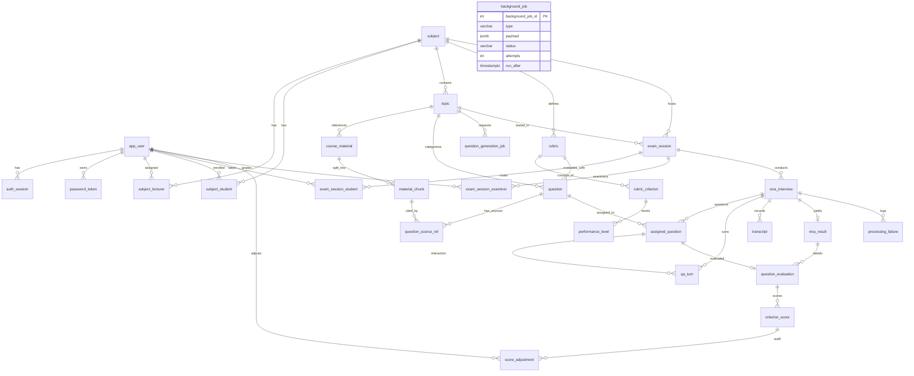

# AIVES - Software Design Specification (SDS)
### Đặc tả Thiết kế Phần mềm theo Chuẩn IEEE Std 1016-2009

**Tên hệ thống**: AIVES (AI-assisted Viva Examination System)  
**Mã học phần / Đồ án**: SWD392 — Software Architecture and Design  
**Tác giả**: @tmqthedev & Antigravity AI Pair Programmer  
**Ngày cập nhật**: 25/10/2026 · Phiên bản: 2.0 (Master Architecture Live Production)

---

## 1. GIỚI THIỆU & NGUYÊN TẮC THIẾT KẾ (INTRODUCTION & DESIGN PRINCIPLES)

### 1.1. Mục đích tài liệu (Purpose)
Tài liệu này đặc tả chi tiết kiến trúc giải pháp, thiết kế phân tầng, cấu trúc dữ liệu vật lý, giao diện phần mềm và các luồng xử lý kỹ thuật của hệ thống **AIVES**, tuân thủ tiêu chuẩn kỹ thuật quốc tế **IEEE Std 1016-2009** (*Standard for Information Technology — Systems Design — Software Design Descriptions*).

### 1.2. Các nguyên tắc kiến trúc cốt lõi (Architectural Principles)
1. **Kiến trúc Hybrid Serverless kết hợp Container (Hybrid Cloud Architecture)**:
   - Các tác vụ đòi hỏi kết nối liên tục, độ trễ thấp và lưu trữ trạng thái (REST API, Socket.IO, Interview Engine, Transactional Database) được container hóa và chạy trên máy chủ EC2 t4g.small (ARM64 Graviton).
   - Các tác vụ tính toán nặng nề về AI và xử lý âm thanh không liên tục (STT với PhoWhisper, TTS với Kokoro-82M) được ủy quyền xử lý cho AWS Lambda Serverless (x86_64, 3008 MB RAM) nhằm tối ưu hóa chi phí điện toán.
2. **Kiến trúc phân tầng nghiêm ngặt (Strict Layered Architecture)**:
   - Request Lifecycle tuân thủ tuần tự một chiều:
     $$\text{Client} \longrightarrow \text{Route} \longrightarrow \text{Controller} \longrightarrow \text{Service} \longrightarrow \text{Repository} \longrightarrow \text{Database}$$
   - Tuyệt đối không viết câu lệnh SQL trong Service hay Controller; không đặt logic nghiệp vụ trong Controller hay Repository.
3. **Cơ chế Dependency Injection (DI) linh hoạt**:
   - Khởi tạo ứng dụng qua hàm `createApp(overrides)` trong `backend/src/app.js`. Mọi Service, Repository, Database Connection hoặc Cloud Adapter đều có thể được thay thế dễ dàng thông qua tham số `overrides`, tạo điều kiện lý tưởng cho việc kiểm thử tự động (Unit & E2E Testing).
4. **Tính độc lập với môi trường thực thi (Environment Parity)**:
   - Mã nguồn không chứa các nhánh rẽ điều kiện theo tên môi trường (`if (local)` hay `if (prod)`). Việc chuyển đổi giữa chế độ Mock và Cloud Services được kiểm soát tường minh bằng các cờ tính năng chức năng (`DB_MOCK_MODE`, `AWS_MOCK_MODE`, `STT_PROVIDER`, `TTS_PROVIDER`, `LLM_PROVIDER`, `EMBEDDING_PROVIDER`).
5. **Nguyên tắc Phòng vệ theo Chiều sâu (Defense-in-Depth & Student Safety)**:
   - Áp dụng cơ chế Data Masking nghiêm ngặt (`toStudentInterviewView`, `toStudentResultView`) với các hàm quét bảo mật đệ quy (`assertStudentSafe`, `assertStudentResultSafe`), đảm bảo không có bất kỳ thông tin nội bộ nào (đáp án, rationale, prompt, rubric) bị rò rỉ cho thí sinh.

---

## 2. KIẾN TRÚC TRIỂN KHAI HẠ TẦNG ĐÁM MÂY (DEPLOYMENT ARCHITECTURE)

Hệ thống được triển khai trên vùng `ap-southeast-1` (Singapore) của Amazon Web Services (AWS):

```
                                [ Trình duyệt Người dùng ]
                                            │
                                            ▼  HTTPS (443) / WSS
                      ┌───────────────────────────────────────────┐
                      │    Amazon CloudFront CDN (*.cloudfront.net)│
                      └───────┬───────────────────────────┬───────┘
                              │                           │
          (Behavior: Default *)                 (Behavior: /api/*, /socket.io/*)
                              │                           │
                              ▼                           ▼
                 ┌─────────────────────────┐  ┌─────────────────────────────────────────┐
                 │ Amazon S3 (Web Static)  │  │ AWS VPC (10.30.0.0/16 - Public Subnet)  │
                 │ React 19 + Vite Dist    │  │ ┌─────────────────────────────────────┐ │
                 │ OAC Security Policy     │  │ │ EC2 t4g.small (Amazon Linux 2023)   │ │
                 └─────────────────────────┘  │ │ SG: Port 80 chỉ mở cho CloudFront   │ │
                                              │ │                                     │ │
                                              │ │ ┌─────────────────────────────────┐ │ │
                                              │ │ │ Docker Engine                   │ │ │
                                              │ │ │  ├─ backend (Node 20, Exp 5)    │ │ │
                                              │ │ │  └─ postgres (pgvector pg16)    │ │ │
                                              │ │ └──────────────────┬──────────────┘ │ │
                                              │ └────────────────────┼────────────────┘ │
                                              └──────────────────────┼──────────────────┘
                                                                     │
                     ┌──────────────────────┬────────────────────────┴─────────┬──────────────────────┐
                     ▼                      ▼                                   ▼                      ▼
           ┌───────────────────┐  ┌───────────────────┐               ┌───────────────────┐  ┌───────────────────┐
           │ Amazon S3 Buckets │  │  Amazon DynamoDB  │               │ AWS Lambda x86_64 │  │  Amazon Bedrock   │
           │ - aives-prod-audio│  │ SessionContext    │               │ (3008 MB RAM)     │  │ - Nova Pro (LLM)  │
           │ - aives-prod-mat  │  │ (TTL expiresAt)   │               │ - STT: PhoWhisper │  │ - Titan Text V2   │
           │ - aives-prod-back │  └───────────────────┘               │ - TTS: Kokoro-82M │  │   (Embedding)     │
           └───────────────────┘                                      └───────────────────┘  └───────────────────┘
```

### 2.1. Phân tích các thành phần hạ tầng
- **Amazon CloudFront**: Phân phối nội dung tĩnh, tích hợp CloudFront Function thực hiện SPA URL Rewriting (điều hướng request về `/index.html`), đồng thời đóng vai trò Reverse Proxy chuyển tiếp WebSocket và API động về EC2.
- **Amazon EC2 `t4g.small`**: Chạy kiến trúc vi xử lý ARM64 Graviton tiết kiệm điện năng và chi phí. Vận hành container backend Node.js và PostgreSQL. Quản trị bảo mật hoàn toàn thông qua AWS SSM Session Manager, không mở cổng SSH 22.
- **PostgreSQL 16 + pgvector**: Cơ sở dữ liệu chính, gắn với volume EBS `gp3` 10 GB có cờ chống xóa nhầm (`prevent_destroy = true`).
- **AWS Lambda STT (`aives-prod-stt`)**: Container image x86_64 chạy mô hình PhoWhisper-small (tiếng Việt) và Whisper small (tiếng Anh) dạng CTranslate2 int8, cấp phát 3008 MB RAM.
- **AWS Lambda TTS (`aives-prod-tts`)**: Container image x86_64 chạy ONNX Kokoro-82M (giọng `diem_trinh` và `af_heart`), cấp phát 3008 MB RAM. File âm thanh tổng hợp được tự động lưu trữ trong S3 `tts-cache/<sha256>.wav`.
- **Amazon Bedrock**: Cung cấp dịch vụ mô hình ngôn ngữ lớn Nova Pro và tạo vector embedding Titan Text Embeddings V2.
- **Amazon DynamoDB**: Lưu trữ vi mô trạng thái phiên thi thời gian thực (`SessionContext`), hỗ trợ dọn rác tự động bằng TTL.

---

## 3. THIẾT KẾ CẤU TRÚC MÃ NGUỒN (SOURCE CODE ORGANIZATION)

### 3.1. Phân rã cấu trúc Backend (`backend/src/`)

```text
backend/src/
├── app.js               # Container cấu hình DI createApp(overrides), middleware, route mounts
├── server.js            # Entry point vận hành: migration runner, in-database job queue, HTTP socket server
├── auth/                # Xử lý JWT, mã hóa scrypt, quản lý cookie httpOnly
├── config/              # env.js loader kiểm tra biến môi trường, logger pino
├── controllers/         # Bộ tiếp nhận HTTP request, trích xuất DTO và gọi Service
├── db/                  # PgDatabase pool, migrationRunner.js, mapDbError.js
├── domain/              # Máy trạng thái domain: questionStatus, examSessionStatus, vivaStatus
├── embedding/           # Adapter tạo vector: Titan Text Embeddings V2 & Mock adapter
├── ingest/              # Document parser (PDF/DOCX/PPTX) & text chunker (~500 từ)
├── interview/           # Logic phỏng vấn thuần túy: pickBalancedQuestions, decideFollowUp, studentView
├── jobs/                # JobQueue runner (SKIP LOCKED) & background handlers (INGEST, GENERATE, GRADE, v.v.)
├── llm/                 # Adapter Bedrock Nova Pro & Prompt builders có phiên bản hóa
├── middleware/          # requireAuth, requireRole, requireSubjectScope, verifyOrigin (CSRF)
├── realtime/            # Socket.IO namespace /interview, audio streaming chunk processor
├── repositories/        # Tầng truy xuất dữ liệu raw SQL (28 repositories)
├── routes/              # Express routers gắn dưới tiền tố /api
├── services/            # Tầng nghiệp vụ xử lý logic cốt lõi (14 services)
├── stt/                 # Adapter nhận dạng giọng nói: Lambda PhoWhisper/Whisper & Mock
└── tts/                 # Adapter tổng hợp giọng nói: Lambda Kokoro-82M & Mock
```

### 3.2. Phân rã cấu trúc Frontend (`frontend/src/`)

```text
frontend/src/
├── assets/              # Static icons, styles, logo
├── components/          # Reusable UI widgets: Modal, Table, Badge, Button, Input, CheckboxTable
├── contexts/            # AuthContext (quản lý phiên qua /api/auth/me)
├── hooks/               # useInterviewSocket (quản lý WebSocket, AudioWorklet PCM 16 kHz)
├── pages/               # Trang ứng dụng theo vai trò:
│   ├── admin/           # Users, Subjects, ExamSchedule
│   ├── lecturer/        # Topics, Questions, PendingReview, Rubrics, Materials, ExamSessions, EvaluationReview
│   └── student/         # Dashboard, VivaRoom (phòng thi), Results (danh sách kết quả), ResultDetail (chi tiết điểm)
├── routes/              # AppRoutes.jsx định tuyến bảo vệ theo vai trò
└── services/            # API Client wrappers (authApi, examApi, studentApi, topicApi, v.v.)
```

---

## 4. THIẾT KẾ CƠ SỞ DỮ LIỆU VẬT LÝ (PHYSICAL DATABASE DESIGN)

Hệ thống cơ sở dữ liệu bao gồm **28 bảng nghiệp vụ** và **1 bảng quản lý migration**, được kiến tạo và tiến hóa tuần tự qua **23 file migration** (`backend/db/migrations/001_...` đến `023_...`).

### 4.1. Sơ đồ Quan hệ Thực thể Vật lý (Physical ERD - Mermaid)



### 4.2. Danh mục Bảng Dữ liệu & Các Trường Cốt lõi (Data Dictionary)

| Phân hệ | Tên Bảng | Khóa chính | Khóa ngoại & Ràng buộc chính | Mục đích lưu trữ & Ý nghĩa |
| :--- | :--- | :--- | :--- | :--- |
| **Tài khoản** | `app_user` | `app_user_id` | `email` (UK), `code` (UK) | Danh mục tài khoản người dùng (`ADMIN`, `LECTURER`, `STUDENT`), trạng thái khóa và dấu thời gian. |
| **Tài khoản** | `auth_session` | `auth_session_id` | `user_id` $\rightarrow$ `app_user` | Phiên làm việc JWT, mã băm sha256 của refresh token, IP và User Agent. |
| **Tài khoản** | `password_token`| `password_token_id` | `user_id` $\rightarrow$ `app_user` | Mã băm sha256 của token thiết lập (`SET`) hoặc đặt lại (`RESET`) mật khẩu một lần. |
| **Môn học** | `subject` | `subject_id` | `code` (UK) | Danh mục môn học (`SWD392`, v.v.). |
| **Môn học** | `subject_lecturer`| `subject_lecturer_id`| `(subject_id, lecturer_id)` (UK) | Phân công giảng viên phụ trách bộ môn. |
| **Môn học** | `subject_student` | `subject_student_id` | `(subject_id, student_id)` (UK) | Danh sách sinh viên chính thức ghi danh theo môn học (Migration 020). |
| **Chủ đề** | `topic` | `topic_id` | `subject_id` $\rightarrow$ `subject` | Chủ đề thi trực thuộc môn học. |
| **Học liệu** | `course_material` | `material_id` | `topic_id` $\rightarrow$ `topic` | Học liệu giảng dạy tải lên S3 (PDF, DOCX, PPTX $\le 50$ MB). |
| **Học liệu** | `material_chunk` | `chunk_id` | `material_id` $\rightarrow$ `course_material` | Đoạn văn bản ~500 từ và vector embedding 1024 chiều (Titan Text V2) có chỉ mục HNSW. |
| **Ngân hàng** | `rubric` | `rubric_id` | `subject_id` $\rightarrow$ `subject` | Tiêu chí đánh giá, cờ khóa cứng `is_locked` và số hiệu phiên bản `version`. |
| **Ngân hàng** | `rubric_criterion`| `criterion_id` | `rubric_id` $\rightarrow$ `rubric` | Tiêu chí chi tiết, trọng số `weight_percent`, điểm tối đa và thứ tự `order_index` (Migration 022). |
| **Ngân hàng** | `performance_level`| `level_id` | `criterion_id` $\rightarrow$ `rubric_criterion` | Các mức độ hoàn thành Rubric kèm khoảng điểm `[min_score, max_score]` và mô tả. |
| **Ngân hàng** | `question` | `question_id` | `topic_id`, `rubric_id` | Ngân hàng câu hỏi: mức Bloom, đáp án tham khảo, ý chính JSONB, vector embedding 1024-dim, trạng thái. |
| **Ngân hàng** | `question_source_ref`| `ref_id` | `question_id`, `chunk_id` | Liên kết trích dẫn đối soát nguồn tài liệu cho câu hỏi do AI sinh. |
| **Ngân hàng** | `question_generation_job`| `job_id` | `topic_id` $\rightarrow$ `topic` | Quản lý tiến trình tác vụ AI sinh câu hỏi theo lô. |
| **Kỳ thi** | `exam_session` | `exam_session_id` | `topic_id`, `subject_id` | Cấu hình kỳ thi: số câu, giới hạn hỏi xoáy, thời gian, khung giờ mở/đóng, trạng thái, `warm_status`. |
| **Kỳ thi** | `exam_session_student`| PK đôi | `exam_session_id`, `student_id` | Roster danh sách thí sinh đủ điều kiện dự thi của kỳ thi. |
| **Kỳ thi** | `exam_session_examiner`| PK đôi | `exam_session_id`, `lecturer_id` | Danh sách ban giám khảo được phân công chấm thi. |
| **Phỏng vấn**| `viva_interview` | `viva_interview_id` | `(exam_session_id, student_id)` (UK)| Phiên thi vấn đáp của từng thí sinh, trạng thái, thời hạn `deadline_at`, lý do kết thúc. |
| **Phỏng vấn**| `assigned_question` | `assigned_question_id`| `interview_id`, `question_id` | Bộ câu hỏi chính được hệ thống chọn riêng cho thí sinh theo phân bổ Bloom. |
| **Phỏng vấn**| `qa_turn` | `qa_turn_id` | `interview_id`, `assigned_question_id`| Từng lượt hỏi đáp (câu hỏi, audio TTS, câu trả lời, audio STT, độ trễ, WPM, số lần ngập ngừng). |
| **Phỏng vấn**| `transcript` | `transcript_id` | `interview_id` $\rightarrow$ `viva_interview` | Bản ghi toàn văn transcript của toàn bộ buổi phỏng vấn. |
| **Phỏng vấn**| `processing_failure`| `failure_id` | `interview_id`, `turn_id` | Nhật ký ghi nhận các lỗi xử lý âm thanh/AI để phục vụ kiểm toán và khắc phục. |
| **Chấm điểm**| `viva_result` | `viva_result_id` | `interview_id` (UK) | Kết quả tổng kết điểm thi: trạng thái (`AI_SUGGESTED`, `FLAGGED`, `FINALIZED`), điểm AI và điểm chốt. |
| **Chấm điểm**| `question_evaluation`| `evaluation_id`| `result_id`, `assigned_question_id` | Chi tiết đánh giá từng câu hỏi chính: điểm mạnh, điểm yếu, ý thiếu JSONB, độ tin cậy. |
| **Chấm điểm**| `criterion_score` | `criterion_score_id`| `evaluation_id`, `criterion_id` | Điểm thành phần từng tiêu chí Rubric, minh chứng `evidence` trích xuất từ transcript. |
| **Chấm điểm**| `score_adjustment` | `adjustment_id` | `criterion_score_id` $\rightarrow$ `criterion_score`| Lịch sử điều chỉnh điểm của Giám khảo: điểm cũ, điểm mới, lý do và người sửa. |
| **Hệ thống** | `background_job` | `background_job_id` | Check constraint `type` | Hàng đợi công việc nền chạy bằng SQL (`SKIP LOCKED`): `INGEST`, `GENERATE`, `GRADE`, `KEEP_WARM`, `PREPARE_AUDIO`, `EXPIRE_INTERVIEWS`. |

---

## 5. THIẾT KẾ CÁC MÁY TRẠNG THÁI CỐT LÕI (STATE MACHINE DESIGN)

### 5.1. Máy trạng thái Vòng đời Câu hỏi (Question Lifecycle)

```
            ┌──────────────┐
            │    DRAFT     │
            └──────┬───────┘
                   │ submit for review
                   ▼
            ┌──────────────┐
            │PENDING_REVIEW│◀─────── (Generated by RAG)
            └──────┬───────┘
                   │
         ┌─────────┴─────────┐
         │ approve           │ reject (bắt buộc lý do)
         ▼                   ▼
  ┌──────────────┐    ┌──────────────┐
  │   APPROVED   │    │   REJECTED   │
  └──────┬───────┘    └──────────────┘
         │ archive
         ▼
  ┌──────────────┐
  │   ARCHIVED   │
  └──────────────┘
```

### 5.2. Máy trạng thái Kỳ thi & Lịch thi (Exam Session Lifecycle)

```
        ┌──────────────┐
        │    DRAFT     │
        └──────┬───────┘
               │ schedule (đủ câu approved, đúng Bloom)
               ▼
        ┌──────────────┐
        │  SCHEDULED   │
        └──────┬───────┘
               │
      ┌────────┴────────┐
      │ unschedule      │ start (chỉ Admin, kích hoạt warm-up & pre-audio)
      ▼                 ▼
┌──────────────┐  ┌──────────────┐
│    DRAFT     │  │     OPEN     │
└──────────────┘  └──────┬───────┘
                         │ close (Admin hoặc Giảng viên)
                         ▼
                  ┌──────────────┐
                  │    CLOSED    │
                  └──────────────┘
```

### 5.3. Máy trạng thái Phiên thi Vấn đáp (Viva Interview Lifecycle)

```
               ┌──────────────┐
               │ NOT_STARTED  │
               └──────┬───────┘
                      │ student enters & mic ready
                      ▼
               ┌──────────────┐
       ┌──────▶│ IN_PROGRESS  │◀──────┐
       │       └──────┬───────┘       │
       │              │ network drop  │ reconnection (resume)
       │              ▼               │
       │       ┌──────────────┐       │
       │       │    PAUSED    │───────┘
       │       └──────┬───────┘
       │              │
       │              │ exam closed prematurely
       │              ▼
       │       ┌──────────────┐
       │       │  TERMINATED  │
       │       └──────────────┘
       │
       │ all questions answered OR deadline expired (auto-sweep)
       ▼
┌──────────────┐
│  COMPLETED   │ ──▶ [ Kích hoạt Job GRADE_INTERVIEW ]
└──────────────┘
```

### 5.4. Máy trạng thái Đánh giá & Chốt điểm (Viva Result Lifecycle)

```
            [ Phiên thi COMPLETED / TERMINATED ]
                            │
                            ▼
                     ┌──────────────┐
                     │   PENDING    │
                     └──────┬───────┘
                            │ enqueue GRADE_INTERVIEW
                            ▼
                     ┌──────────────┐
                     │  AI_SCORING  │
                     └──────┬───────┘
                            │
              ┌─────────────┴─────────────┐
              │ score ok                  │ confidence < 0.6 / corrupted
              ▼                           ▼
       ┌──────────────┐            ┌──────────────┐
       │ AI_SUGGESTED │            │   FLAGGED    │
       └──────┬───────┘            └──────┬───────┘
              │                           │
              └─────────────┬─────────────┘
                            │ Examiner reviews, adjusts & finalizes
                            ▼
                     ┌──────────────┐
           ┌────────▶│  FINALIZED   │
           │         └──────┬───────┘
           │                │
           │ regrade/reopen │ reopen by examiner
           │                ▼
           └─────────┌──────────────┐
                     │ AI_SUGGESTED │
                     └──────────────┘
```

---

## 6. THIẾT KẾ CHI TIẾT TƯƠNG TÁC THỜI GIAN THỰC (REALTIME SEQUENCE DESIGN)

Sơ đồ tuần tự thể hiện một lượt hỏi đáp phỏng vấn hoàn chỉnh trong phòng thi:

```
Sinh viên (Client)        Backend Socket.IO         AWS Lambda STT/TTS      Amazon Bedrock Nova Pro
      │                           │                          │                         │
      │ 1. question:new           │                          │                         │
      │◀──────────────────────────│ (Audio URL từ S3 Cache)  │                         │
      │                           │                          │                         │
      │ 2. Phát âm thanh câu hỏi   │                          │                         │
      │ 3. question:played        │                          │                         │
      │──────────────────────────▶│ Bắt đầu think_timer     │                         │
      │                           │ Bắt đầu answer_timer    │                         │
      │                           │                          │                         │
      │ 4. Sinh viên trả lời      │                          │                         │
      │    audio:chunk (PCM 16k)  │                          │                         │
      │══════════════════════════▶│ Gom audio, ghi S3       │                         │
      │                           │                          │                         │
      │ 5. answer:end / Hết giờ   │                          │                         │
      │──────────────────────────▶│                          │                         │
      │                           │ 6. Invoke STT (Sync)     │                         │
      │                           │─────────────────────────▶│                         │
      │                           │◀─────────────────────────│                         │
      │                           │    (Transcript đoạn)     │                         │
      │                           │                          │                         │
      │                           │ 7. decideFollowUp        │                         │
      │                           │───────────────────────────────────────────────────▶│
      │                           │◀───────────────────────────────────────────────────│
      │                           │    ({ action: FOLLOW_UP, question, rationale })    │
      │                           │                          │                         │
      │                           │ 8. Invoke TTS (Kokoro)   │                         │
      │                           │─────────────────────────▶│                         │
      │                           │◀─────────────────────────│                         │
      │                           │    (WAV audio -> S3)     │                         │
      │                           │                          │                         │
      │ 9. question:new (xoáy)    │                          │                         │
      │◀──────────────────────────│                          │                         │
```

---

## 7. KIẾN TRÚC AN NINH & BẢO MẬT (SECURITY ARCHITECTURE)

1. **Xác thực và Quản lý Phiên (Authentication & Session)**:
   - Sử dụng cặp token HMAC JWT ký bảo mật bằng `JWT_SECRET` (tối thiểu 32 ký tự ngẫu nhiên).
   - Lưu trữ trong Cookie với đầy đủ các thuộc tính bảo vệ: `httpOnly` (chống XSS đánh cắp token), `Secure` (chỉ truyền qua HTTPS trên CloudFront) và `SameSite=Lax`.
   - Cơ chế Refresh Token Rotation: Mỗi lần làm mới phiên, token cũ bị thu hồi ngay lập tức; phát hiện và chặn đứng tấn công phát lại token cũ (Replay Attack).
2. **Bảo vệ Chống Giả mạo Yêu cầu Chéo trang (CSRF Protection)**:
   - Middleware `verifyOrigin` đối soát bắt buộc header `Origin` của các request thay đổi trạng thái (`POST`, `PUT`, `PATCH`, `DELETE`) với biến môi trường `APP_BASE_URL`.
3. **Phân quyền Đa tầng (Multi-tier Authorization)**:
   - **Tầng 1 (Role Guard)**: Phân quyền theo vai trò `ADMIN`, `LECTURER`, `STUDENT`.
   - **Tầng 2 (Subject Scope Guard)**: Giảng viên chỉ được thao tác trên dữ liệu thuộc các môn học mình được gán trong `subject_lecturer`.
   - **Tầng 3 (Examiner Guard)**: Giảng viên chỉ được chỉnh sửa điểm hoặc chốt điểm khi có tên trong danh sách ban giám khảo của kỳ thi (`exam_session_examiner`) hoặc là người tạo kỳ thi (`created_by`).
4. **Bộ lọc An toàn Thí sinh (Student Safety Masking)**:
   - Toàn bộ dữ liệu trả về cho sinh viên trong lúc thi và khi xem kết quả bắt buộc phải đi qua các hàm biến đổi allowlist chuyên biệt (`toStudentInterviewView`, `toStudentResultView`) và được kiểm định đệ quy qua `assertStudentSafe()`.
   - Bất kỳ sự hiện diện nào của các trường nhạy cảm như `rationale`, `key_points`, `evidence`, `ai_justification` hay `prompt` đều kích hoạt ném lỗi bảo mật `STUDENT_VIEW_LEAK`.
5. **Bảo vệ Bề mặt Tấn công Máy chủ**:
   - Loại bỏ toàn bộ các endpoint thử nghiệm hoặc legacy không có xác thực (`/api/audio/*`).
   - Kiểm tra và thanh lọc tham số đầu vào (Sanitization): Ngăn chặn Path Traversal tại endpoint âm thanh tĩnh `/api/tts/:filename` bằng biểu thức chính quy nghiêm ngặt.
   - Chống SQL Injection 100% thông qua Parameterized Queries của thư viện `pg`.
