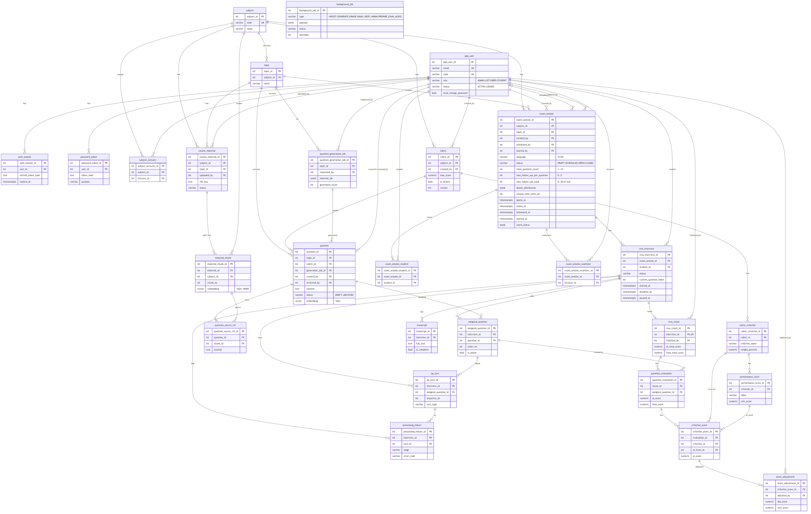

# **AIVES \- Software Design Specification (SDS)**

Oct 15, 2026 · @tmqthedev

Tài liệu này mô tả cách AIVES được xây để đáp ứng các yêu cầu trong SRS: một backend Node.js và Postgres trong Docker trên một EC2, STT và TTS trên Lambda, AI qua Bedrock, cùng một image chạy được ở local. Thứ tự làm và chi phí nằm trong [kế hoạch triển khai](https://claude.ai/code/artifact/f2a9989b-ff90-4200-86b9-66af7ac7e890).

## **1\. Kiến trúc triển khai**

Mọi thứ cần chạy liên tục (REST, Socket.IO, bộ máy phỏng vấn, việc nền, Postgres) nằm trong Docker trên một EC2 t4g.small; STT (PhoWhisper) và TTS (Kokoro) nặng, chỉ chạy từng lúc nên nằm trên Lambda. Mỗi dịch vụ bên ngoài có bản thay thế trong docker compose, nên code không có nhánh theo môi trường.

![triển khai · một EC2 và sáu dịch vụ, bản thay thế khi chạy local][image1]

triển khai · một EC2 và sáu dịch vụ, bản thay thế khi chạy local

Hình trên vẽ trước khi TTS chuyển sang Lambda. Sơ đồ đang chạy trên AWS (Lambda STT và Lambda TTS Kokoro, không còn Google TTS) nằm ở [architecture-aws.md](architecture-aws.md) và [architecture-aws.png](architecture-aws.png).

CloudFront phục vụ web tĩnh từ S3 và chuyển /api, /ws thẳng tới EC2; security group của EC2 chỉ nhận dải IP của CloudFront. EC2 ở subnet công khai nên gọi AWS không cần NAT; Postgres không mở cổng ra ngoài. Không dùng Load Balancer, API Gateway, RDS, Step Functions, SQS, Transcribe hay Polly.

## **2\. Cấu trúc mã nguồn**

Backend giữ kiểu đang có của repo: Express 5, CommonJS, ba lớp route → controller → service → repository, và createApp(overrides) để test thay phụ thuộc. Phần mới thêm các thư mục dưới đây trong backend/src.

| Thư mục | Trách nhiệm |
| :---- | :---- |
| config | Đọc và kiểm tra biến môi trường lúc khởi động; thiếu biến bắt buộc thì dừng ngay |
| db | Pool Postgres, bộ chạy migration (file SQL đánh số trong backend/db/migrations), ánh xạ lỗi DB |
| auth | Băm mật khẩu scrypt, phát và kiểm tra JWT, cookie, middleware requireRole và requireSubjectScope, kiểm tra Origin |
| routes, controllers | HTTP: kiểm tra đầu vào, gọi service, trả lỗi theo một định dạng chung |
| services | Nghiệp vụ: user, subject, question, rubric, material, generation, exam, exam schedule (bảng lịch thi, khởi động, làm nóng), interview, grading, explanation |
| repositories | SQL thuần với pg; mỗi bảng hoặc nhóm bảng một file |
| engine | Bộ máy phỏng vấn: máy trạng thái phiên, đồng hồ và hạn chót, quy tắc hỏi xoáy (BR-05), chọn câu chính cho từng thí sinh (BR-13), ngữ cảnh trên DynamoDB |
| realtime | Socket.IO namespace /interview, xác thực bằng cookie, nhận audio từng đoạn, phát sự kiện |
| providers | Adapter có bản thật và bản mock, chọn bằng biến môi trường: stt (lambda: Lambda PhoWhisper), tts (kokoro: Lambda Kokoro; google: Google Chirp 3 HD, tuỳ chọn), llm (Bedrock Converse), embedding (Titan), storage (S3), mail (SMTP) |
| documents | Trích chữ PDF (pdfjs-dist), DOCX (mammoth), PPTX (đọc XML), cắt đoạn |
| prompts | Prompt và JSON schema cho hỏi xoáy, sinh câu hỏi, chấm điểm; có số phiên bản lưu cùng kết quả |
| jobs | Hàng đợi trên bảng background\_job và các handler: INGEST\_MATERIAL, GENERATE\_QUESTIONS, GRADE\_INTERVIEW, SEND\_EMAIL, KEEP\_WARM, PREPARE\_EXAM\_AUDIO. Sao lưu không phải việc nền mà là cron pg\_dump trên EC2 |

Các module cũ không còn dùng được bỏ: audioWorkflowService (Transcribe theo lô), evaluationService và lecturerDataController (dữ liệu giả), cùng thư mục lambda cũ. Mock DB dạng phân tích chuỗi SQL được thay bằng Postgres thật trong Docker khi test e2e.

Frontend giữ React 19, Vite, react-router và bộ component trong components/ui. Thêm services/api.js (fetch kèm cookie, tự gọi /auth/refresh khi gặp 401), AuthContext lấy từ /auth/me, route bảo vệ theo vai trò, và một hook useInterviewSocket gom Socket.IO, ghi âm AudioWorklet chuyển PCM 16 kHz và phát audio.

Hai image Lambda (container x86\_64) nằm trong lambda/. lambda/stt/ là Python, faster-whisper với PhoWhisper-small (tiếng Việt) và Whisper small (tiếng Anh) dạng CTranslate2 int8; bật lọc VAD, beam 1, không lấy mốc thời gian từng từ; chạy ở Lambda aives-prod-stt (3008 MB, mức tối đa của tài khoản, timeout 120 giây). lambda/tts/ chạy Kokoro-82M bằng ONNX: tiếng Việt dùng bản fine-tune contextboxai/Kokoro-Vietnamese (giọng nữ diem\_trinh), tiếng Anh dùng hexgrad/Kokoro-82M qua kokoro-onnx (giọng nữ af\_heart); chạy ở Lambda aives-prod-tts, trả WAV.

## **3\. Thiết kế dữ liệu**

Mô hình lấy class diagram làm gốc, gồm 26 bảng nghiệp vụ và bảng hàng đợi background\_job (tới migration 018; 018 chỉ thêm cột, không thêm bảng). Mỗi chủ đề thuộc một môn; câu hỏi thuộc chủ đề và gắn một rubric; kỳ thi chọn câu Đã duyệt vào từng phiên; phiên xong thì sinh ra một bài chấm.

mô hình dữ liệu · Physical ERD tới migration 018 (nguồn Mermaid trong [architecture-aws.md](architecture-aws.md))

Điểm AI và điểm cuối nằm cạnh nhau trên cùng một dòng (ai\_score, final\_score) ở cả ba cấp bài, câu, tiêu chí; mỗi lần giảng viên sửa thêm một dòng score\_adjustment. Phần giải thích câu hỏi nằm ở question.rationale (lúc sinh) và qa\_turn.rationale (lúc hỏi), nên sửa câu trong ngân hàng không làm đổi lịch sử buổi thi. Ngữ cảnh phiên đang chạy nằm trong DynamoDB (khoá sessionId có dạng interview\#\<id\>, thuộc tính TTL expiresAt \= hạn chót phiên cộng thời gian ân hạn, mặc định 24 giờ).

| Phần | Bảng | Cột chính |
| :---- | :---- | :---- |
| Tài khoản | app\_user | code (varchar, duy nhất), email (duy nhất), full\_name, password\_hash, role (ADMIN/LECTURER/STUDENT), status (ACTIVE/LOCKED), failed\_login\_count, locked\_until, last\_login\_at |
| Tài khoản | auth\_session | user\_id, refresh\_token\_hash, expires\_at, revoked\_at, ip, user\_agent |
| Tài khoản | password\_token | user\_id, token\_hash, purpose (SET/RESET), expires\_at, used\_at |
| Môn học | subject | code, name |
| Môn học | subject\_lecturer | subject\_id, lecturer\_id |
| Môn học | topic | subject\_id (thêm), các cột đang có |
| Nhóm 1 | course\_material | subject\_id, topic\_id, title, file\_key, mime\_type, size\_bytes, page\_count, status (UPLOADED/PROCESSING/READY/FAILED), error, uploaded\_by |
| Nhóm 1 | material\_chunk | material\_id, chunk\_no, location, content, embedding vector(1024) có chỉ mục HNSW |
| Nhóm 1 | rubric | subject\_id, is\_locked, version, created\_by (thêm), name, max\_score |
| Nhóm 1 | rubric\_criterion | rubric\_id, name, description, weight\_percent (đang có), max\_score |
| Nhóm 1 | performance\_level | criterion\_id, label, min\_score, max\_score, description, order\_no |
| Nhóm 1 | question | topic\_id, rubric\_id, content (đang có); bloom\_level, language, reference\_answer, key\_points JSONB, source (MANUAL/IMPORT/AI), status (DRAFT/PENDING\_REVIEW/APPROVED/REJECTED/ARCHIVED), rationale JSONB, embedding vector(1024), generation\_job\_id, created\_by, reviewed\_by, reviewed\_at, review\_note |
| Nhóm 1 | question\_source\_ref | question\_id, chunk\_id, excerpt |
| Nhóm 1 | question\_generation\_job | topic\_id, material\_ids, requested\_count, bloom\_distribution JSONB, language, status, generated\_count, error, requested\_by |
| Nhóm 3 | exam\_session | subject\_id, topic\_id, title, language, main\_question\_count, max\_follow\_ups\_per\_question, max\_follow\_ups\_total, bloom\_distribution JSONB, answer\_time\_limit\_sec, think\_time\_sec, session\_time\_limit\_sec, opens\_at, closes\_at, status (DRAFT/SCHEDULED/OPEN/CLOSED), created\_by, scheduled\_at, scheduled\_by, started\_at, started\_by, warm\_status JSONB |
| Nhóm 3 | exam\_session\_student | exam\_session\_id, student\_id |
| Nhóm 3 | exam\_session\_examiner | exam\_session\_id, lecturer\_id |
| Nhóm 3 | viva\_interview | exam\_session\_id, student\_id (duy nhất theo cặp), status (NOT\_STARTED/IN\_PROGRESS/PAUSED/COMPLETED/TERMINATED), current\_question\_index, current\_follow\_up\_count, started\_at, deadline\_at, paused\_at, ended\_at, end\_reason, client\_ip |
| Nhóm 3 | assigned\_question | interview\_id, question\_id, order\_no, is\_asked |
| Nhóm 3 | qa\_turn | interview\_id, assigned\_question\_id, sequence\_no, turn\_type, follow\_up\_reason, question\_text, question\_audio\_key, played\_at, answer\_deadline\_at, retry\_count, rationale JSONB, answer\_text, answer\_audio\_key, transcript\_confidence, asked\_at, answer\_started\_at, answer\_ended\_at, timed\_out, status, response\_latency\_ms, speech\_duration\_ms, words\_per\_minute, pause\_count |
| Nhóm 3 | transcript | interview\_id, full\_text, is\_complete |
| Nhóm 3 | processing\_failure | interview\_id, turn\_id, stage, error\_code, message, retry\_count, resolved |
| Nhóm 4 | viva\_result | interview\_id (duy nhất), status (PENDING/AI\_SCORING/AI\_SUGGESTED/FLAGGED/FINALIZED), ai\_total\_score, final\_total\_score, finalized\_by, finalized\_at |
| Nhóm 4 | question\_evaluation | result\_id, assigned\_question\_id, ai\_score, final\_score, confidence, strengths, weaknesses, missing\_points JSONB, feedback, flag\_reason, model\_id, prompt\_version |
| Nhóm 4 | criterion\_score | evaluation\_id, criterion\_id, ai\_level\_id, ai\_score, ai\_justification, evidence JSONB, final\_score |
| Nhóm 4 | score\_adjustment | criterion\_score\_id, old\_score, new\_score, reason, adjusted\_by, adjusted\_at |
| Hệ thống | background\_job | type (INGEST\_MATERIAL/GENERATE\_QUESTIONS/GRADE\_INTERVIEW/SEND\_EMAIL/KEEP\_WARM/PREPARE\_EXAM\_AUDIO), payload JSONB, status (PENDING/RUNNING/DONE/FAILED), attempts, max\_attempts, run\_after, locked\_at, last\_error |

Migration 018\_exam\_schedule.sql thêm trạng thái SCHEDULED, các cột bloom\_distribution, max\_follow\_ups\_total, scheduled\_at, scheduled\_by, started\_at, started\_by, warm\_status cho exam\_session, hai loại việc KEEP\_WARM, PREPARE\_EXAM\_AUDIO, và các chỉ mục exam\_session (status, opens\_at), viva\_interview (exam\_session\_id, started\_at), assigned\_question (question\_id) để bảng lịch thi và việc chọn câu chạy nhanh.

## **4\. Luồng xử lý**

### **4.1 Một lượt hỏi đáp**

1. Server gửi question:new (chữ, link audio, giờ suy nghĩ, giờ trả lời) và ghi qa\_turn trạng thái ASKED. Audio câu chính thường đã có sẵn nhờ việc nền PREPARE\_EXAM\_AUDIO chạy khi quản trị viên khởi động kỳ thi; câu chưa có audio và câu xoáy được Lambda TTS tổng hợp ngay, cache trên S3 theo SHA-256 của nội dung (tts-cache/\<sha256\>.wav).  
2. Trình duyệt phát xong thì gửi question:played; server bắt đầu giờ suy nghĩ, rồi giờ trả lời, và lưu mốc thời gian vào ngữ cảnh phiên.  
3. Trong lúc sinh viên nói, trình duyệt gửi audio:chunk (PCM 16 kHz, khoảng 250 ms mỗi gói). Server gom lại, cắt đoạn theo khoảng lặng và gọi Lambda STT cho từng đoạn ngay khi đoạn đó kết thúc.  
4. answer:end hoặc hết giờ: server nhận dạng đoạn cuối, ghép transcript của lượt, ghi file WAV lên S3, tính tín hiệu phụ, ghi qa\_turn trạng thái TRANSCRIBED.  
5. Server gọi LLM với câu hỏi, ý chính, đoạn nguồn và lịch sử của câu chính này; kiểm tra JSON và trích dẫn; ghi qa\_turn trạng thái ANALYZED.  
6. Engine áp BR-05 để chọn hỏi xoáy, câu chính tiếp hay kết thúc; cập nhật ngữ cảnh trên DynamoDB bằng ghi có điều kiện theo version, rồi quay lại bước 1\.

Lambda được giữ nóng theo ba cách: khi quản trị viên khởi động kỳ thi, backend gọi làm nóng Lambda STT và TTS theo ngôn ngữ kỳ thi; việc nền KEEP\_WARM gọi lại hai Lambda mỗi 5 phút tới giờ đóng; khi sinh viên bắt đầu phiên, backend làm nóng STT thêm một lần. Lần gọi đầu tiên sau khi đổi image mất 45–75 giây, các lần sau chỉ thêm khoảng 1 giây, nên phải làm nóng trước khi sinh viên vào thi. Các ý chính của câu hỏi được truyền vào Whisper làm gợi ý từ vựng.

### **4.2 Trạng thái phiên thi và kỳ thi**

| Từ | Sang | Khi |
| :---- | :---- | :---- |
| NOT\_STARTED | IN\_PROGRESS | Sinh viên gửi interview:ready |
| IN\_PROGRESS | PAUSED | Mất ngữ cảnh phiên sau khi thử lại (A5) |
| PAUSED | IN\_PROGRESS | Khôi phục được ngữ cảnh; hạn chót cộng thêm thời gian tạm dừng |
| IN\_PROGRESS | COMPLETED | Hết câu chính hoặc hết giờ phiên |
| IN\_PROGRESS, PAUSED | TERMINATED | Giảng viên đóng kỳ thi khi phiên chưa xong; phần đã trả lời vẫn được chấm |

Một bộ hẹn giờ trong backend quét các phiên quá deadline\_at mỗi 30 giây để kết thúc cả những phiên mà sinh viên đã rời đi.

**Trạng thái kỳ thi**

| Từ | Sang | Khi |
| :---- | :---- | :---- |
| DRAFT | SCHEDULED | Giảng viên bấm Gửi lịch: đã có giờ mở và đóng, giờ đóng chưa qua, chủ đề đủ câu Đã duyệt theo tổng và từng mức Bloom; ghi scheduled\_at, scheduled\_by |
| SCHEDULED | DRAFT | Giảng viên bấm Rút lịch để sửa cấu hình |
| SCHEDULED | OPEN | Quản trị viên bấm Khởi động (giờ đóng chưa qua); ghi started\_at, started\_by, khoá rubric; làm nóng và tạo audio chạy nền |
| OPEN | CLOSED | Quản trị viên hoặc giảng viên bấm Đóng; phiên chưa xong chuyển TERMINATED, KEEP\_WARM dừng |

Giảng viên không còn mở kỳ thi trực tiếp. Sinh viên chỉ bắt đầu được khi kỳ thi OPEN và giờ mở ≤ hiện tại \< giờ đóng (BR-12).

### **4.3 Tài liệu và sinh câu hỏi**

1. Tải lên: backend kiểm tra loại file và kích thước, lưu lên S3, ghi course\_material UPLOADED, xếp việc INGEST\_MATERIAL.  
2. INGEST\_MATERIAL: trích chữ theo trang hoặc slide, cắt đoạn khoảng 500 từ chồng 50 từ, gọi Titan theo lô, ghi material\_chunk, chuyển READY. Không có chữ thì FAILED kèm lý do.  
3. Giảng viên tạo question\_generation\_job; việc GENERATE\_QUESTIONS tạo vector cho tên và mô tả chủ đề, lấy khoảng 12 đoạn gần nhất trong các tài liệu đã chọn (giới hạn số đoạn mỗi tài liệu để trải đều).  
4. Gọi Nova Pro với các đoạn đánh số, số câu từng mức Bloom, ngôn ngữ và câu đã có của chủ đề (để tránh lặp).  
5. Với mỗi câu trả về: trích dẫn phải là chuỗi con của đoạn được dẫn (so sánh sau khi chuẩn hoá khoảng trắng); tạo vector cho câu, so với câu cùng môn; ghi question PENDING\_REVIEW, question\_source\_ref và rationale.

### **4.4 Chấm điểm**

1. Phiên kết thúc: cùng một transaction ghi transcript, viva\_result PENDING và việc GRADE\_INTERVIEW.  
2. Việc chấm chuyển viva\_result sang AI\_SCORING, chấm từng câu chính một lần gọi LLM (tối đa 2 câu song song).  
3. Kiểm tra đầu ra: mọi tiêu chí đều có điểm, điểm nằm trong khoảng của mức, bằng chứng có trong transcript; sai thì gọi lại một lần.  
4. Ghi question\_evaluation và criterion\_score, tính điểm theo BR-07, áp BR-08, chuyển bài sang AI\_SUGGESTED hoặc FLAGGED.  
5. Chấm lại tạo bản question\_evaluation mới, đánh dấu bản cũ không còn hiệu lực, giữ final\_score đã sửa.

### **4.5 Đăng nhập**

1. POST /auth/login: tìm theo email hoặc code, kiểm tra khoá, so mật khẩu bằng scrypt và timingSafeEqual.  
2. Đúng thì tạo auth\_session, đặt cookie access (JWT HS256, 15 phút, chứa userId, role) và refresh (chuỗi ngẫu nhiên, 7 ngày, path /auth).  
3. Access hết hạn: frontend gọi /auth/refresh; server kiểm tra băm, thu hồi token cũ, cấp cặp mới. Token cũ bị dùng lại thì thu hồi cả phiên.  
4. Socket.IO đọc cookie access lúc bắt tay, từ chối nếu không phải sinh viên của phiên đó.

### **4.6 Khởi động kỳ thi và chọn câu chính**

1. POST /admin/exam-sessions/:id/start: trong một transaction kiểm tra SCHEDULED và giờ đóng, chuyển OPEN, ghi started\_at, started\_by, khoá rubric của mọi câu APPROVED trong chủ đề.  
2. Sau khi trả lời, backend chạy song song: gọi làm nóng Lambda STT và TTS theo ngôn ngữ kỳ thi; xếp PREPARE\_EXAM\_AUDIO (tổng hợp audio cho mọi câu APPROVED của chủ đề, ghi tiến độ đã xong/tổng); xếp KEEP\_WARM (gọi hai Lambda mỗi 5 phút, dừng khi qua closes\_at hoặc kỳ thi không còn OPEN). Kết quả ghi vào exam\_session.warm\_status. POST /admin/exam-sessions/:id/warm làm nóng lại.  
3. Sinh viên bấm Vào thi: backend kiểm tra OPEN và khung giờ (sai thì EXAM\_NOT\_STARTED), rồi trong một transaction khoá dòng exam\_session (SELECT … FOR UPDATE) và chọn câu theo BR-13: bỏ câu chính của K thí sinh bắt đầu gần nhất, K \= clamp(floor(số câu ÷ main\_question\_count) − 1, 0, 3); ưu tiên câu ít dùng trong kỳ thi; chia số câu mỗi mức Bloom theo bloom\_distribution hoặc theo tỉ lệ ngân hàng (phần dư lớn nhất). Thiếu câu thì nới loại trừ từ thí sinh cũ nhất và ghi cảnh báo.  
4. Backend ghi assigned\_question theo order\_no, đặt deadline\_at và gọi làm nóng STT một lần nữa.

## **5\. API và sự kiện**

Mọi API nằm dưới /api, nhận và trả JSON, xác thực bằng cookie. Lỗi có một định dạng chung: { "error": { "code": "QUESTION\_DUPLICATE", "message": "...", "details": \[...\] } } với mã HTTP 400 (đầu vào sai), 401 (chưa đăng nhập), 403 (sai vai trò hoặc ngoài phạm vi môn), 404, 409 (trùng hoặc sai trạng thái), 422 (lỗi import theo dòng). Danh sách có phân trang bằng ?page và ?pageSize.

| Loại | Điểm cuối hoặc sự kiện | Việc | SRS |
| :---- | :---- | :---- | :---- |
| REST, chung | POST /auth/login, /auth/logout, /auth/refresh, GET /auth/me | Đăng nhập, đăng xuất, làm mới phiên | FR-AUTH-01..03 |
| REST, chung | POST /auth/forgot-password, /auth/reset-password, PUT /auth/password | Quên, đặt và đổi mật khẩu | FR-AUTH-04 |
| REST, quản trị | /admin/users, POST /admin/users/import, POST /admin/users/:id/send-link | Tài khoản và import | FR-AUTH-05, 06 |
| REST, quản trị | /admin/subjects, PUT /admin/subjects/:id/lecturers | Môn học | FR-AUTH-07 |
| REST, quản trị | GET /admin/exam-schedule?status\&subjectId\&from\&to, POST /admin/exam-sessions/:id/start, /close, /warm | Bảng lịch thi, khởi động, đóng, làm nóng lại | FR-EXAM-04, 07, 08 |
| REST, giảng viên | /materials (POST multipart, GET, DELETE) | Tài liệu | FR-RAG-01, 02 |
| REST, giảng viên | POST /question-generation-jobs, GET /question-generation-jobs/:id | Sinh câu hỏi | FR-RAG-03..05 |
| REST, giảng viên | /questions, POST /questions/import, GET /questions/import-template, POST /questions/:id/approve, /reject, /archive, POST /questions/approve-batch | Ngân hàng câu hỏi và duyệt | FR-QB-01..04, 07, FR-RAG-06 |
| REST, giảng viên | /rubrics, POST /rubrics/:id/clone | Rubric và mức đánh giá | FR-QB-05, 06 |
| REST, giảng viên | /exam-sessions, PUT /exam-sessions/:id/students, /examiners, POST /exam-sessions/:id/schedule, /unschedule, /close | Kỳ thi, gửi và rút lịch, đóng (không còn /open) | FR-EXAM-01..03, 06, 09 |
| REST, giảng viên | GET /exam-sessions/:id/results, GET /results/:id | Danh sách bài, chi tiết một bài | FR-GRD-05, FR-EXP-01 |
| REST, giảng viên | PUT /criterion-scores/:id, POST /results/:id/regrade, /finalize, /reopen | Chỉnh, chấm lại, chốt | FR-GRD-06..08 |
| REST, sinh viên | GET /me/exam-sessions, POST /interviews | Kỳ thi của mình, tạo hoặc lấy lại phiên (EXAM\_NOT\_STARTED khi chưa khởi động hoặc chưa tới giờ mở) | FR-EXAM-05, FR-INT-01, 14 |
| REST | GET /tts/:hash.wav (Kokoro; .mp3 nếu dùng Google), GET /turns/:id/audio | Audio câu hỏi; audio trả lời cho giảng viên | FR-INT-03, FR-GRD-05 |
| Client → server | interview:join, interview:ready, question:played | Vào phòng, bắt đầu, nghe xong câu hỏi | FR-INT-02..04 |
| Client → server | answer:start, audio:chunk, answer:end | Ghi và gửi câu trả lời | FR-INT-05 |
| Server → client | interview:state, question:new | Trạng thái, đồng hồ, câu hỏi mới (không kèm giải thích, đáp án, ý chính) | FR-INT-03, 08, FR-EXP-04 |
| Server → client | answer:timeout, turn:processing, turn:retry, interview:paused, interview:completed | Hết giờ, đang xử lý, nói lại, tạm dừng, kết thúc | FR-INT-04, 10, 12 |

Payload Socket.IO có kiểu cố định trong một file schema dùng chung cho backend và test; question:new chỉ có turnId, text, audioUrl, thinkSec, answerSec, questionNo, followUpNo.

## **6\. Hợp đồng với LLM**

Cả ba lần gọi dùng Bedrock Converse API với Nova Pro, một tool duy nhất có inputSchema và toolChoice bắt buộc dùng tool đó, nên đầu ra luôn là JSON theo schema. Temperature 0,2 cho hỏi xoáy và chấm, 0,7 cho sinh câu hỏi. Dữ liệu do người dùng tạo (câu trả lời, nội dung tài liệu) nằm trong thẻ riêng và system prompt nói rõ đó là dữ liệu. Mỗi kết quả lưu model\_id và prompt\_version.

**Hỏi xoáy** (tool decide\_next\_turn)

{  
  "next\_action": "ASK\_FOLLOW\_UP | NEXT\_MAIN\_QUESTION",  
  "follow\_up\_reason": "AMBIGUOUS | INCOMPLETE | CONTRADICTORY | NEEDS\_CLARIFICATION | null",  
  "covered\_key\_points": \["..."\],  
  "missing\_key\_points": \["..."\],  
  "follow\_up\_question": "... | null",  
  "rationale": {  
    "why": "...",  
    "purpose": "...",  
    "target\_key\_points": \["..."\],  
    "target\_criteria": \["..."\],  
    "grounding": \[{ "type": "STUDENT\_QUOTE | KEY\_POINT | SOURCE\_EXCERPT", "ref": "...", "text": "..." }\],  
    "synthesis": "..."  
  }  
}  
**Sinh câu hỏi** (tool propose\_questions)

{  
  "questions": \[  
    {  
      "content": "...",  
      "bloom\_level": "REMEMBER | UNDERSTAND | APPLY | ANALYZE",  
      "reference\_answer": "...",  
      "key\_points": \["..."\],  
      "sources": \[{ "chunk\_no": 3, "excerpt": "..." }\],  
      "purpose": "...",  
      "synthesis": "..."  
    }  
  \]  
}  
**Chấm một câu chính** (tool grade\_answer)

{  
  "criteria": \[  
    {  
      "criterion\_id": 12,  
      "level\_id": 40,  
      "score": 7.5,  
      "justification": "...",  
      "evidence": \[{ "turn\_seq": 2, "quote": "..." }\]  
    }  
  \],  
  "strengths": \["..."\],  
  "weaknesses": \["..."\],  
  "missing\_points": \["..."\],  
  "feedback": "...",  
  "confidence": 0.82  
}  
Backend không tin đầu ra một cách mù quáng: mọi id phải thuộc dữ liệu đã gửi đi, mọi trích dẫn phải khớp văn bản gốc, điểm phải nằm trong khoảng của mức, câu xoáy không được chứa nguyên văn một ý chính còn thiếu. Sai điều nào thì gọi lại một lần kèm lỗi, rồi áp luồng lỗi tương ứng.

## **7\. Bảo mật, xử lý lỗi và việc nền**

**Bảo mật**

* Mật khẩu: scrypt (N=16384, r=8, p=1, salt 16 byte), so bằng timingSafeEqual; token đặt mật khẩu và refresh token chỉ lưu băm SHA-256.  
* Cookie httpOnly, Secure (tắt Secure khi chạy http local qua biến môi trường), SameSite=Lax; kiểm tra header Origin với mọi yêu cầu thay đổi dữ liệu.  
* Phân quyền hai lớp: requireRole ở route, kiểm tra phạm vi môn hoặc người chấm trong service, nên gọi thẳng service từ Socket.IO cũng được kiểm tra.  
* Giới hạn tốc độ cho /auth/login và /auth/forgot-password theo IP.  
* File tải lên: kiểm tra định dạng theo nội dung, không theo đuôi; tên file trên S3 là UUID; audio và tài liệu chỉ phát qua backend sau khi kiểm tra quyền.  
* Bí mật nằm trong .env (local) hoặc SSM SecureString (prod); EC2 dùng IAM role chỉ có quyền Bedrock, S3 bucket của dự án, DynamoDB bảng của dự án, Lambda STT và Lambda TTS.  
* Log không ghi mật khẩu, token, nội dung audio.

**Xử lý lỗi.** Các luồng A1–A8 được cài trong engine như bảng ở SRS mục 4\. Mỗi lần thử lại hoặc bỏ qua đều ghi processing\_failure để giảng viên thấy trong màn chấm. Gọi dịch vụ ngoài luôn có timeout: trên prod STT 90 giây (STT\_TIMEOUT\_MS, đủ cho câu trả lời dài), LLM 20 giây, TTS 25 giây (TTS\_TIMEOUT\_MS, có tính khởi động nguội của Kokoro).

**Việc nền.** Một worker trong chính tiến trình backend lấy việc bằng SELECT … FROM background\_job WHERE status \= 'PENDING' AND run\_after \<= now() ORDER BY run\_after FOR UPDATE SKIP LOCKED LIMIT 1, chạy tối đa 2 việc cùng lúc. Lỗi thì thử lại tối đa 3 lần với giãn cách 30 giây, 2 phút, 10 phút, rồi chuyển FAILED. Việc RUNNING quá 15 phút (backend chết giữa chừng) được trả về PENDING khi khởi động. Mỗi handler phải chạy lại được mà không tạo dữ liệu trùng. KEEP\_WARM chạy lại mỗi 5 phút và dừng khi qua giờ đóng hoặc kỳ thi không còn OPEN; PREPARE\_EXAM\_AUDIO dùng lại audio đã có trong cache theo hash nội dung.

## **8\. Cấu hình, triển khai, quan sát và kiểm thử**

**Cấu hình.** Mọi khác biệt giữa local và prod nằm trong biến môi trường. Adapter chọn bằng STT\_PROVIDER (lambda hoặc mock), TTS\_PROVIDER (kokoro, google hoặc mock), LLM\_PROVIDER và EMBEDDING\_PROVIDER (bedrock hoặc mock); mock là mặc định và là đường test tự động.

| Biến | Local | Prod |
| :---- | :---- | :---- |
| DATABASE\_URL | postgres trong compose | postgres trong compose trên EC2 |
| DYNAMODB\_ENDPOINT, S3\_ENDPOINT, LAMBDA\_ENDPOINT | dynamodb:8000, minio:9000, stt:8080 | để trống |
| BEDROCK\_MODEL\_ID, BEDROCK\_EMBED\_MODEL\_ID | Nova Pro, Titan V2 | như local |
| SMTP\_HOST, SMTP\_PORT, SMTP\_USER, SMTP\_PASS | mailpit, 1025 | smtp.gmail.com, 587, Gmail nhóm, App Password |
| JWT\_SECRET, COOKIE\_SECURE, APP\_BASE\_URL, ALLOWED\_ORIGIN | .env, false, http\://localhost:8080 | SSM, true, địa chỉ CloudFront |
| STT\_PROVIDER, TTS\_PROVIDER | mock (hoặc lambda, kokoro khi chạy image Lambda qua RIE) | lambda, kokoro |
| TTS\_LAMBDA\_FUNCTION\_NAME, TTS\_LAMBDA\_ENDPOINT | aives-prod-tts, endpoint RIE của image TTS | aives-prod-tts, để trống |
| STT\_TIMEOUT\_MS, TTS\_TIMEOUT\_MS | 10000, 8000 (mặc định) | 90000, 25000 |
| GOOGLE\_APPLICATION\_CREDENTIALS | tuỳ chọn, chỉ khi TTS\_PROVIDER=google | tuỳ chọn: SSM SecureString GOOGLE\_TTS\_KEY\_JSON ghi ra file lúc khởi động |

**Triển khai.** docker-compose.yml (local) chạy backend, frontend qua nginx, Postgres pgvector/pgvector:pg16, DynamoDB Local, MinIO, Mailpit, STT và TTS (image Lambda với RIE). docker-compose.prod.yml trên EC2 chạy backend và Postgres với giới hạn bộ nhớ (backend 768 MB, Postgres 640 MB), volume Postgres trên ổ EBS dữ liệu riêng. Terraform tạo hạ tầng; GitHub Actions dùng OIDC để build, đẩy image, cập nhật Lambda, chạy SSM Run Command trên EC2. Sao lưu là cron trên EC2 chạy scripts/pg-backup.sh (pg\_dump) lúc 02:00, đẩy lên S3, lifecycle xoá sau 14 ngày; dump thêm khi kỳ thi đóng vẫn đang hoãn.

**Quan sát.** Log JSON bằng pino (đã có trong repo), mỗi yêu cầu và mỗi lượt có requestId hoặc turnId. Mỗi lượt ghi thời gian từng bước (stt\_ms, llm\_ms, tts\_ms, total\_ms) để kiểm NFR-01. Prod đẩy log lên CloudWatch Logs, giữ 14 ngày. GET /health kiểm tra Postgres và hàng đợi.

**Kiểm thử**

| Tầng | Công cụ | Phủ |
| :---- | :---- | :---- |
| Đơn vị | node \--test | Quy tắc BR-02 đến BR-08, cách tính điểm, kiểm tra trích dẫn, cắt đoạn, băm mật khẩu, JWT |
| Tích hợp | Jest, Supertest, Postgres thật trong Docker | Mọi route, kể cả sai vai trò và sai môn; import Excel; hàng đợi việc nền |
| E2E | Jest, socket.io-client, adapter mock | Trọn vòng đăng nhập → sinh câu → duyệt → thi → chấm → chốt; A1–A8; khởi động lại giữa buổi |
| Prompt | Test với Bedrock thật, chạy tay | Bộ câu trả lời mẫu đủ, thiếu, mơ hồ, mâu thuẫn, có chèn mệnh lệnh |
| STT | Python, file audio mẫu | Image trả đúng định dạng, đo thời gian |

Mỗi PR nêu các mã FR và BR mà nó đáp ứng; test đặt tên theo mã đó để truy vết từ yêu cầu tới test.

[image1]: <>