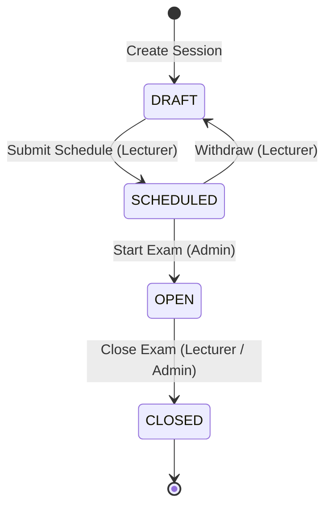

# AIVES: Đặc tả Luồng Nghiệp vụ (Business Flows Specification)

Tài liệu đặc tả chi tiết 10 luồng nghiệp vụ cốt lõi (F1 → F10) của hệ thống **AIVES** (AI-assisted Viva Examination System). Mỗi luồng được chuẩn hóa theo cấu trúc: **Actor** · **Tiền điều kiện** · **Các bước (UI → API)** · **Trạng thái & Chuyển trạng thái** · **Luật nghiệp vụ (BR)** · **Lỗi có thể gặp (HTTP + Code + UI)** · **Tiêu chí chấp nhận (AC)** · **Liên kết SRS/SDS**.

---

## Mục lục

1. [F1: Đăng nhập, Đặt & Đổi mật khẩu, Khoá tài khoản](#f1-đăng-nhập-đặt--đổi-mật-khẩu-khoá-tài-khoản)
2. [F2: Admin - Quản lý tài khoản người dùng](#f2-admin---quản-lý-tài-khoản-người-dùng)
3. [F3: Admin - Môn học, Gán giảng viên & Ghi danh sinh viên](#f3-admin---môn-học-gán-giảng-viên--ghi-danh-sinh-viên)
4. [F4: Giảng viên - Quản lý Topic trong môn học](#f4-giảng-viên---quản-lý-topic-trong-môn-học)
5. [F5: Giảng viên - Quản lý tài liệu học liệu (Upload & Ingest)](#f5-giảng-viên---quản-lý-tài-liệu-học-liệu-upload--ingest)
6. [F6: Giảng viên - Ngân hàng câu hỏi & Quản lý Rubric](#f6-giảng-viên---ngân-hàng-câu-hỏi--quản-lý-rubric)
7. [F7: Giảng viên - Thiết lập, Cấu hình & Lên lịch Kỳ thi](#f7-giảng-viên---thiết-lập-cấu-hình--lên-lịch-kỳ-thi)
8. [F8: Admin - Điều phối Lịch thi (Exam Schedule)](#f8-admin---điều-phối-lịch-thi-exam-schedule)
9. [F9: Sinh viên - Thi vấn đáp AI (Viva Interview)](#f9-sinh-viên---thi-vấn-đáp-ai-viva-interview)
10. [F10: Chấm điểm, Đánh giá & Xem kết quả (Grading & Review)](#f10-chấm-điểm-đánh-giá--xem-kết-quả-grading--review)
11. [Phụ lục A: Ma trận phân quyền Role × Endpoint](#phụ-lục-a-ma-trận-phân-quyền-role--endpoint)
12. [Phụ lục B: Bảng mã lỗi chuẩn hóa](#phụ-lục-b-bảng-mã-lỗi-chuẩn-hóa)

---

## F1: Đăng nhập, Đặt & Đổi mật khẩu, Khoá tài khoản

### 1. Actor
- Tất cả người dùng: `ADMIN`, `LECTURER`, `STUDENT`.

### 2. Tiền điều kiện
- Tài khoản đã được tạo trong hệ thống (`app_user`), trạng thái `ACTIVE` (hoặc `must_change_password = true` khi mới tạo).

### 3. Các bước thực hiện (UI → API)
1. **Đăng nhập**:
   - Người dùng nhập Email hoặc Mã tài khoản (`code`) và Mật khẩu.
   - Frontend gửi: `POST /api/auth/login` với `{ email|code, password }`.
   - Backend xác thực bcrypt hash, tạo `auth_session`, trả về HTTP 200 kèm Set-Cookie: `access_token` (15 phút) và `refresh_token` (7 ngày) dạng `httpOnly; SameSite=Lax`.
2. **Đặt mật khẩu lần đầu (Account Setup)**:
   - Người dùng bấm link trong email nhận được: `/set-password?token=...`.
   - Frontend gửi: `POST /api/auth/set-password` với `{ token, password }`.
   - Backend xác thực token (hash sha256, purpose `SET`), cập nhật mật khẩu, set `must_change_password = false`, đánh dấu token đã dùng.
3. **Quên & Đặt lại mật khẩu**:
   - Nhập email tại `/forgot-password` → `POST /api/auth/forgot-password`. Phản hồi luôn trả 200 (enumeration-safe). Nếu email tồn tại, hệ thống tạo job `SEND_EMAIL` chứa token RESET (hạn 15 phút).
   - Người dùng bấm link email → `POST /api/auth/reset-password` với `{ token, password }`.
4. **Đổi mật khẩu trong phiên**:
   - Người dùng đã đăng nhập vào Profile/Settings → `POST /api/auth/change-password` với `{ currentPassword, newPassword }`.
   - Backend xác thực mật khẩu cũ, cập nhật mật khẩu mới, thu hồi mọi phiên đăng nhập khác.

### 4. Trạng thái & Chuyển trạng thái
- Tài khoản: `ACTIVE` → `LOCKED` (sau 5 lần sai mật khẩu liên tiếp trong cửa sổ 15 phút). `LOCKED` kéo dài 30 phút hoặc đến khi Admin mở khóa.

### 5. Luật nghiệp vụ (BR)
- **BR-F1.1**: Đăng nhập hỗ trợ cả Email và Code sinh viên/giảng viên.
- **BR-F1.2**: Password phải từ 8 ký tự trở lên. Không bao giờ gửi mật khẩu dạng plaintext trong email hoặc log.
- **BR-F1.3**: Enumeration defense: Request quên mật khẩu luôn trả `200 { ok: true }` dù email có tồn tại hay không.
- **BR-F1.4**: Token `SET` và `RESET` chỉ dùng được một lần duy nhất (`used_at IS NULL`).
- **BR-F1.5**: CSRF Protection: Mọi method thay đổi trạng thái (`POST`, `PUT`, `PATCH`, `DELETE`) bắt buộc có header `Origin` khớp với `APP_BASE_URL`.

### 6. Lỗi có thể gặp
| HTTP | Code | Nguyên nhân | Thông báo UI |
| :--- | :--- | :--- | :--- |
| 401 | `INVALID_CREDENTIALS` | Sai email/mật khẩu | Tên đăng nhập hoặc mật khẩu không chính xác. |
| 403 | `ACCOUNT_LOCKED` | Đăng nhập sai quá 5 lần | Tài khoản tạm thời bị khoá. Vui lòng thử lại sau 30 phút hoặc liên hệ Quản trị viên. |
| 400 | `INVALID_TOKEN` | Token link hết hạn hoặc đã dùng | Liên kết không hợp lệ hoặc đã hết hạn. |
| 403 | `CSRF_FORBIDDEN` | Thiếu hoặc sai header Origin | Yêu cầu bị từ chối do chính sách bảo mật CSRF. |

### 7. Tiêu chí chấp nhận (AC)
- Đăng nhập đúng cấp cookie `httpOnly`, chuyển hướng đúng Dashboard theo vai trò.
- Tài khoản khoá chính xác sau 5 lần sai. Đổi mật khẩu thu hồi các session khác.

### 8. Liên kết SRS/SDS
- SRS: §3.1.1 (Authentication & Authorization), §3.1.2 (Account Security).
- SDS: §4.1 (Auth Architecture, JWT & Cookie strategy).

---

## F2: Admin - Quản lý tài khoản người dùng

### 1. Actor
- `ADMIN`.

### 2. Tiền điều kiện
- Đã đăng nhập vai trò `ADMIN`.

### 3. Các bước thực hiện (UI → API)
1. **Tạo tài khoản Giảng viên**:
   - Admin vào trang *Users* → Chọn *Add Lecturer* (nhập `code`, `email`, `fullName`).
   - Gửi: `POST /api/admin/users`. Backend tạo user `status='ACTIVE'`, sinh single-use SET token và enqueue job `SEND_EMAIL`.
2. **Import sinh viên hàng loạt**:
   - Admin upload file Excel `.xlsx` chứa cột: Code, Full Name, Email.
   - Gửi: `POST /api/admin/users/import` (raw binary buffer).
   - Backend validate toàn bộ file (all-or-nothing): kiểm tra trùng lặp trong file và trong DB. Nếu hợp lệ, tạo toàn bộ tài khoản `STUDENT` và gửi email thiết lập mật khẩu.
3. **Gửi lại link kích hoạt**:
   - Bấm *Resend setup link* → `POST /api/admin/users/:id/resend-setup`.
4. **Khoá / Mở khoá tài khoản**:
   - Bấm *Lock* → `POST /api/admin/users/:id/lock`.
   - Bấm *Unlock* → `POST /api/admin/users/:id/unlock` (xoá `locked_until` và reset `failed_login_count = 0`).

### 4. Trạng thái & Chuyển trạng thái
- `ACTIVE` $\leftrightarrow$ `LOCKED`.

### 5. Luật nghiệp vụ (BR)
- **BR-F2.1**: Không cho phép tạo tài khoản có email hoặc code đã tồn tại trong DB.
- **BR-F2.2**: Import Excel là All-or-Nothing: Nếu có bất kỳ dòng nào sai format hoặc trùng lặp, không có bản ghi nào được ghi vào DB. Trả về chi tiết lỗi từng dòng.

### 6. Lỗi có thể gặp
| HTTP | Code | Nguyên nhân | Thông báo UI |
| :--- | :--- | :--- | :--- |
| 409 | `EMAIL_TAKEN` | Email đã tồn tại | Email này đã được sử dụng bởi tài khoản khác. |
| 409 | `CODE_TAKEN` | Mã người dùng đã tồn tại | Mã người dùng này đã tồn tại trong hệ thống. |
| 422 | `VALIDATION_ERROR` | File Excel import có dòng lỗi | File import chứa dữ liệu không hợp lệ. Vui lòng kiểm tra danh sách lỗi. |

### 7. Tiêu chí chấp nhận (AC)
- Danh sách người dùng hiển thị đúng vai trò và trạng thái.
- File Excel sai 1 dòng lập tức trả danh sách lỗi và rollback toàn bộ.

### 8. Liên kết SRS/SDS
- SRS: §3.2.1 (User Management), §3.2.2 (Bulk Student Import).

---

## F3: Admin - Môn học, Gán giảng viên & Ghi danh sinh viên

### 1. Actor
- `ADMIN`.

### 2. Tiền điều kiện
- Đã đăng nhập vai trò `ADMIN`.

### 3. Các bước thực hiện (UI → API)
1. **Quản lý Môn học (CRUD)**:
   - Admin tạo môn: `POST /api/admin/subjects` với `{ code, name }`.
   - Sửa môn: `PUT /api/admin/subjects/:id`.
   - Xoá môn: `DELETE /api/admin/subjects/:id` (chỉ khi không có dữ liệu ràng buộc).
2. **Gán Giảng viên phụ trách môn**:
   - Bấm *Assign lecturers* trên môn học → chọn danh sách giảng viên.
   - Gửi: `PUT /api/admin/subjects/:id/lecturers` với `{ lecturerIds: [id1, id2] }`.
   - Backend cập nhật bảng `subject_lecturer` trong transaction.
3. **Ghi danh Sinh viên vào môn học (Mới - Step 13)**:
   - Bấm *Students* trên môn học → Xem danh sách sinh viên hiện tại (`GET /api/admin/subjects/:id/students`).
   - Nhập/dán danh sách mã sinh viên (phân tách bằng dấu phẩy hoặc xuống dòng).
   - Gửi: `PUT /api/admin/subjects/:id/students` với `{ codes: "SE123\nSE124" }`.
   - Backend validate toàn bộ mã (all-or-nothing): Mỗi mã phải là user role `STUDENT` và trạng thái `ACTIVE`. Nếu hợp lệ, lưu vào bảng `subject_student`.

### 4. Trạng thái & Chuyển trạng thái
- Quan hệ `subject_lecturer` và `subject_student` được cập nhật đồng bộ toàn bộ (replace set).

### 5. Luật nghiệp vụ (BR)
- **BR-F3.1**: Giảng viên chỉ được thao tác trên các môn học được gán trong `subject_lecturer`.
- **BR-F3.2**: Sinh viên chỉ được tham gia kỳ thi thuộc các môn học mà sinh viên đã được ghi danh trong `subject_student`.
- **BR-F3.3**: Ghi danh sinh viên là All-or-Nothing: Nếu có mã sinh viên lạ hoặc chưa ACTIVE, thao tác bị từ chối và giữ nguyên danh sách cũ.

### 6. Lỗi có thể gặp
| HTTP | Code | Nguyên nhân | Thông báo UI |
| :--- | :--- | :--- | :--- |
| 404 | `NOT_FOUND` | Môn học không tồn tại | Không tìm thấy môn học. |
| 409 | `SUBJECT_CODE_TAKEN` | Trùng mã môn học | Mã môn học này đã tồn tại. |
| 422 | `VALIDATION_ERROR` | Mã SV không hợp lệ khi ghi danh | Một số mã sinh viên không tồn tại hoặc chưa kích hoạt. |

### 7. Tiêu chí chấp nhận (AC)
- Giảng viên được gán xuất hiện trong phạm vi môn của họ.
- Sinh viên được ghi danh xuất hiện trong danh sách lựa chọn Roster kỳ thi của môn đó.

### 8. Liên kết SRS/SDS
- SRS: §3.2.3 (Course & Subject Scoping).
- SDS: §3.2 (Data Model: `subject`, `subject_lecturer`, `subject_student`).

---

## F4: Giảng viên - Quản lý Topic trong môn học

### 1. Actor
- `LECTURER` (thuộc môn), `ADMIN`.

### 2. Tiền điều kiện
- Môn học đã tồn tại; Giảng viên đã được gán vào môn học đó.

### 3. Các bước thực hiện (UI → API)
- Tạo Topic: `POST /api/topics` với `{ name, subject_id, course_id }`.
- Cập nhật Topic: `PATCH /api/topics/:id` với `{ name, course_id }`.
- *Lưu ý hiện trạng*: Hiện tại UI chưa có màn hình độc lập riêng cho Quản trị Topic; Topic được hiển thị thông qua Dropdown chọn chủ đề ở Question Bank, Material Upload và Exam Sessions. API đã hoàn thiện đầy đủ.

### 4. Luật nghiệp vụ (BR)
- **BR-F4.1**: `topic.subject_id` xác định môn học sở hữu topic.
- **BR-F4.2**: `topic.course_id` dùng để đối soát mã topic khi import câu hỏi qua file Excel.

---

## F5: Giảng viên - Quản lý tài liệu học liệu (Upload & Ingest)

### 1. Actor
- `LECTURER` (thuộc môn).

### 2. Tiền điều kiện
- Giảng viên được phân công môn học.

### 3. Các bước thực hiện (UI → API)
1. Giảng viên vào trang *Materials*, chọn Môn học.
2. Tải file tài liệu lên (PDF, PPTX, DOCX, tối đa 50MB):
   - Frontend gửi: `POST /api/materials/upload-url` hoặc upload trực tiếp `POST /api/materials`.
   - File được lưu vào S3 bucket materials.
3. Backend tạo bản ghi `material` với trạng thái `PROCESSING`, đồng thời enqueue background job `INGEST_MATERIAL`.
4. Job Worker xử lý:
   - Trích xuất văn bản từ file tài liệu.
   - Chia đoạn (chunking) theo ngữ cảnh và số từ mục tiêu, gán `chunk_no`.
   - Sinh vector embedding qua Bedrock Titan (`amazon.titan-embed-text-v1`), lưu vào `material_chunk` với kiểu dữ liệu `vector(1024)`.
   - Cập nhật trạng thái `material` thành `READY`.
5. Nếu file lỗi/không parse được: Cập nhật `material` thành `FAILED` kèm lý do lỗi.
6. Xoá tài liệu: Bấm *Delete* → `DELETE /api/materials/:id` (xoá bản ghi, xoá chunks và xoá object trên S3).

### 4. Trạng thái & Chuyển trạng thái
- `PROCESSING` $\rightarrow$ `READY` | `FAILED`.

### 5. Luật nghiệp vụ (BR)
- **BR-F5.1**: Giảng viên không thể upload hay xoá tài liệu của môn học mình không phụ trách.
- **BR-F5.2**: Chỉ các tài liệu ở trạng thái `READY` mới được đưa vào ngữ cảnh sinh câu hỏi RAG.

### 6. Lỗi có thể gặp
| HTTP | Code | Nguyên nhân | Thông báo UI |
| :--- | :--- | :--- | :--- |
| 403 | `FORBIDDEN` | Upload ngoài phạm vi môn | Bạn không có quyền quản lý tài liệu của môn này. |
| 400 | `INVALID_FILE` | Sai định dạng hoặc file rỗng | File không đúng định dạng hỗ trợ (PDF/PPTX/DOCX). |

### 7. Tiêu chí chấp nhận (AC)
- Upload file PDF hợp lệ chuyển sang `READY` sau vài chục giây.
- Bảng `material_chunk` lưu đúng các chunk kèm vector embedding.

### 8. Liên kết SRS/SDS
- SRS: §3.3.1 (Course Materials Ingestion).
- SDS: §4.3 (RAG Pipeline & Chunking Engine).

---

## F6: Giảng viên - Ngân hàng câu hỏi & Quản lý Rubric

### 1. Actor
- `LECTURER` (thuộc môn).

### 2. Tiền điều kiện
- Môn học đã có Topic; Rubric đã được tạo (nếu muốn duyệt câu hỏi).

### 3. Các bước thực hiện (UI → API)
1. **Tạo câu hỏi thủ công**:
   - `POST /api/questions`: Nhập nội dung, mức độ Bloom (REMEMBER → CREATE), ngôn ngữ, đáp án tham khảo, key points, gắn rubric.
   - Nếu đủ rubric và nội dung hợp lệ: lưu trạng thái `APPROVED` (hoặc `DRAFT` nếu chưa đủ rubric).
2. **Sinh câu hỏi tự động (RAG Generation)**:
   - Bấm *Generate AI Questions* → Chọn Topic, chọn tài liệu nguồn `READY`, số lượng câu, phân bố Bloom.
   - Gửi: `POST /api/question-generation`. Backend enqueue job `GENERATE_QUESTIONS`.
   - Worker tìm kiếm semantic similarity từ `material_chunk`, gửi prompt tới Bedrock Nova, sinh câu hỏi kèm trích dẫn (citations) và rationale, lưu trạng thái `PENDING_REVIEW`.
3. **Duyệt / Chỉnh sửa / Từ chối câu hỏi (Review)**:
   - Giảng viên vào *Pending Review*:
     - Duyệt từng câu: Chọn Rubric → Bấm *Approve* (`POST /api/questions/:id/approve`).
     - Sửa rồi duyệt: Bấm *Edit then approve* (`PUT /api/questions/:id` kèm `rubricId` rồi `approve`).
     - Duyệt hàng loạt: Chọn checkbox các câu, chọn rubric chung → Bấm *Approve selected* (`POST /api/questions/approve-batch`).
     - Từ chối: Bấm *Reject* kèm lý do từ chối (`POST /api/questions/:id/reject`).
4. **Kiểm tra trùng lặp (Duplicate Detection)**:
   - Khi tạo/sửa: Hệ thống kiểm tra trùng lặp exact content (chặn cứng 409).
   - Kiểm tra cosine similarity với các câu trong cùng môn: Nếu $\ge 0.9$, trả về cảnh báo `NEAR_DUPLICATE` kèm ID câu gần nhất nhưng vẫn cho phép lưu.
5. **Quản lý Rubric đánh giá**:
   - Tạo Rubric: `POST /api/rubrics` kèm danh sách tiêu chí, trọng số (tổng phải bằng 100%), performance levels.
   - Sửa Rubric: `PUT /api/rubrics/:id` (chỉ khi `is_locked = false`).
   - Clone Rubric: Khi kỳ thi đã bắt đầu khiến rubric bị khoá, bấm *Clone* (`POST /api/rubrics/:id/clone`) để nhân bản ra rubric mới có version tăng và `is_locked = false`.

### 4. Trạng thái & Chuyển trạng thái
- Câu hỏi: `DRAFT` $\rightarrow$ `PENDING_REVIEW` $\rightarrow$ `APPROVED` | `REJECTED` $\rightarrow$ `ARCHIVED`.
- Rubric: `is_locked = false` $\rightarrow$ `is_locked = true` (khi kỳ thi SCHEDULED $\rightarrow$ OPEN).

### 5. Luật nghiệp vụ (BR)
- **BR-F6.1**: Câu hỏi muốn chuyển sang `APPROVED` bắt buộc phải có `rubric_id` hợp lệ.
- **BR-F6.2**: Câu hỏi ở trạng thái `REJECTED` bắt buộc phải có `review_note`.
- **BR-F6.3**: Rubric đã bị khoá (`is_locked = true`) không được phép chỉnh sửa cấu trúc tiêu chí hay trọng số.
- **BR-F6.4**: Sinh viên tuyệt đối không được truy cập API đọc câu hỏi, rubric hay rationale.

### 6. Lỗi có thể gặp
| HTTP | Code | Nguyên nhân | Thông báo UI |
| :--- | :--- | :--- | :--- |
| 409 | `RUBRIC_REQUIRED` | Duyệt câu hỏi nhưng chưa gắn rubric | Cần chọn Rubric trước khi duyệt câu hỏi này. |
| 409 | `INVALID_TRANSITION` | Chuyển trạng thái câu hỏi sai luật | Trạng thái hiện tại của câu hỏi không thể thực hiện thao tác này. |
| 409 | `DUPLICATE_CONTENT` | Trùng 100% nội dung câu hỏi đã có | Nội dung câu hỏi đã tồn tại trong hệ thống. |
| 409 | `RUBRIC_LOCKED` | Sửa rubric đang được kỳ thi sử dụng | Rubric đã bị khoá do đang được sử dụng trong kỳ thi. Vui lòng Clone rubric mới. |

### 7. Tiêu chí chấp nhận (AC)
- Câu hỏi sau khi duyệt hiển thị badge xanh `APPROVED`.
- Trùng lặp nội dung được phát hiện ngay lập tức.
- Duyệt hàng loạt hoàn thành atomic qua một transaction.

### 8. Liên kết SRS/SDS
- SRS: §3.3.2 (Question Bank), §3.3.3 (Rubric Management), §3.3.4 (AI Question Review).
- SDS: §4.4 (Question Lifecycle State Machine), §4.5 (Vector Duplicate Detection).

---

## F7: Giảng viên - Thiết lập, Cấu hình & Lên lịch Kỳ thi

### 1. Actor
- `LECTURER` (thuộc môn).

### 2. Tiền điều kiện
- Môn học đã có Topic chứa đủ số lượng câu hỏi `APPROVED`.
- Sinh viên đã được ghi danh môn học; Giảng viên đã được gán môn học.

### 3. Các bước thực hiện (UI → API)
1. **Lấy danh sách lựa chọn cấu hình (Options)**:
   - Frontend gửi: `GET /api/exam-sessions/options`.
   - Backend trả về danh sách môn học của giảng viên, topics kèm số câu approved và phân bố Bloom, sinh viên đã ghi danh, và giảng viên được gán môn.
2. **Tạo phiên thi (Create Draft)**:
   - Giảng viên chọn Môn học, Topic, Ngôn ngữ thi (`EN` / `VI`).
   - Cấu hình: Số câu chính (`main_question_count`, 1-10), số câu phụ tối đa mỗi câu chính (`max_follow_ups_per_question`, 0-5), tổng câu phụ toàn bài (`max_follow_ups_total`), thời gian trả lời (`answer_time_limit_sec`), thời gian suy nghĩ (`think_time_sec`), tổng thời gian phỏng vấn (`session_time_limit_min`), khung giờ mở (`opens_at`) và đóng (`closes_at`).
   - Nếu Topic được chọn thiếu câu approved so với cấu hình, UI hiển thị ngay cảnh báo vàng.
   - Bấm *Create session* → `POST /api/exam-sessions` tạo bản ghi trạng thái `DRAFT`.
3. **Chọn Roster sinh viên & Giám khảo (Examiners)**:
   - Trong panel chi tiết kỳ thi DRAFT:
     - Bảng Sinh viên: Tìm kiếm theo mã/tên, chọn từng người hoặc *Select all*. Bấm *Save roster* → `PUT /api/exam-sessions/:id/students` với `{ studentIds: [...] }`.
     - Bảng Giảng viên chấm: Tìm kiếm theo mã/tên, chọn giảng viên. Bấm *Save examiners* → `PUT /api/exam-sessions/:id/examiners` với `{ lecturerIds: [...] }`.
4. **Lên lịch thi (Submit Schedule)**:
   - Bấm *Submit schedule* → `POST /api/exam-sessions/:id/schedule`.
   - Backend kiểm tra điều kiện:
     - Cửa sổ thời gian hợp lệ (`opens_at < closes_at`, `closes_at > now`).
     - Đủ số câu hỏi `APPROVED` cho ứng viên (cả tổng số và theo từng mức Bloom nếu có cấu hình `bloom_distribution`).
   - Chuyển trạng thái sang `SCHEDULED`.
5. **Rút lại lịch thi (Withdraw)**:
   - Khi kỳ thi đang `SCHEDULED` và chưa bắt đầu: Giảng viên có thể bấm *Withdraw* → `POST /api/exam-sessions/:id/unschedule` để đưa về `DRAFT` chỉnh sửa lại cấu hình.
6. **Đóng kỳ thi (Close)**:
   - Khi kỳ thi đang `OPEN`: Bấm *Close* → `POST /api/exam-sessions/:id/close` chuyển sang `CLOSED`.

### 4. Trạng thái & Chuyển trạng thái

### 5. Luật nghiệp vụ (BR)
- **BR-F7.1**: Giảng viên không được tự tiện mở kỳ thi trực tiếp sang `OPEN`; kỳ thi phải qua bước `SCHEDULED` để Admin bắt đầu đồng bộ.
- **BR-F7.2**: Roster sinh viên bắt buộc là các sinh viên ACTIVE đã được ghi danh môn học (`subject_student`). Sinh viên ngoài môn bị từ chối với lỗi 422.
- **BR-F7.3**: Examiner bắt buộc là các giảng viên được gán môn học (`subject_lecturer`). Giảng viên ngoài môn bị từ chối với lỗi 400.
- **BR-F7.4**: Kiểm tra đủ câu hỏi: Số câu `APPROVED` của Topic $\ge$ `main_question_count` và đáp ứng đủ chỉ tiêu phân bố Bloom (Bloom Quota).

### 6. Lỗi có thể gặp
| HTTP | Code | Nguyên nhân | Thông báo UI |
| :--- | :--- | :--- | :--- |
| 409 | `NOT_ENOUGH_QUESTIONS` | Topic không đủ câu approved theo Bloom | Topic không đủ câu hỏi đã duyệt cho cấu hình này (thiếu câu theo mức Bloom). |
| 400 | `VALIDATION_ERROR` | Khung thời gian closes_at $\le$ opens_at | Thời gian kết thúc phải sau thời gian bắt đầu và ở tương lai. |
| 409 | `INVALID_TRANSITION` | Sửa kỳ thi đang SCHEDULED/OPEN | Kỳ thi đã lên lịch hoặc đang diễn ra, không thể sửa trực tiếp. Hãy Withdraw trước. |
| 422 | `VALIDATION_ERROR` | Sinh viên trong roster không thuộc môn | Một số sinh viên không thuộc danh sách ghi danh của môn học này. |

### 7. Tiêu chí chấp nhận (AC)
- Form tạo kỳ thi hiển thị đúng môn, số câu duyệt của topic và danh sách sinh viên/giảng viên.
- Không thể submit schedule nếu topic thiếu câu approved.
- Chuyển đổi trạng thái DRAFT $\leftrightarrow$ SCHEDULED chính xác.

### 8. Liên kết SRS/SDS
- SRS: §3.4.1 (Exam Session Creation & Configuration), §3.4.2 (Scheduling).
- SDS: §4.6 (Exam Session Lifecycle Engine).

---

## F8: Admin - Điều phối Lịch thi (Exam Schedule)

### 1. Actor
- `ADMIN`.

### 2. Tiền điều kiện
- Đã đăng nhập vai trò `ADMIN`. Kỳ thi đã ở trạng thái `SCHEDULED`.

### 3. Các bước thực hiện (UI → API)
1. Admin vào trang *Exam Schedule* (`GET /api/admin/exam-schedule?status=SCHEDULED&...`).
2. Xem thông tin kỳ thi sắp diễn ra, số lượng thí sinh, trạng thái Lambda warm-up.
3. **Bắt đầu kỳ thi (Start Exam)**:
   - Admin bấm *Start exam* → `POST /api/admin/exam-sessions/:id/start`.
   - Backend thực hiện transaction:
     - Chuyển trạng thái `SCHEDULED` $\rightarrow$ `OPEN`.
     - Ghi nhận `started_at` và `started_by`.
     - Khóa rubric của tất cả câu hỏi approved thuộc topic (`is_locked = true`).
   - Kích hoạt ngầm (fire-and-forget background job):
     - STT Warm-up Lambda.
     - TTS Audio Pre-generation cho toàn bộ ngân hàng câu hỏi của topic.
     - Lên lịch job `KEEP_WARM` chạy định kỳ 5 phút một lần trong suốt thời gian mở kỳ thi.
4. **Thao tác Re-warm thủ công**:
   - Bấm *Re-warm* → `POST /api/admin/exam-sessions/:id/warm` để kích hoạt lại container Lambda nếu cần.
5. **Đóng kỳ thi**:
   - Bấm *Close* → `POST /api/admin/exam-sessions/:id/close` chuyển sang `CLOSED`.

### 4. Luật nghiệp vụ (BR)
- **BR-F8.1**: Chỉ có `ADMIN` mới có quyền kích hoạt kỳ thi từ `SCHEDULED` sang `OPEN`.
- **BR-F8.2**: Nếu thời gian hiện tại đã vượt quá `closes_at`, không cho phép bắt đầu kỳ thi (trả về 409 `EXAM_WINDOW_PASSED`).

---

## F9: Sinh viên - Thi vấn đáp AI (Viva Interview)

### 1. Actor
- `STUDENT`.

### 2. Tiền điều kiện
- Sinh viên có tên trong Roster của kỳ thi; Kỳ thi đang ở trạng thái `OPEN` và trong khung giờ thi (`opens_at` $\le$ now $\le$ `closes_at`).

### 3. Các bước thực hiện (UI → API)
1. **Dashboard Sinh viên**:
   - Sinh viên đăng nhập, vào trang Dashboard (`GET /api/student/exam-sessions`).
   - Hệ thống chỉ hiển thị các kỳ thi có sinh viên tham gia, kèm cờ `canStart` hoặc `canResume`.
2. **Kiểm tra Micro (Mic Check)**:
   - Sinh viên vào phòng chờ thi, thực hiện kiểm tra microphone trên trình duyệt (Web Audio API). Khi đạt âm lượng chuẩn, nút vào thi mới khả dụng.
3. **Bắt đầu Phỏng vấn**:
   - Bấm *Start interview* → `POST /api/student/exam-sessions/:id/start`.
   - Hệ thống tạo bản ghi `viva_interview` (`status='IN_PROGRESS'`), bốc ngẫu nhiên bộ câu hỏi chính cân bằng Bloom không trùng lặp (`pickBalancedQuestions`), và khởi tạo session trong DynamoDB `SessionContextStore`.
   - Kết nối Socket.IO: `interviewSocket` xác thực qua access token cookie.
4. **Diễn biến từng Lượt hỏi - đáp (Turn Cycle)**:
   - **TTS Phát câu hỏi**: AI đọc câu hỏi bằng giọng tự nhiên qua file audio (Kokoro TTS / Google TTS) được pre-cache trên S3.
   - **Think Time**: Đồng hồ đếm ngược thời gian suy nghĩ (nếu được cấu hình).
   - **Ghi âm câu trả lời**: Sinh viên trả lời qua micro. Trình duyệt truyền luồng âm thanh hoặc gửi file audio trả lời lên backend qua Socket/API.
   - **STT Nhận diện giọng nói**: Worker gọi Lambda PhoWhisper/STT chuyển đổi âm thanh thành văn bản (transcript) kèm độ tin cậy (`confidence`) và dấu thời gian từng từ.
   - **Đánh giá câu hỏi phụ (Follow-up Decision)**:
     - Engine kiểm tra câu trả lời:
       1. Nếu hết giờ phiên thi (`session_time_limit_sec`) $\rightarrow$ Kết thúc phỏng vấn.
       2. Nếu sinh viên không trả lời (rỗng) $\rightarrow$ Chuyển câu chính tiếp theo.
       3. LLM Nova phân tích câu trả lời, nếu cần làm rõ VÀ chưa chạm trần follow-up (`max_follow_ups_per_question` và `max_follow_ups_total`) $\rightarrow$ Đặt câu hỏi phụ (`IS_FOLLOW_UP`).
       4. Ngược lại $\rightarrow$ Chuyển sang câu hỏi chính tiếp theo (hoặc kết thúc nếu hết câu).
5. **Xử lý sự cố mạng & Reconnect (Fault Tolerance)**:
   - Nếu sinh viên vô tình tải lại trang (F5) hoặc mất mạng tạm thời:
     - Khi vào lại, gọi `GET /api/student/interviews/:id/state`.
     - Hệ thống khôi phục nguyên vẹn trạng thái từ DynamoDB: đúng câu hỏi hiện tại, thời gian còn lại được trừ chính xác theo thời gian thực (wall-clock time), không bị reset giờ.
6. **Kết thúc phỏng vấn**:
   - Khi hết câu hỏi hoặc hết thời gian tối đa: Interview chuyển sang `COMPLETED`, ngắt kết nối Socket, tự động enqueue job `GRADE_INTERVIEW`.

### 4. Luật nghiệp vụ (BR)
- **BR-F9.1**: An toàn tuyệt đối (Student Safety): Mọi dữ liệu trả về cho sinh viên bắt buộc đi qua bộ lọc `toStudentInterviewView()` và `assertStudentSafe()`. Không bao giờ lộ đáp án mẫu, rubric, citations hay prompt rationale cho sinh viên.
- **BR-F9.2**: Thứ tự quyết định follow-up nghiêm ngặt: Session deadline $\rightarrow$ Empty answer $\rightarrow$ LLM Follow-up (nếu trong quota) $\rightarrow$ Next main question $\rightarrow$ End.
- **BR-F9.3**: Chống gian lận thời gian: Thời hạn trả lời (`answerDeadlineMs`) và thời hạn phiên thi (`sessionDeadlineMs`) tính theo server clock tuyệt đối. Reconnect không làm kéo dài thời gian thi.

---

## F10: Chấm điểm, Đánh giá & Xem kết quả (Grading & Review)

### 1. Actor
- `LECTURER` (thuộc môn), `ADMIN`, `STUDENT`.

### 2. Tiền điều kiện
- Phiên thi của sinh viên đã ở trạng thái `COMPLETED`.

### 3. Các bước thực hiện (UI → API)
1. **AI Chấm điểm tự động (Background Job)**:
   - Worker nhận job `GRADE_INTERVIEW`.
   - Lấy toàn bộ transcript các lượt hỏi đáp, đáp án tham khảo và tiêu chí Rubric.
   - Gửi prompt có cấu trúc tới LLM Bedrock Nova.
   - LLM đánh giá từng tiêu chí: cho điểm số (`score`), mức độ đạt được (`performance_level`), và nhận xét chi tiết (`feedback`).
   - Tính điểm tổng hợp: Trung bình trọng số theo tiêu chí trên thang điểm 10 (`calculateVivaTotalScore`).
   - Lưu kết quả vào `viva_result` và `criterion_score`. Trạng thái kết quả là `PENDING_REVIEW`.
   - Nếu độ tin cậy thấp hoặc có lượt trả lời lỗi: Hệ thống tự động gán cờ cảnh báo `flag_reason`.
2. **Giảng viên xem lại & Chỉnh sửa điểm (Lecturer Review)**:
   - Giảng viên vào *Evaluation Review* (`GET /api/exam-sessions/:id/results`).
   - Xem chi tiết từng sinh viên (`GET /api/results/:id`): Xem transcript, audio nghe lại câu trả lời, lý do AI hỏi câu hỏi phụ, và điểm AI gợi ý theo từng tiêu chí.
   - Chỉnh sửa điểm: Nhập điểm mới và **bắt buộc nhập lý do điều chỉnh** (`reason`) → `PUT /api/criterion-scores/:id`.
   - Hệ thống tự động tính lại điểm tổng sau khi điều chỉnh.
3. **Chốt điểm (Finalize)**:
   - Giảng viên bấm *Finalize result* → `POST /api/results/:id/finalize`.
   - Kết quả chuyển sang `FINALIZED`, khoá toàn bộ điểm không cho chỉnh sửa nữa.
   - Nếu phát hiện sai sót, giảng viên có thể bấm *Reopen* (`POST /api/results/:id/reopen`) để mở lại trạng thái `PENDING_REVIEW`.
4. **Sinh viên xem kết quả**:
   - Khi kết quả đã được giảng viên chốt, sinh viên vào mục *My Results* để xem điểm số chính thức và nhận xét của giảng viên.

### 4. Trạng thái & Chuyển trạng thái
- `PENDING_REVIEW` $\leftrightarrow$ `FINALIZED`.

### 5. Luật nghiệp vụ (BR)
- **BR-F10.1**: Mọi thay đổi điểm số của giảng viên so với điểm AI gợi ý bắt buộc phải có giải trình lý do (`reason`).
- **BR-F10.2**: Không thể chỉnh sửa điểm trên kết quả đã ở trạng thái `FINALIZED` trừ khi thực hiện Reopen.

---

## Phụ lục A: Ma trận phân quyền Role × Endpoint

Bảng tổng hợp quyền truy cập API theo vai trò người dùng (dựa trên cấu hình router tại `backend/src/routes/`):

| Endpoint / Nhóm Endpoint | Method | Public | STUDENT | LECTURER | ADMIN | Ghi chú bảo mật |
| :--- | :---: | :---: | :---: | :---: | :---: | :--- |
| `/api/auth/login` | POST | ✓ | ✓ | ✓ | ✓ | Cấp access & refresh cookies |
| `/api/auth/set-password`, `reset-password` | POST | ✓ | ✓ | ✓ | ✓ | Single-use token validation |
| `/api/auth/me`, `logout`, `change-password` | ALL | ✗ | ✓ | ✓ | ✓ | Yêu cầu `requireAuth` |
| `/api/admin/**` | ALL | ✗ | ✗ | ✗ | ✓ | Yêu cầu `requireRole('ADMIN')` |
| `/api/admin/subjects/:id/students` | PUT, GET | ✗ | ✗ | ✗ | ✓ | Ghi danh sinh viên vào môn |
| `/api/topics` | ALL | ✗ | ✗ | ✓ | ✓ | Giảng viên theo môn & Admin |
| `/api/materials/**` | ALL | ✗ | ✗ | ✓ | ✓ | Scoped theo `subject_lecturer` |
| `/api/questions/**` | ALL | ✗ | ✗ | ✓ | ✓ | Sinh viên bị 403 tuyệt đối |
| `/api/rubrics/**` | ALL | ✗ | ✗ | ✓ | ✓ | Sinh viên bị 403 tuyệt đối |
| `/api/exam-sessions` | POST, GET | ✗ | ✗ | ✓ | ✗ | Giảng viên tạo và quản lý |
| `/api/exam-sessions/options` | GET | ✗ | ✗ | ✓ | ✓ | Trả môn, topics, SV & GV theo scope |
| `/api/exam-sessions/:id/schedule` | POST | ✗ | ✗ | ✓ | ✗ | Submit lịch thi |
| `/api/exam-sessions/:id/students`, `examiners` | PUT | ✗ | ✗ | ✓ | ✗ | Validate theo môn |
| `/api/admin/exam-sessions/:id/start` | POST | ✗ | ✗ | ✗ | ✓ | Chỉ Admin được start |
| `/api/student/exam-sessions/**` | ALL | ✗ | ✓ | ✗ | ✗ | Scoped theo Roster của sinh viên |
| `/api/results/:id/finalize`, `reopen` | POST | ✗ | ✗ | ✓ | ✓ | Chốt điểm đánh giá |

---

## Phụ lục B: Bảng mã lỗi chuẩn hóa

Mọi phản hồi lỗi $\ge 400$ đều tuân thủ cấu trúc JSON: `{ message: string, code: string, details?: object }` và được ghi nhận trong server log với mã `errorCode`.

| Mã lỗi (`code`) | HTTP Status | Mô tả chi tiết |
| :--- | :---: | :--- |
| `UNAUTHORIZED` | 401 | Thiếu cookie xác thực hoặc token không hợp lệ / hết hạn |
| `FORBIDDEN` | 403 | Người dùng không đúng vai trò hoặc thao tác ngoài phạm vi môn học được gán |
| `CSRF_FORBIDDEN` | 403 | Thiếu hoặc sai header `Origin` trên các method mutating (POST/PUT/PATCH/DELETE) |
| `ACCOUNT_LOCKED` | 403 | Tài khoản bị khoá tạm thời do đăng nhập sai mật khẩu quá 5 lần liên tiếp |
| `NOT_FOUND` | 404 | Tài nguyên (môn học, câu hỏi, phiên thi...) không tồn tại trong hệ thống |
| `VALIDATION_ERROR` | 400 / 422 | Dữ liệu đầu vào sai định dạng, ngoài khoảng cho phép, hoặc mã người dùng không hợp lệ |
| `NOT_ENOUGH_QUESTIONS` | 409 | Topic không đủ số câu hỏi `APPROVED` theo tổng số lượng hoặc theo phân bố Bloom |
| `INVALID_TRANSITION` | 409 | Chuyển trạng thái thực thể vi phạm máy trạng thái (VD: sửa kỳ thi đã SCHEDULED) |
| `RUBRIC_REQUIRED` | 409 | Thao tác duyệt câu hỏi thất bại do câu hỏi chưa được gán Rubric đánh giá |
| `RUBRIC_LOCKED` | 409 | Không thể sửa Rubric đang được kỳ thi sử dụng |
| `DUPLICATE_CONTENT` | 409 | Nội dung câu hỏi trùng lặp 100% với câu hỏi đã có trong môn học |
| `EXAM_WINDOW_PASSED` | 409 | Khung giờ thi đã kết thúc; không thể bắt đầu kỳ thi |
| `RESULT_FINALIZED` | 400 | Không thể sửa điểm đánh giá khi kết quả đã được chốt (FINALIZED) |
| `REASON_REQUIRED` | 400 | Bắt buộc phải có lý do giải trình khi giảng viên điều chỉnh điểm số |
