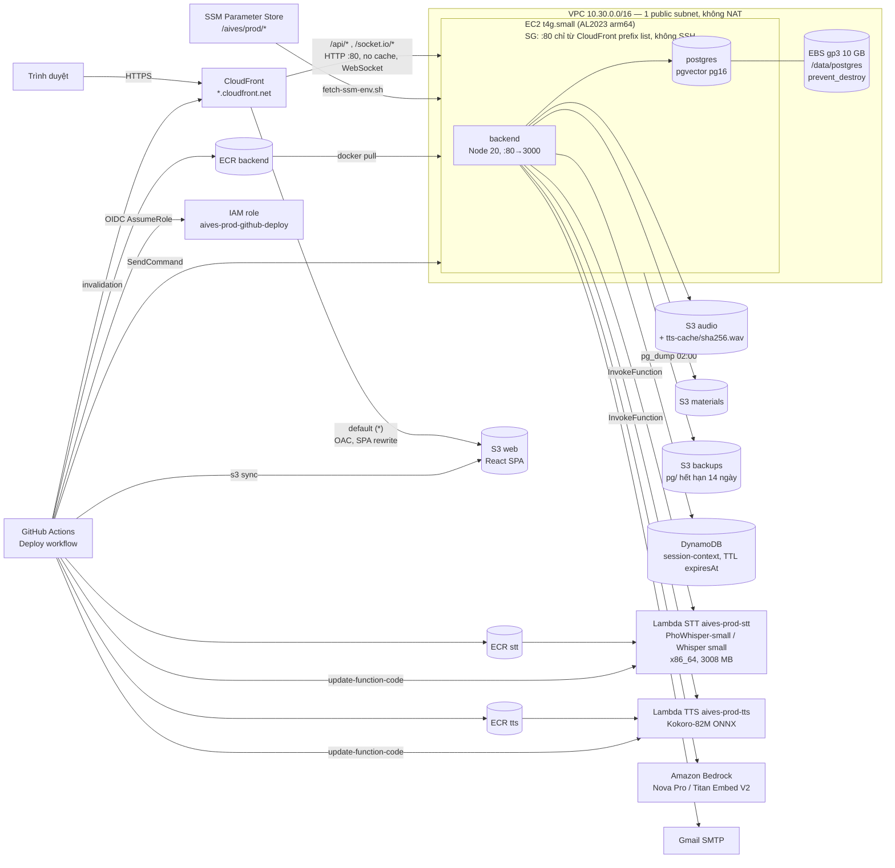

# AIVES — Kiến trúc triển khai AWS & Physical ERD (Bước 11–12)

Nguồn hạ tầng: `infrastructure/terraform/` (region mặc định `ap-southeast-1`, tiền tố `aives-<env>`).
Hướng dẫn deploy: README → "Deploy lên AWS (Bước 11)".

## Kiến trúc triển khai

Ghi chú:

- Không có nginx trong prod: CloudFront phục vụ SPA từ S3 và chuyển `/api/*`, `/socket.io/*` về EC2.
- Deep link của SPA được CloudFront Function viết lại thành `/index.html` (chỉ ở behavior S3), nên lỗi JSON 403/404 của API không bị thay bằng `index.html`.
- Giọng nói chạy hết trên Lambda: STT (PhoWhisper-small cho tiếng Việt, Whisper small cho tiếng Anh) và TTS (Kokoro-82M; bản fine-tune `contextboxai/Kokoro-Vietnamese` giọng `diem_trinh`, bản gốc `hexgrad/Kokoro-82M` giọng `af_heart`). Không còn Google TTS ở đường chính (adapter `google` vẫn chọn được); Web Speech của trình duyệt chỉ là dự phòng khi audio lỗi. Không dùng API Gateway, Transcribe, Polly, Step Functions hay SQS.
- Khi quản trị viên khởi động kỳ thi, backend làm nóng hai Lambda, việc nền `KEEP_WARM` gọi lại mỗi 5 phút tới `closes_at`, và `PREPARE_EXAM_AUDIO` tạo sẵn audio câu hỏi vào `tts-cache/`.
- Ảnh xuất từ sơ đồ này: [architecture-aws.png](architecture-aws.png).
- Shell vào máy chủ qua SSM Session Manager (`aws ssm start-session`). Máy chủ chỉ dùng IMDSv2 và instance role, không có access key.
- Chi phí ước tính: README → "Deploy lên AWS" → "Chi phí". Các quyết định thiết kế: `.agents/tasks/e2e-step11-deploy/plan.md`.

## Physical ERD (Postgres)

Xây từ `backend/db/migrations/001…018_*.sql` (27 bảng; 016–018 chỉ thêm cột, ràng buộc, chỉ mục). Ảnh xuất: [erd.png](erd.png). Mỗi bảng chỉ liệt kê PK, FK và vài cột chính.
Bảng `schema_migrations` do migration runner tạo không được vẽ.

```mermaid
erDiagram
  app_user {
    int app_user_id PK
    varchar email UK
    varchar code UK
    varchar role "ADMIN|LECTURER|STUDENT"
    varchar status "ACTIVE|LOCKED"
    bool must_change_password
  }
  auth_session {
    int auth_session_id PK
    int user_id FK
    text refresh_token_hash
    timestamptz expires_at
  }
  password_token {
    int password_token_id PK
    int user_id FK
    text token_hash
    varchar purpose
  }
  subject {
    int subject_id PK
    varchar code UK
    varchar name
  }
  subject_lecturer {
    int subject_lecturer_id PK
    int subject_id FK
    int lecturer_id FK
  }
  topic {
    int topic_id PK
    int subject_id FK
    varchar name
  }
  course_material {
    int course_material_id PK
    int subject_id FK
    int topic_id FK
    int uploaded_by FK
    text file_key
    varchar status
  }
  material_chunk {
    int material_chunk_id PK
    int material_id FK
    int subject_id FK
    int chunk_no
    vector embedding "1024, HNSW"
  }
  rubric {
    int rubric_id PK
    int subject_id FK
    int created_by FK
    numeric max_score
    bool is_locked
    int version
  }
  rubric_criterion {
    int rubric_criterion_id PK
    int rubric_id FK
    varchar criterion_name
    numeric weight_percent
  }
  performance_level {
    int performance_level_id PK
    int criterion_id FK
    varchar label
    numeric min_score
  }
  question_generation_job {
    int question_generation_job_id PK
    int topic_id FK
    int requested_by FK
    jsonb material_ids
    int generated_count
  }
  question {
    int question_id PK
    int topic_id FK
    int rubric_id FK
    int generation_job_id FK
    int created_by FK
    int reviewed_by FK
    text content
    varchar status "DRAFT..ARCHIVED"
    vector embedding "1024"
  }
  question_source_ref {
    int question_source_ref_id PK
    int question_id FK
    int chunk_id FK
    text excerpt
  }
  exam_session {
    int exam_session_id PK
    int subject_id FK
    int topic_id FK
    int created_by FK
    int scheduled_by FK
    int started_by FK
    varchar language "VI|EN"
    varchar status "DRAFT|SCHEDULED|OPEN|CLOSED"
    int main_question_count "1..10"
    int max_follow_ups_per_question "0..5"
    int max_follow_ups_total "0..20 or null"
    jsonb bloom_distribution
    int session_time_limit_sec
    timestamptz opens_at
    timestamptz closes_at
    timestamptz scheduled_at
    timestamptz started_at
    jsonb warm_status
  }
  exam_session_student {
    int exam_session_student_id PK
    int exam_session_id FK
    int student_id FK
  }
  exam_session_examiner {
    int exam_session_examiner_id PK
    int exam_session_id FK
    int lecturer_id FK
  }
  viva_interview {
    int viva_interview_id PK
    int exam_session_id FK
    int student_id FK
    varchar status
    int current_question_index
    timestamptz started_at
    timestamptz deadline_at
    timestamptz paused_at
  }
  assigned_question {
    int assigned_question_id PK
    int interview_id FK
    int question_id FK
    int order_no
    bool is_asked
  }
  qa_turn {
    int qa_turn_id PK
    int interview_id FK
    int assigned_question_id FK
    int sequence_no
    varchar turn_type
  }
  transcript {
    int transcript_id PK
    int interview_id FK
    text full_text
    bool is_complete
  }
  processing_failure {
    int processing_failure_id PK
    int interview_id FK
    int turn_id FK
    varchar stage
    varchar error_code
  }
  viva_result {
    int viva_result_id PK
    int interview_id FK, UK
    int finalized_by FK
    numeric ai_total_score
    numeric final_total_score
  }
  question_evaluation {
    int question_evaluation_id PK
    int result_id FK
    int assigned_question_id FK
    numeric ai_score
    numeric final_score
  }
  criterion_score {
    int criterion_score_id PK
    int evaluation_id FK
    int criterion_id FK
    int ai_level_id FK
    numeric ai_score
  }
  score_adjustment {
    int score_adjustment_id PK
    int criterion_score_id FK
    int adjusted_by FK
    numeric old_score
    numeric new_score
  }
  background_job {
    int background_job_id PK
    varchar type "INGEST|GENERATE|GRADE|EMAIL|KEEP_WARM|PREPARE_EXAM_AUDIO"
    jsonb payload
    varchar status
    int attempts
  }

  app_user ||--o{ auth_session : "has"
  app_user ||--o{ password_token : "has"
  subject ||--o{ subject_lecturer : "assigns"
  app_user ||--o{ subject_lecturer : "lecturer"
  subject ||--o{ topic : "contains"
  subject ||--o{ course_material : "has"
  topic ||--o{ course_material : "has"
  app_user ||--o{ course_material : "uploaded_by"
  course_material ||--o{ material_chunk : "split into"
  subject ||--o{ material_chunk : "scopes"
  subject ||--o{ rubric : "has"
  app_user ||--o{ rubric : "created_by"
  rubric ||--o{ rubric_criterion : "has"
  rubric_criterion ||--o{ performance_level : "has"
  topic ||--o{ question_generation_job : "for"
  app_user ||--o{ question_generation_job : "requested_by"
  topic ||--o{ question : "contains"
  rubric ||--o{ question : "grades"
  question_generation_job ||--o{ question : "generated"
  app_user ||--o{ question : "created/reviewed_by"
  question ||--o{ question_source_ref : "cites"
  material_chunk ||--o{ question_source_ref : "source"
  subject ||--o{ exam_session : "has"
  topic ||--o{ exam_session : "scopes"
  app_user ||--o{ exam_session : "created_by"
  exam_session }o--o| app_user : "scheduled_by"
  exam_session }o--o| app_user : "started_by"
  exam_session ||--o{ exam_session_student : "roster"
  app_user ||--o{ exam_session_student : "student"
  exam_session ||--o{ exam_session_examiner : "examiners"
  app_user ||--o{ exam_session_examiner : "lecturer"
  exam_session ||--o{ viva_interview : "has"
  app_user ||--o{ viva_interview : "student"
  viva_interview ||--o{ assigned_question : "asks"
  question ||--o{ assigned_question : "assigned"
  viva_interview ||--o{ qa_turn : "turns"
  assigned_question ||--o{ qa_turn : "about"
  viva_interview ||--o{ transcript : "has"
  viva_interview ||--o{ processing_failure : "logs"
  qa_turn ||--o{ processing_failure : "at"
  viva_interview ||--o| viva_result : "result"
  app_user ||--o{ viva_result : "finalized_by"
  viva_result ||--o{ question_evaluation : "has"
  assigned_question ||--o{ question_evaluation : "evaluates"
  question_evaluation ||--o{ criterion_score : "has"
  rubric_criterion ||--o{ criterion_score : "criterion"
  performance_level ||--o{ criterion_score : "ai_level"
  criterion_score ||--o{ score_adjustment : "adjusted"
  app_user ||--o{ score_adjustment : "adjusted_by"
```

Ngoài Postgres, ngữ cảnh phiên phỏng vấn (session context) nằm ở DynamoDB `aives-<env>-session-context` (khóa `sessionId` có giá trị `interview#<id>`, TTL `expiresAt`), và file âm thanh / tài liệu nằm ở S3 audio / materials; audio câu hỏi đã tổng hợp nằm ở `tts-cache/<sha256>.wav` trong bucket audio.

## Ảnh xuất và bản vẽ cũ

Hai sơ đồ Mermaid ở trên là nguồn chuẩn. `docs/erd.png` (ERD) và `docs/architecture-aws.png` (triển khai) được xuất từ chúng bằng mermaid-cli, ví dụ `npx -y @mermaid-js/mermaid-cli@11.4.2 -i erd.mmd -o docs/erd.png -w 2400 -b white`. Sửa sơ đồ thì xuất lại ảnh.

`docs/SWD392-Physical_ERD.drawio.png` đã cũ, được thay bằng `docs/erd.png`; file chỉ giữ để tham khảo. `docs/00_Full_Flow_Class_Diagram.drawio.png` cũng chưa cập nhật theo các migration mới.
