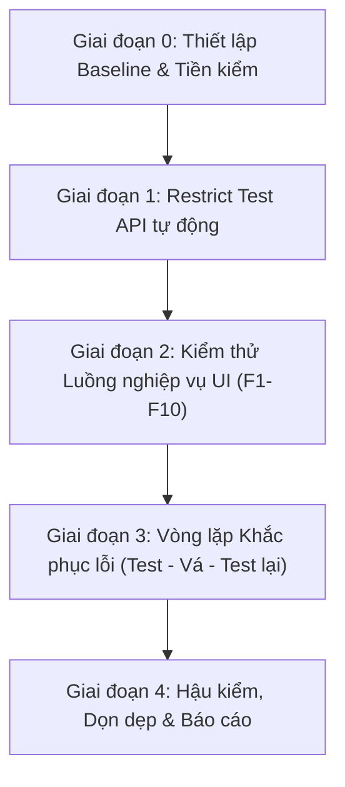

# AIVES: Kế hoạch Thực thi E2E v2 (Restrict Test & Toàn diện Luồng Nghiệp vụ)

Tài liệu hướng dẫn thực thi kiểm thử đầu-cuối (E2E Plan v2) dành cho AI Agent và nhóm phát triển. Kế hoạch kết hợp **Restrict Test tự động** (phân quyền, phạm vi môn học, máy trạng thái, ràng buộc biên) với **Kiểm thử luồng nghiệp vụ trên UI** (F1 → F10) và **Vòng lặp khắc phục lỗi (Test → Vá → Test lại)**.

---

## 1. Thông tin chung & Môi trường

- **Repository**: `https://github.com/tmqthedev/swd392_team7_product` (nhánh `main`).
- **Production URL**: `https://d36ezmiqpl9miu.cloudfront.net`
- **AWS Region**: `ap-southeast-1`, Account ID: `554013701253`, EC2: `i-0797c55ad243db382`.
- **SSM Prefix**: `/aives/prod/`
- **Tài liệu tham chiếu**:
  - `docs/AIVES - Đặc tả luồng nghiệp vụ.md` (Đặc tả chi tiết F1 → F10).
  - `docs/fix-e2e-plan.md` (Kế hoạch vá lỗi tạo kỳ thi & phân quyền môn).

---

## 2. Quy tắc bắt buộc khi thực thi

1. **Bảo mật thông tin**:
   - Tuyệt đối không in mật khẩu, `JWT_SECRET`, cookie giá trị thật, hoặc nội dung file `.env` vào terminal, log hoặc artifact markdown.
   - Khi đọc tham số SSM chỉ dùng `get-parameter` không kèm `--with-decryption`.
2. **Dữ liệu kiểm thử (`TEST_`)**:
   - Mọi thực thể tạo ra trong quá trình kiểm thử (môn học, người dùng, tài liệu, kỳ thi, câu hỏi) bắt buộc phải có tiền tố `TEST_` (ví dụ: `TEST_SWD392`, `TEST_GV01`, `TEST_SV01`).
   - Email kiểm thử dùng hộp thư thật của chủ dự án dưới dạng alias: `ten+test_gv@gmail.com`.
3. **Quy trình sửa đổi mã nguồn (Strict PR)**:
   - Mọi sửa đổi code phải được thực hiện trên nhánh riêng (`fix/step13-...` hoặc `feat/step13-...`), viết unit test / e2e test tái hiện lỗi trước, và tạo Pull Request vào `main`.
   - CI GitHub Actions bắt buộc phải xanh trước khi chủ dự án merge.
4. **Ghi nhận lỗi có cấu trúc (`docs/ket-qua-e2e-v2.md`)**:
   - Mọi lỗi phát hiện được trong quá trình kiểm thử phải được lập tức ghi nhận theo mẫu chuẩn:
     `ID | Luồng (F1-F10) | Bước thực hiện | Kết quả mong đợi | Kết quả thực tế | HTTP Code & Error Code | Log trích xuất | Mức độ nghiêm trọng (Cao / Trung bình / Thấp) | PR khắc phục`.
5. **Dọn dẹp triệt để (Zero Residue)**:
   - Sau khi hoàn thành kiểm thử, toàn bộ dữ liệu mang tiền tố `TEST_` phải được xóa sạch, số dòng của các bảng dữ liệu phải trở về đúng với baseline ban đầu.

---

## 3. Các giai đoạn thực thi

### Giai đoạn 0: Thiết lập Baseline & Tiền kiểm

1. **Kiểm tra trạng thái CI & Codebase**:
   - Đảm bảo nhánh `main` đang ở commit mới nhất và workflow CI xanh.
   - Chạy `npm test` trong `backend/` (486+ test pass).
   - Chạy `npm run lint` và `npm run build` trong `frontend/`.
2. **Chụp Baseline số dòng các bảng trong CSDL**:
   - Chạy script đếm số dòng hiện tại trên cơ sở dữ liệu:
     - `app_user`
     - `subject`
     - `subject_lecturer`
     - `subject_student`
     - `topic`
     - `material` & `material_chunk`
     - `question` & `rubric`
     - `exam_session` & `exam_session_student` & `exam_session_examiner`
     - `viva_interview` & `qa_turn` & `viva_result`
     - `background_job` & `processing_failure`
   - Lưu các chỉ số này vào `docs/ket-qua-e2e-v2.md` làm mốc đối soát.
3. **Quét Server Log 72 giờ gần nhất**:
   - Đọc log EC2 backend qua SSM để tổng hợp các mã lỗi 4xx/5xx gần nhất. Đảm bảo request log hiện tại đã ghi nhận `errorCode`.

---

### Giai đoạn 1: Restrict Test API tự động

Chạy script tự động `scripts/e2e-restrict.mjs` để kiểm tra toàn bộ các chốt chặn an ninh và quy tắc nghiệp vụ:

1. **Ma trận Phân quyền Role × Endpoint**:
   - Mọi request không kèm cookie `access_token` $\rightarrow$ 401 `UNAUTHORIZED`.
   - Sinh viên gọi endpoint Admin hoặc Giảng viên $\rightarrow$ 403 `FORBIDDEN`.
   - Giảng viên gọi endpoint Admin $\rightarrow$ 403 `FORBIDDEN`.
   - Mọi request mutating (`POST`, `PUT`, `PATCH`, `DELETE`) thiếu header `Origin` hoặc có `Origin` lạ $\rightarrow$ 403 `CSRF_FORBIDDEN`.
2. **Phạm vi Môn học (Subject Scoping)**:
   - Giảng viên A không thể đọc/sửa/xoá kỳ thi, câu hỏi, tài liệu, rubric thuộc môn của Giảng viên B $\rightarrow$ 403 / 404.
   - Sinh viên chỉ thấy kỳ thi có tên mình trong Roster; không thấy câu hỏi hay rationale (`toStudentInterviewView`).
3. **Tính toàn vẹn Máy trạng thái (State Machine)**:
   - Chuyển trạng thái bất hợp pháp $\rightarrow$ 409 `INVALID_TRANSITION` (ví dụ: Chỉnh sửa kỳ thi đang `SCHEDULED`, Start kỳ thi đang `DRAFT`, Close kỳ thi đã `CLOSED`, Duyệt câu hỏi đã `REJECTED`).
4. **Kiểm tra Ràng buộc Biên & Dữ liệu không hợp lệ**:
   - Khung giờ thi ngược (`closes_at <= opens_at`) hoặc `closes_at` trong quá khứ $\rightarrow$ 400 `VALIDATION_ERROR`.
   - Cấu hình ngoài khoảng (ví dụ: thời gian trả lời âm, số câu hỏi vượt ngưỡng) $\rightarrow$ 400 `VALIDATION_ERROR`.
   - Gán Roster sinh viên chưa ghi danh môn $\rightarrow$ 422 `VALIDATION_ERROR`.
   - Gán Giám khảo không được phân công môn $\rightarrow$ 400 `VALIDATION_ERROR`.

---

### Giai đoạn 2: Kiểm thử Luồng nghiệp vụ UI (F1 → F10) với dữ liệu `TEST_`

Thực hiện kiểm thử người dùng thực tế trên giao diện Frontend theo checklist từng luồng:

- [ ] **F1 (Auth)**: Đăng nhập bằng mã/email, đổi mật khẩu, thử sai 5 lần để xác nhận tài khoản khoá 30 phút.
- [ ] **F2 (Admin Users)**: Admin tạo giảng viên `TEST_GV01` (nhận email SET link), import danh sách sinh viên qua Excel.
- [ ] **F3 (Admin Subjects)**: Admin tạo môn học `TEST_SWD`, gán `TEST_GV01`, ghi danh sinh viên `TEST_SV01` vào môn.
- [ ] **F4 (Topics)**: Kiểm tra danh sách Topic của môn học hoạt động đồng bộ.
- [ ] **F5 (Materials)**: Giảng viên upload PDF học liệu `TEST_DOC.pdf`, theo dõi job `INGEST_MATERIAL` hoàn tất sang `READY`.
- [ ] **F6 (Questions & Rubrics)**: Giảng viên tạo rubric (tổng trọng số 100%), sinh câu hỏi RAG từ tài liệu, duyệt câu hỏi (gắn rubric), kiểm tra cảnh báo trùng lặp `NEAR_DUPLICATE`.
- [ ] **F7 (Exam Session Setup)**:
  - Giảng viên mở form tạo kỳ thi: Dropdown Subject hiện đúng `TEST_SWD`.
  - Dropdown Topic hiển thị số lượng câu approved và thống kê Bloom; nếu thiếu câu xuất hiện cảnh báo vàng.
  - Chọn `TEST_SV01` trong bảng sinh viên bằng checkbox (dùng ô tìm kiếm và chọn tất cả).
  - Chọn giám khảo bằng checkbox.
  - Submit Schedule: Kỳ thi chuyển sang `SCHEDULED`. Thử Withdraw về `DRAFT` rồi submit lại.
- [ ] **F8 (Admin Schedule)**: Admin xem kỳ thi trong Exam Schedule, bấm *Start exam* $\rightarrow$ Kỳ thi sang `OPEN`, rubric tự động khóa `is_locked = true`, Lambda STT/TTS được warm.
- [ ] **F9 (Student Viva Voice Interview - Cần người thật)**:
  - Sinh viên `TEST_SV01` đăng nhập, vào Dashboard thấy kỳ thi `TEST_`.
  - Thực hiện Mic check thành công.
  - Vào thi: Nghe câu hỏi phát qua TTS (Kokoro/Google), trả lời qua micro, kiểm tra transcript hiển thị chính xác.
  - Thử F5 tải lại trang giữa lượt: Xác nhận trạng thái phỏng vấn được phục hồi nguyên vẹn, đồng hồ tiếp tục đếm đúng thời gian thực.
  - Hoàn thành lượt thi $\rightarrow$ Trạng thái sang `COMPLETED`.
- [ ] **F10 (Grading & Review)**:
  - Background job `GRADE_INTERVIEW` tự động chấm điểm theo từng tiêu chí rubric.
  - Giảng viên vào trang Review xem điểm gợi ý, lý do AI hỏi câu phụ.
  - Giảng viên điều chỉnh điểm (bắt buộc nhập lý do `reason`), kiểm tra điểm tổng được tính lại tự động.
  - Giảng viên Finalize chốt điểm. Sinh viên xem được kết quả thi trong mục kết quả của mình.

---

### Giai đoạn 3: Vòng lặp Khắc phục lỗi (Test → Vá → Test lại)

1. Mọi bug phát sinh trong Giai đoạn 1 & 2 được phân loại theo mức độ:
   - **Mức độ Cao (Critical/High)**: Chặn luồng nghiệp vụ chính, lỗi dữ liệu, hổng phân quyền/bảo mật.
   - **Mức độ Trung bình (Medium)**: Sai khác trạng thái UI, thiếu thông báo lỗi rõ ràng, bất tiện thao tác.
   - **Mức độ Thấp (Low)**: Lỗi chính tả, căn chỉnh giao diện nhỏ.
2. Với mỗi nhóm bug theo luồng:
   - Tạo nhánh `fix/step13-...`.
   - Viết test tái hiện (unit test hoặc e2e test).
   - Sửa mã nguồn ở mức tối thiểu cần thiết để giải quyết đúng nguyên nhân gốc rễ.
   - Mở PR, chờ CI xanh, chủ dự án merge và kích hoạt Deploy.
   - Chạy lại checklist của luồng đó trên môi trường sau Deploy.
3. Lặp lại chu trình cho đến khi **không còn bug mức Cao hoặc Trung bình**.

---

### Giai đoạn 4: Hậu kiểm & Dọn dẹp dữ liệu

1. **Kiểm tra tính ổn định hệ thống**:
   - `processing_failure` phát sinh mới = 0.
   - Toàn bộ `background_job` của đợt test đạt trạng thái `DONE`.
   - Server log không ghi nhận lỗi ngoại lệ không mong muốn.
2. **Dọn dẹp dữ liệu `TEST_`**:
   - Xóa câu hỏi, rubric, tài liệu và môn học `TEST_` qua API.
   - Với các bản ghi phiên thi và user không thể xóa qua API: Thực thi script dọn dẹp SQL an toàn trong transaction (kiểm tra `ROLLBACK` trước, sau đó mới `COMMIT`).
   - Xóa các audio files trả lời và file tài liệu `TEST_` trên S3 (giữ nguyên cache TTS `tts-cache/`).
3. **Đối chiếu Baseline**:
   - Chạy lại truy vấn đếm dòng các bảng; số lượng bản ghi phải hoàn toàn khớp với Baseline ghi nhận ở Giai đoạn 0.
4. **Bàn giao báo cáo**:
   - Hoàn thiện tài liệu `docs/ket-qua-e2e-v2.md` và trình chủ dự án nghiệm thu.

---

## 4. Backlog kỹ thuật thực hiện kèm trong Step 13

Từ các phát hiện trong báo cáo kỹ thuật trước, các hạng mục backlog sau được đưa vào rà soát và xử lý đồng thời:
1. **Bộ lọc `topicId` bị bỏ qua**: Sửa logic repository query câu hỏi khi truyền `topicId`.
2. **`order_index` luôn bằng 1**: Đảm bảo thứ tự tiêu chí trong Rubric được tính toán tự tăng chính xác khi import/tạo mới.
3. **Job generation `FAILED` bị coi là terminal**: Xử lý để trạng thái lỗi hiển thị đúng và cho phép thử lại.
4. **`pause_count` trong tín hiệu giọng nói**: Chuẩn hóa cách tính độ ngắt quãng của câu trả lời.
5. **Giao diện quản lý Topic**: Lập kế hoạch bổ sung view quản lý Topic riêng cho Giảng viên.
6. **Xử lý dứt điểm phiên thi khi hết giờ**: Background worker tự động thu dọn và finalize các phiên thi bị bỏ dở khi đã quá hạn `session_time_limit_sec`.
7. **Retry budget cho chấm điểm**: Tinh chỉnh số lần retry tối đa khi gọi LLM chấm điểm để tránh lãng phí token khi gặp lỗi cố định.
