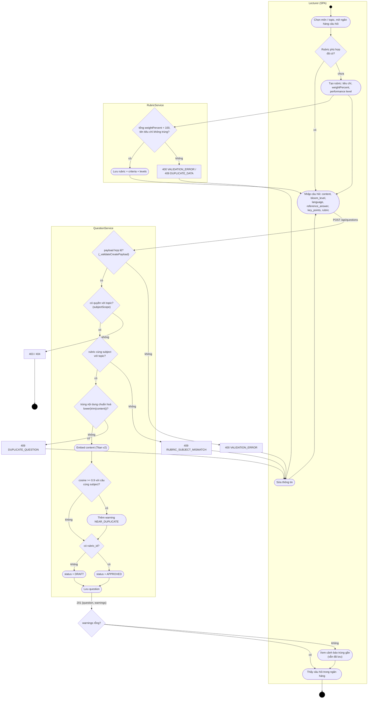
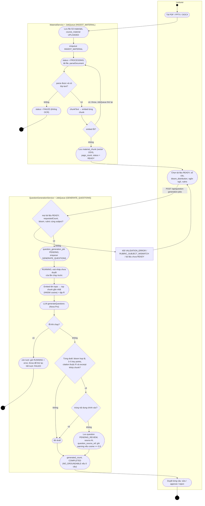
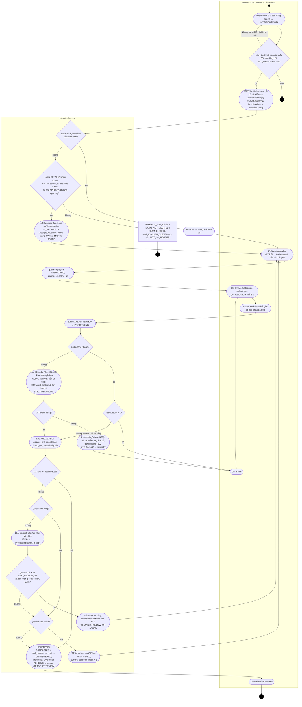
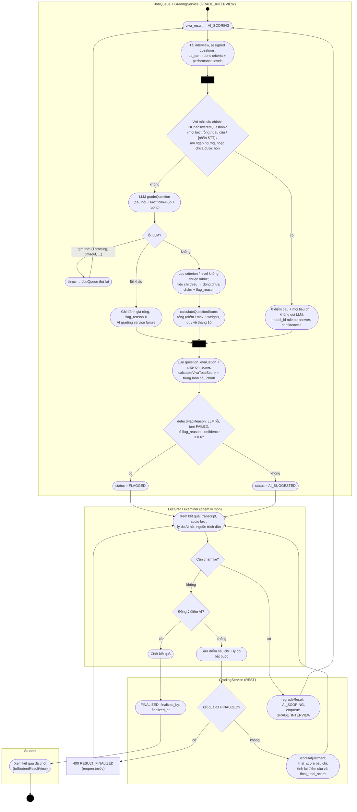

# UML Activity Diagrams

Bốn luồng nghiệp vụ chính, theo đúng thứ tự kiểm tra trong code. Ba luồng đầu tương ứng ba workflow trong [workflow-definition.docx](../workflow-definition.docx); luồng RAG là phần sinh câu hỏi bằng AI (Step 4). Mỗi khung (partition) là một bên tham gia; mã lỗi là `code` mà API trả về.

Ký hiệu UML: chấm đen = initial node, vòng tròn có viền = activity final, hình thoi = decision/merge, thanh đen = fork/join, hình chữ nhật bo góc = action.

## 1. Tạo câu hỏi và gắn rubric

Nguồn: `QuestionService.createQuestion`, `approve`; `RubricService.createRubric`; `frontend/src/pages/lecturer/`.

Câu `DRAFT` (chưa có rubric) chỉ chuyển sang `APPROVED` qua `POST /api/questions/:id/approve` sau khi gắn rubric; thiếu rubric trả `409 RUBRIC_REQUIRED`. Chỉ câu `APPROVED` vào được kỳ thi.

## 2. Tải tài liệu và sinh câu hỏi bằng RAG

Nguồn: `MaterialService.upload`, handler `INGEST_MATERIAL` và `GENERATE_QUESTIONS` (`jobs/handlers.js`), `QuestionGenerationService.createJob` / `persistDrafts`.

## 3. Thi vấn đáp với AI (một lượt hỏi đáp)

Nguồn: `InterviewService.startOrResume`, `markQuestionPlayed`, `submitAnswer`, `_endInterview`; `interview/decideNextStep.js`; `realtime/interviewSocket.js`; `frontend/src/pages/student/`, `frontend/src/components/exam/DeviceCheckModal.jsx`, `frontend/src/shared/utils/audioDevices.js`.

Thứ tự quyết định sau mỗi câu trả lời là cố định: (1) quá `deadline_at` → kết thúc; (2) câu trả lời rỗng → câu chính tiếp; (3) LLM đề xuất hỏi thêm VÀ còn lượt follow-up → hỏi thêm; (4) còn lại → câu chính tiếp, hết câu chính → kết thúc.

Phòng thi mở trực tiếp (không có cờ đã kiểm tra trong tab) hiển thị bước kiểm tra micro tại chỗ trước `interview:ready`. Ngoài luồng trên: việc nền `EXPIRE_INTERVIEWS` chạy mỗi `INTERVIEW_SWEEP_INTERVAL_SEC` và gọi `_endInterview(DEADLINE_REACHED)` cho phiên đã quá `deadline_at + grace`; `pauseInterview` / `resumeInterview` tạm dừng và bù thời gian khi hệ thống lỗi.

## 4. Chấm điểm bằng AI và giảng viên duyệt

Nguồn: `GradingService.gradeInterview`, `adjustCriterionScore`, `finalizeResult`, `reopenResult`, `regradeResult`; `domain/scoringRules.js`.

Thanh đen trong sơ đồ 4 là vùng lặp "với mỗi câu chính" (expansion region, chạy tuần tự trong code). Giảng viên có thể `reopenResult` một kết quả `FINALIZED` để sửa tiếp; kết quả quay về `FLAGGED` nếu còn `flag_reason`, ngược lại `AI_SUGGESTED`.
