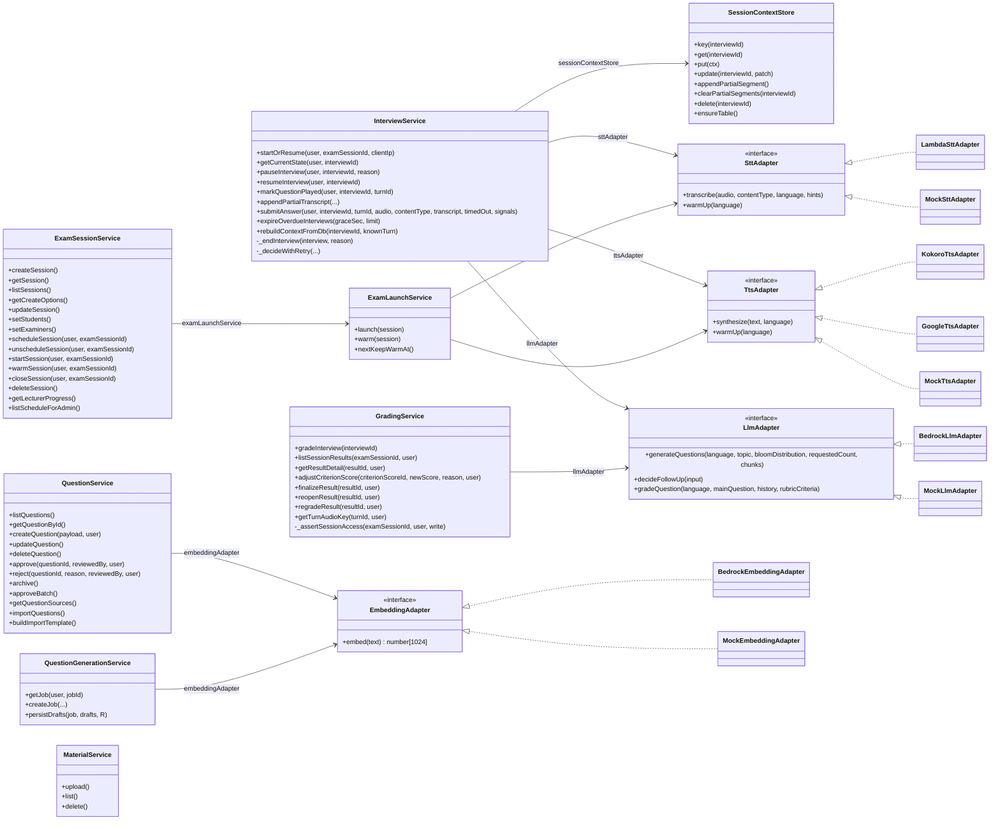
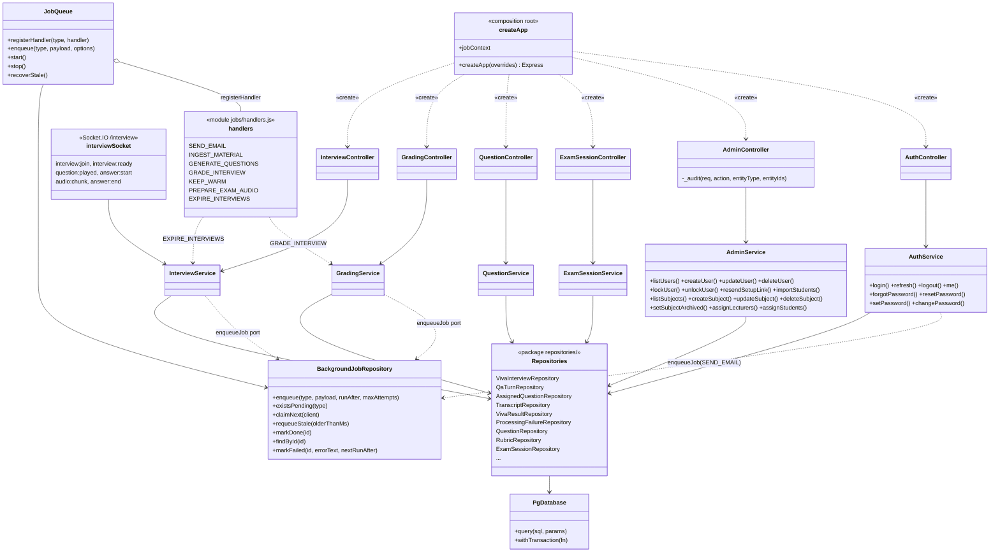

# UML Design Class Diagram (backend)

Sơ đồ lớp thiết kế của `backend/src`: lớp thật, phương thức public thật (lấy từ code), và quan hệ phụ thuộc mà `createApp(overrides)` trong `src/app.js` nối với nhau. Luồng gọi luôn là route → controller → service → repository. Các adapter AI là interface có nhiều hiện thực, chọn bằng biến môi trường (`STT_PROVIDER`, `TTS_PROVIDER`, `LLM_PROVIDER`, `EMBEDDING_PROVIDER`); hiện thực `Mock*` chỉ dùng trong test.

Sơ đồ lớp miền (bảng, thuộc tính, enum) nằm ở [class-diagram.drawio](class-diagram.drawio).

## 1. Service và cổng (port) AI

## 2. Lớp web, service, repository và hàng đợi việc nền

Service không giữ handle của `JobQueue`; chúng nhận cổng `enqueueJob(type, payload)` do `BackgroundJobRepository` cung cấp (`createApp`). `JobQueue` chỉ chạy trong `server.js` khi có Postgres thật.
