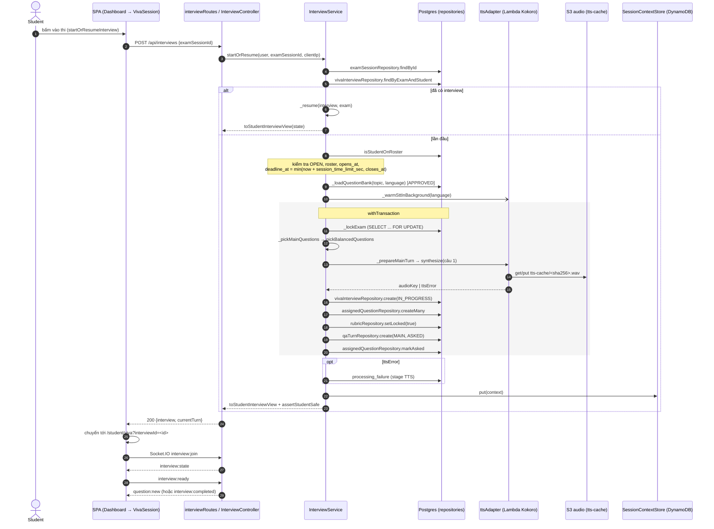
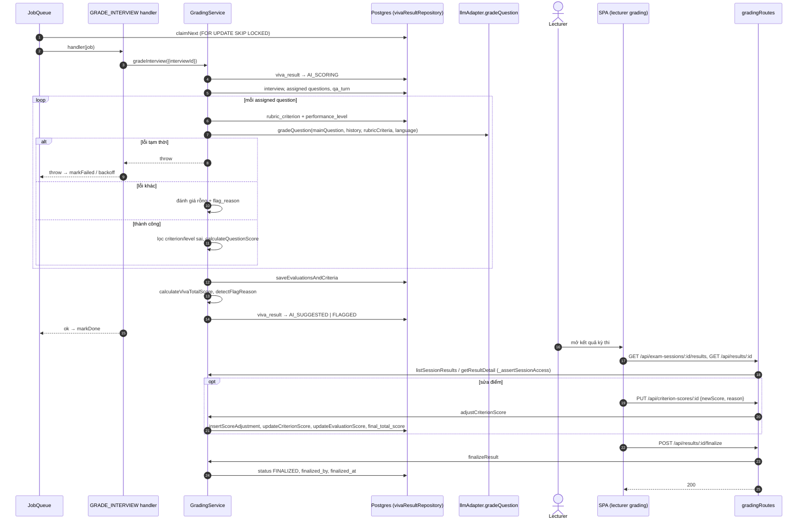

# UML Sequence Diagrams

Tên lifeline là lớp/module thật trong repo; tên message là hàm, endpoint hoặc sự kiện Socket.IO thật. `alt` / `opt` / `loop` là combined fragment của UML.

Nguồn: `frontend/src/pages/student/`, `backend/src/realtime/interviewSocket.js`, `backend/src/services/interviewService.js`, `backend/src/services/gradingService.js`, `backend/src/jobs/`.

## 1. Bắt đầu hoặc tiếp tục phiên thi

## 2. Một lượt trả lời (Socket.IO)

```mermaid
sequenceDiagram
  autonumber
  actor St as Student
  participant UI as SPA (VivaSession, MediaRecorder)
  participant WS as interviewSocket (/interview)
  participant IS as InterviewService
  participant DB as Postgres
  participant S3 as S3 audio
  participant STT as sttAdapter (Lambda PhoWhisper / Whisper)
  participant LLM as llmAdapter (Bedrock Nova Pro)
  participant TTS as ttsAdapter (Lambda Kokoro)
  participant SC as SessionContextStore

  UI->>UI: phát audio câu hỏi (lỗi → Web Speech)
  UI->>WS: question:played {turnId}
  WS->>IS: markQuestionPlayed
  IS->>DB: transitionStatus(ASKED → ANSWERING, answer_deadline_at)
  IS->>SC: update(currentTurnId, answerDeadlineAt)
  WS-->>UI: interview:state
  St->>UI: nói
  UI->>WS: answer:start
  loop mỗi 1 s
    UI->>WS: audio:chunk
  end
  UI->>WS: answer:end
  WS-->>UI: turn:processing
  WS->>IS: submitAnswer(audio, contentType, timedOut, signals)
  IS->>DB: transitionStatus(ASKED|ANSWERING → PROCESSING)
  alt audio rỗng / hỏng và retry_count < 1
    IS->>DB: processing_failure (AUDIO_INPUT), turn → ANSWERING
    IS-->>WS: view + retryPrompt
    WS-->>UI: turn:retry
  else có audio
    loop tối đa 3 lần
      IS->>S3: putObject(interviews/<id>/turns/<turn>/answer.webm)
    end
    loop tối đa 2 lần
      IS->>STT: transcribe(audio, language, hints = key_points)
    end
    alt STT lỗi cả 2 lần
      IS->>DB: processing_failure (STT), turn về trạng thái cũ, retry_count + 1
      IS-->>WS: 502 STT_FAILED
      WS-->>UI: turn:retry
    end
  end
  IS->>DB: qaTurnRepository.update(ANSWERED, answer_text, confidence, timed_out, signals)
  opt còn hạn, câu trả lời không rỗng, còn lượt follow-up
    IS->>LLM: decideFollowUp(question, rubric, sourceChunks, history)
    Note right of LLM: lỗi / timeout / JSON sai → thử lại 1 lần,<br/>lần 2 lỗi → processing_failure (FOLLOW_UP_LLM)
    LLM-->>IS: {next_action, follow_up_question, covered_key_points, rationale}
  end
  IS->>IS: decideNextStep(now, deadlineAt, answerText, caps, llmDecision)
  alt END_SESSION hoặc hết câu chính
    IS->>DB: _endInterview (COMPLETED, UNANSWERED, transcript, viva_result PENDING)
    IS->>DB: enqueueJob(GRADE_INTERVIEW)
    WS-->>UI: interview:completed
  else ASK_FOLLOW_UP
    IS->>IS: validateGrounding, buildFollowUpRationale
    IS->>TTS: synthesize(follow_up_question)
    IS->>DB: qa_turn FOLLOW_UP ASKED, current_follow_up_count + 1
    WS-->>UI: question:new
  else NEXT_MAIN
    IS->>TTS: _prepareMainTurn (cache hit sau PREPARE_EXAM_AUDIO)
    IS->>DB: qa_turn MAIN ASKED, markAsked, current_question_index + 1
    WS-->>UI: question:new
  end
  IS->>SC: update(context, coveredKeyPoints)
  WS-->>UI: interview:state
  Note over WS,UI: lỗi khác trong answer:end → turn:error {message, code}
```

## 3. Chấm điểm nền và giảng viên chốt

