# UML Sequence Diagrams

Tên lifeline là lớp/module thật trong repo; tên message là hàm, endpoint hoặc sự kiện Socket.IO thật. `alt` / `opt` / `loop` là combined fragment của UML.

Nguồn: `frontend/src/pages/`, `frontend/src/components/exam/DeviceCheckModal.jsx`, `frontend/src/contexts/AuthContext.jsx`, `frontend/src/services/authApi.js`, `backend/src/realtime/interviewSocket.js`, `backend/src/services/` (auth, admin, material, questionGeneration, question, examSession, examLaunch, interview, grading), `backend/src/jobs/`, `backend/src/server.js`.

## 1. Bắt đầu hoặc tiếp tục phiên thi

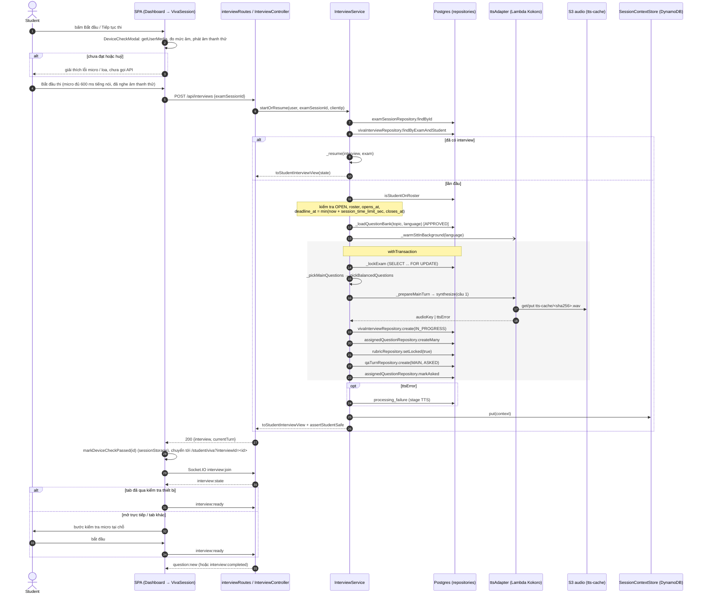

## 2. Một lượt trả lời (Socket.IO)

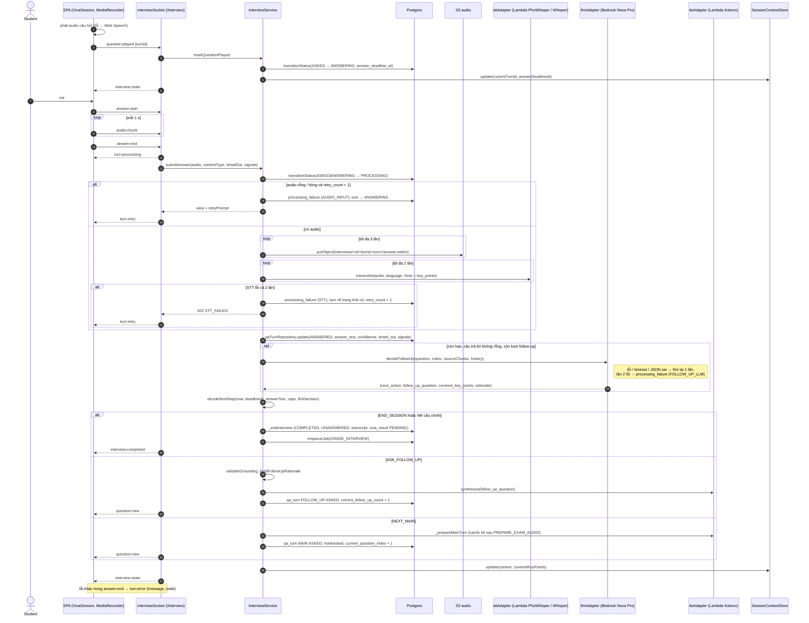

## 3. Chấm điểm nền và giảng viên chốt

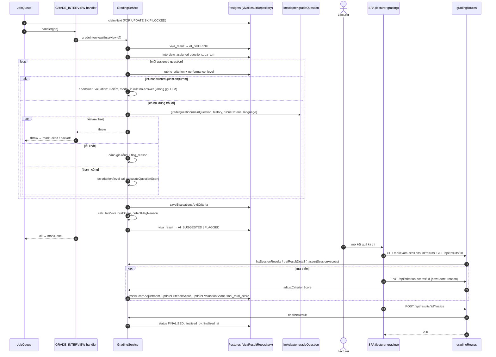

## 4. Đăng nhập và làm mới phiên (refresh token xoay vòng)

`AuthService.login` / `refresh` (`backend/src/services/authService.js`). Token nằm trong cookie httpOnly (access 15 phút, refresh 7 ngày). SPA gọi `/auth/me` khi tải trang và tự làm mới phiên qua `refreshSession` (`frontend/src/services/authApi.js`): khi một lời gọi API nhận `401` (`authedFetch`, trừ các endpoint login/refresh/logout/forgot/reset/set-password), mỗi 10 phút khi đã đăng nhập (`AuthContext`), và khi bắt tay Socket.IO phòng thi bị từ chối. Các `401` đồng thời dùng chung một lần refresh.

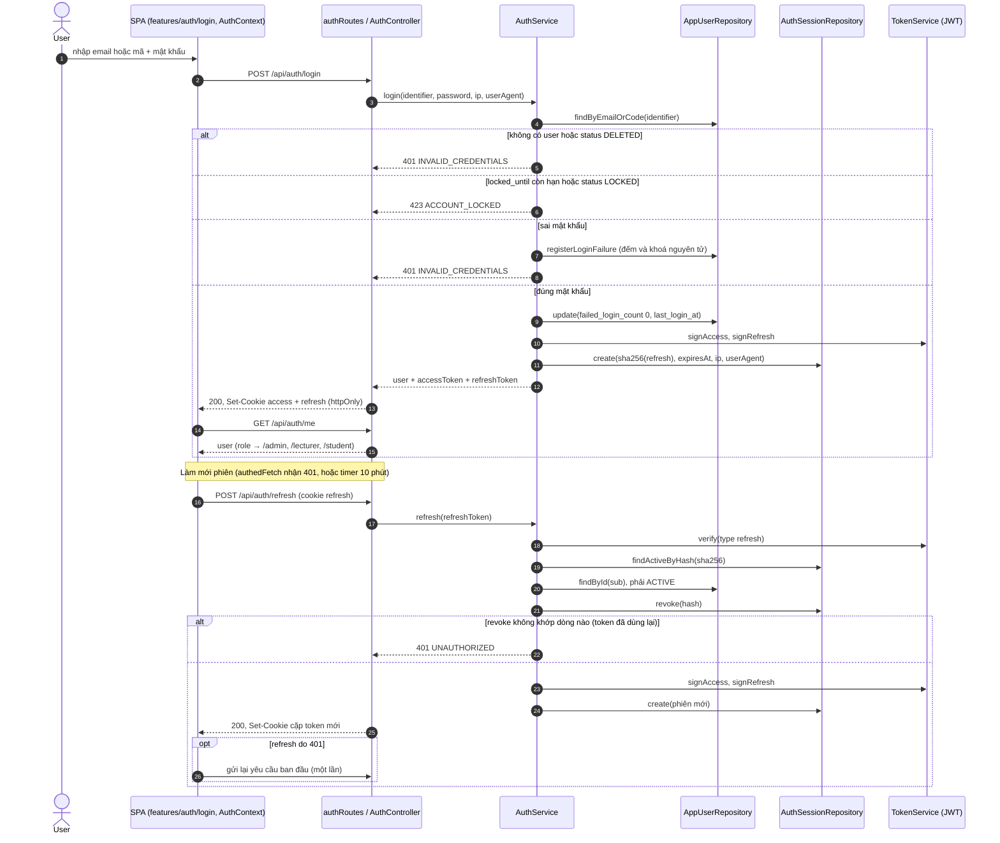

## 5. Quên mật khẩu và gửi email nền

`AuthService.forgotPassword` / `resetPassword`, handler `SEND_EMAIL` (`backend/src/jobs/handlers.js`). Phản hồi luôn giống nhau để không lộ tài khoản có tồn tại hay không. Luồng đặt mật khẩu lần đầu (`set-password`, purpose `SET`) đi y hệt.

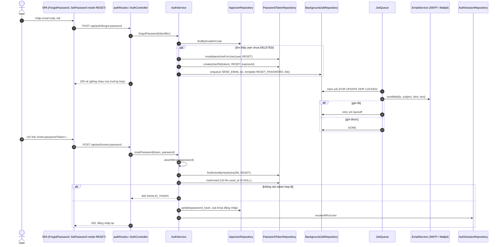

## 6. Admin tạo người dùng

`AdminController.createUser` → `AdminService.createUser` (`backend/src/services/adminService.js`). Không có mật khẩu trong email, chỉ có link đặt mật khẩu một lần. Ghi audit sau khi ghi thành công, ngoài transaction.

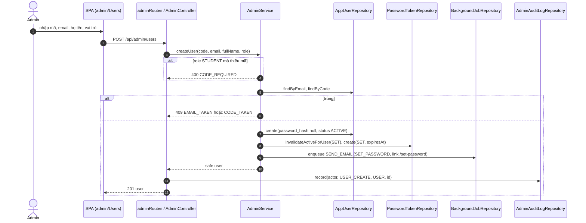

## 7. Tải tài liệu môn học và ingest (RAG)

`MaterialService.upload` và handler `INGEST_MATERIAL`. Lỗi nội dung (không parse được, không có lớp chữ) đánh dấu `FAILED` và không retry. Lỗi tạm thời (S3, embedding) ném ra để hàng đợi retry.

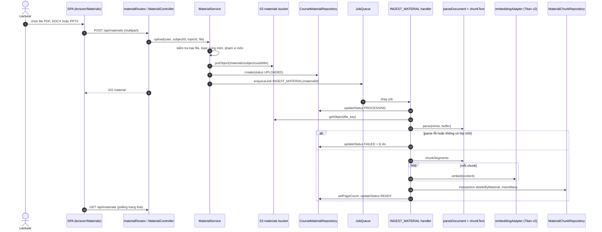

## 8. Sinh câu hỏi bằng AI từ tài liệu

`QuestionGenerationService.createJob` / `persistDrafts` và handler `GENERATE_QUESTIONS`. Câu hỏi sinh ra luôn ở trạng thái `PENDING_REVIEW`, giảng viên duyệt sau.

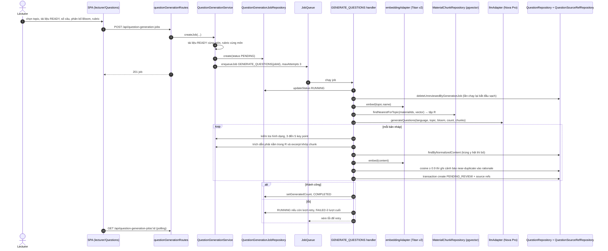

## 9. Tạo câu hỏi thủ công và duyệt

`QuestionService.createQuestion` / `approve`. Trùng nội dung chuẩn hoá thì chặn, gần trùng chỉ cảnh báo.

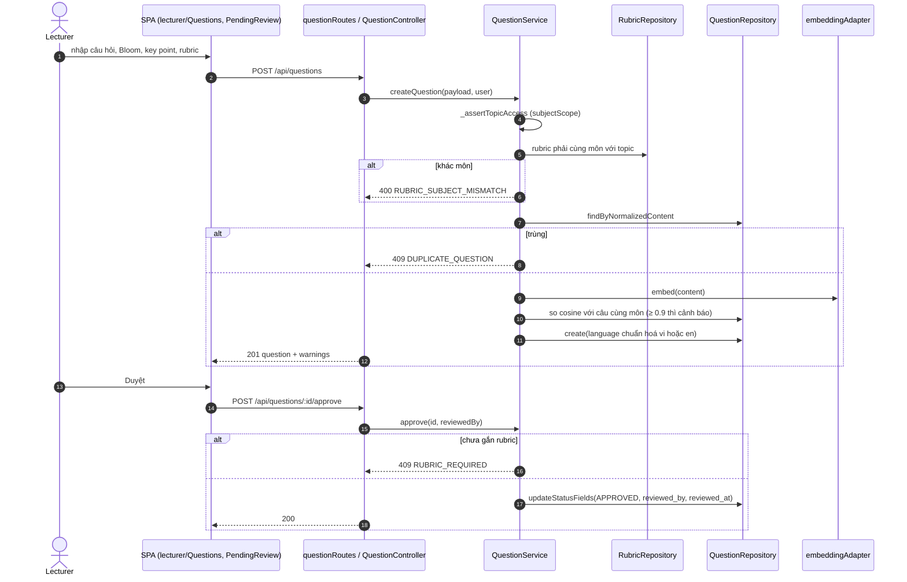

## 10. Lên lịch và mở kỳ thi

`ExamSessionService.scheduleSession` / `startSession`, `ExamLaunchService.launch`, handler `KEEP_WARM` và `PREPARE_EXAM_AUDIO`. Ngôn ngữ kỳ thi được đồng bộ lại từ ngân hàng câu hỏi ở cả hai bước. `launch` chạy sau commit, không chặn phản hồi và không bao giờ ném lỗi.

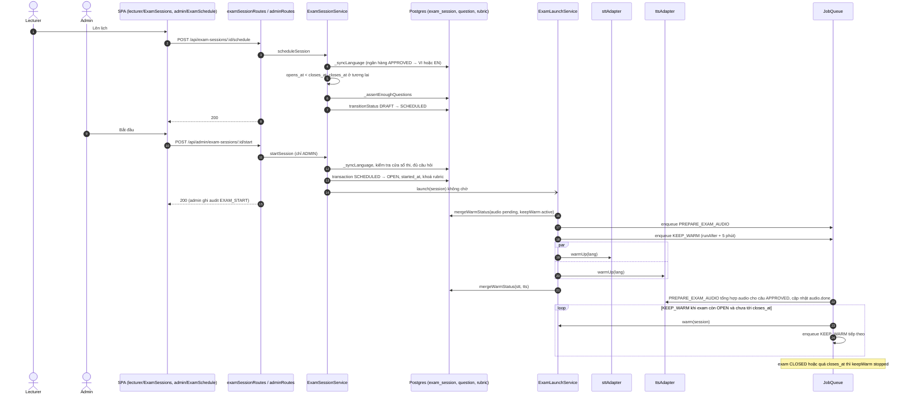

## 11. Quét bài thi quá hạn (EXPIRE_INTERVIEWS)

Handler `EXPIRE_INTERVIEWS` gọi `InterviewService.expireOverdueInterviews`. `server.js` gieo job đầu tiên khi khởi động nếu chưa có job chờ. Đóng kỳ thi không tự kết thúc bài đang làm, chính job này kết thúc bài quá hạn.

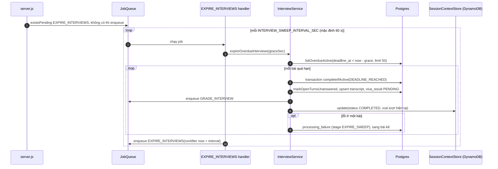
