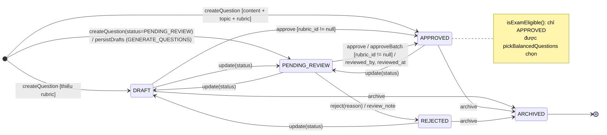
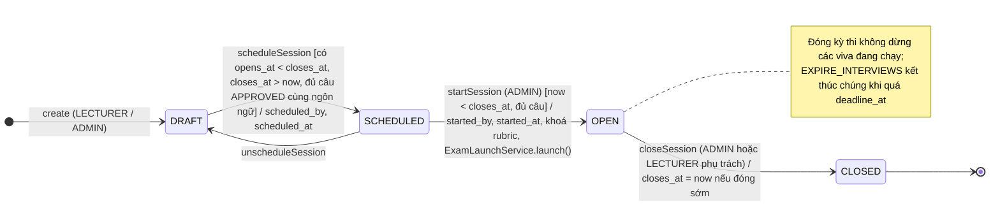
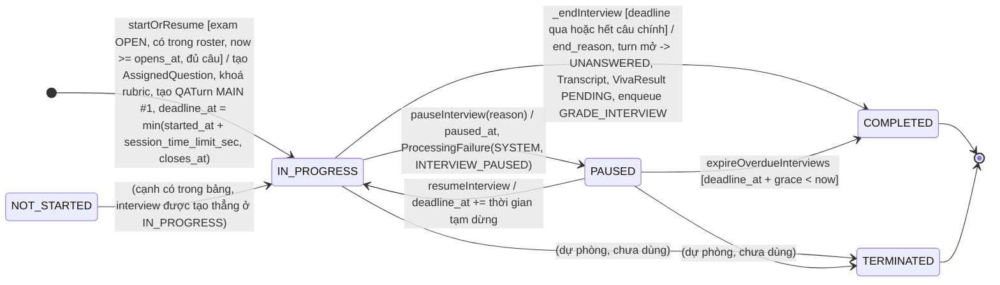
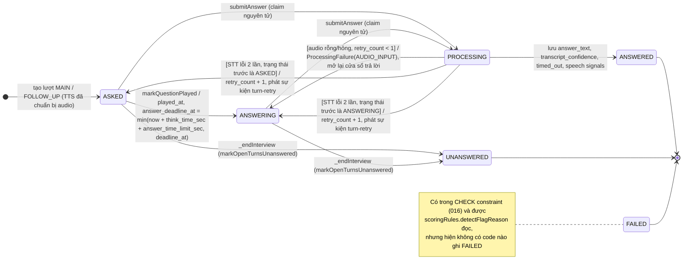
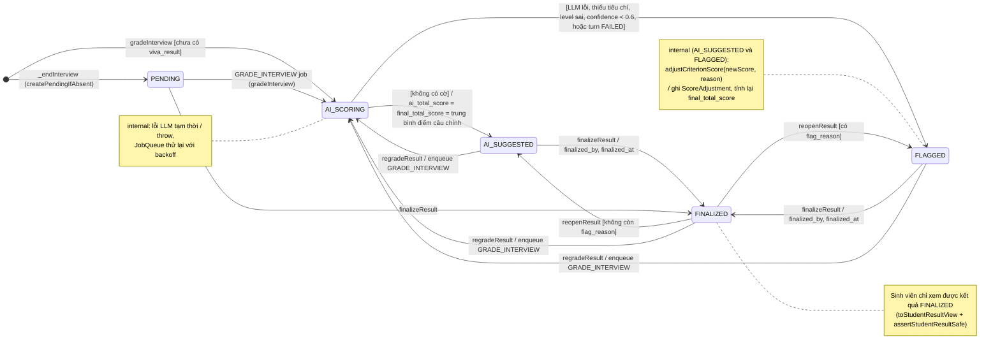
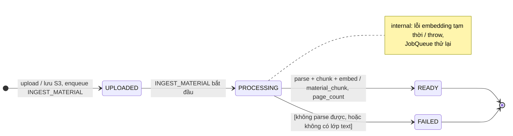
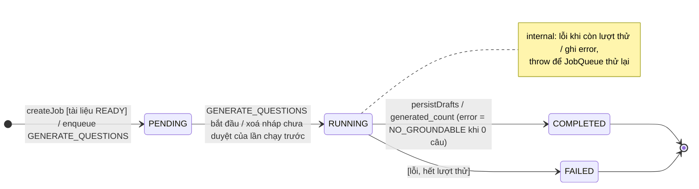
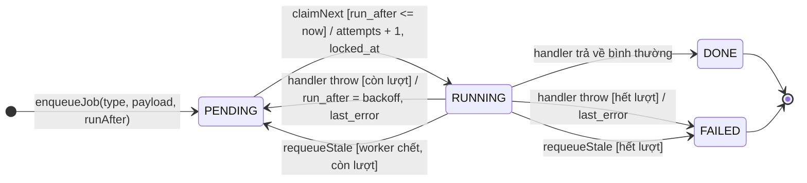

# UML State Machine Diagrams

Mỗi sơ đồ vẽ đúng bảng chuyển trạng thái trong code. Cạnh nào không có trong code thì không vẽ. Tên sự kiện là tên hàm/endpoint gây ra chuyển trạng thái; `[guard]` là điều kiện code kiểm tra; `/ action` là việc code làm kèm.

Nguồn: `backend/src/domain/questionStatus.js`, `examSessionStatus.js`, `interviewStatus.js`, `backend/src/services/*.js`, `backend/src/jobs/*.js`, CHECK constraint trong `backend/db/migrations/`.

## 1. Question (`question.status`)

`TRANSITIONS` trong `domain/questionStatus.js`. Chỉ `APPROVED` được đưa vào kỳ thi (`isExamEligible`). Câu hỏi mới chỉ được tạo ở `DRAFT` hoặc `PENDING_REVIEW` nếu truyền `status`; không truyền thì `APPROVED` khi đủ content + topic + rubric, ngược lại `DRAFT` (`_resolveCreateStatus`). Câu sinh bởi AI vào `PENDING_REVIEW`.

## 2. ExamSession (`exam_session.status`)

`TRANSITIONS` trong `domain/examSessionStatus.js`.

## 3. VivaInterview (`viva_interview.status`)

`INTERVIEW_TRANSITIONS` trong `domain/interviewStatus.js` và các hàm của `InterviewService`. `TERMINATED` có trong bảng chuyển trạng thái nhưng hiện không có code nào ghi giá trị này.

## 4. QATurn (`qa_turn.status`)

`TURN_STATUSES` trong `domain/interviewStatus.js`; chuyển trạng thái nguyên tử qua `qaTurnRepository.transitionStatus`.

## 5. VivaResult (`viva_result.status`)

`GradingService` và `vivaResultRepository`.

`finalizeResult` chỉ chặn khi kết quả đã `FINALIZED` (`ALREADY_FINALIZED`), nên về mặt code mọi trạng thái khác đều chốt được; giao diện giảng viên chỉ hiện nút chốt sau khi AI chấm xong.

## 6. CourseMaterial (`course_material.status`)

`MaterialService.upload` và handler `INGEST_MATERIAL` trong `jobs/handlers.js`.

## 7. QuestionGenerationJob (`question_generation_job.status`)

`QuestionGenerationService.createJob` và handler `GENERATE_QUESTIONS`.

## 8. BackgroundJob (`background_job.status`)

`backgroundJobRepository` + `jobs/jobQueue.js` (claim bằng `FOR UPDATE SKIP LOCKED`, backoff mũ tới `JOB_MAX_ATTEMPTS`).

